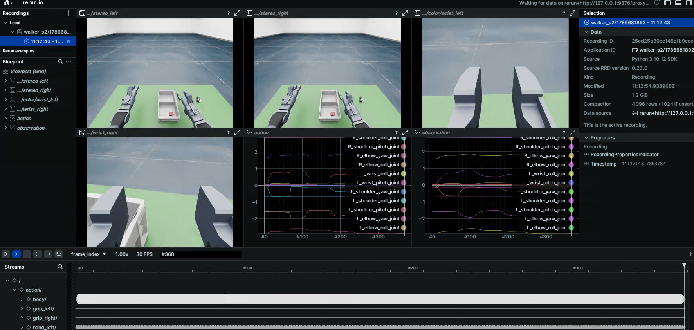

# Data Visualization and Playback

Reads `ubt_sim/dataset/{walker_s2,tienkung_pro,walker_c1,tienkung_dex}/<timestamp>/trajectory.hdf5` in two modes:

| Mode | Purpose | Dependency |
| --- | --- | --- |
| **Preview** (`--mode preview`) | Inspect recorded camera images + joint/hand/gripper curves in Rerun; timeline scrub, frame stepping, and looping are built in | `rerun-sdk` (control Python) |
| **Control** (`--mode control`) | Replay recorded actions to simulation or hardware at the original rate | ROS 2 (rclpy + robot message packages) |

Entry scripts live in `ubt_sim/teleoperation/tools/`:

- `playback_walker_s2.py` - Walker S2 EDU (17 body joints + 7+7 V4 hands + 2 grippers + 4 cameras)
- `playback_tienkung_pro.py` - Walker TienKung Pro (7+7 arms + 6+6 hands + 1 camera with depth)
- `playback_walker_c1.py` - Walker C1 EDU (31 body joints + 6+6 hands + 1 camera)
- `playback_tienkung_dex.py` - Walker TienKung Dex (right arm 7 + right hand 6/13 + 1 camera with depth)

Architecture: a shared core `playback/common.py` (HDF5 loading, pacing, CLI, Rerun preview) + robot adapters in `playback/robots/` (schema + ROS 2 publishers + first-frame alignment), with thin entry scripts under `tools/`.

## Environment (container)

```bash
# rerun-sdk is included in the Dockerfile control environment; install it in an old container without rebuilding:
# (pin 0.23.0: 0.24+ requires numpy>=2, conflicting with the container's numpy<2 constraint)
docker exec -it ubt-sim /usr/bin/python3 -m pip install "numpy<2" "rerun-sdk==0.23.0" -i https://pypi.tuna.tsinghua.edu.cn/simple

# Control mode additionally needs (Walker requires SDK messages; TienKung only needs ROS 2):
source /opt/ros/humble/setup.bash
source /opt/ubt_sim/walker_sdk_ros2_msgs/install/setup.bash   # Walker only

# Always use system Python:
/usr/bin/python3
```

## Preview mode

> ⚠️ **Use the web viewer (browser) inside the container**: the native Rerun viewer is a wgpu/egui application, but the container only provides NVIDIA vendor GL (no Mesa, no Vulkan surface); wgpu cannot obtain an adapter and fails silently. The local pop-up mode only works on hosts with a working GL/Vulkan window environment.

```bash
cd /ubt_sim

# ① Browser preview (recommended, works in the container)
python3 teleoperation/tools/playback_walker_s2.py \
    --episode dataset/walker_s2/1786681892 --mode preview --web-port 9090

# ② Save .rrd (no viewer) and open it with a rerun viewer on the host
python3 teleoperation/tools/playback_walker_s2.py \
    --episode dataset/walker_s2/1786681892 --mode preview --save-rrd /tmp/walker_ep.rrd

# ③ Local pop-up (only with a GPU window environment: run directly on a workstation/host)
python3 teleoperation/tools/playback_walker_s2.py \
    --episode dataset/walker_s2/1786681892 --mode preview
```

- For other robots, switch to `playback_tienkung_pro.py` / `playback_walker_c1.py` / `playback_tienkung_dex.py`.
- After starting the web viewer, the script prints the **full URL** (like `http://localhost:9090/?url=rerun%2Bhttp%3A%2F%2F127.0.0.1%3A9876%2Fproxy`); open it as printed. ⚠️ The trailing `?url=` parameter is the data source and **must not be omitted**. For a remote browser, forward both ports 9090 and 9876 (`ssh -L 9090:localhost:9090 -L 9876:localhost:9876`).
- `--episode` defaults to the newest episode under `dataset/<robot>/` (largest timestamp directory); `--max-frames N` records only the first N frames.
- Rerun panels: `cameras/color/<camera>` (images), `cameras/depth/...` (TienKung depth), `action/<group>/<channel>` (command curves), `observation|puppet/...` (observation curves), all synchronized on the `frame_index` / `timestamp` timelines.



## Control mode

Playback sends the **raw recorded frame values** (most faithful). Published ROS 2 topics:

- **Walker S2 EDU**: 17 joints `RobotCommand(MODE_POSITION)` @ `/mc/sdk/robot_command` + both hands `JointCommand(mode=5)` + both grippers `GripCmd`
- **Walker TienKung Pro**: `CmdSetMotorPosition` (14 motors) @ `/arm/cmd_pos` + both hands `JointState`
- **Walker C1 EDU**: `RobotCommand(MODE_POSITION)` @ `/mc/sdk/robot_command` + both hands `JointCommand(mode=5)`
- **Walker TienKung Dex**: `ArmCtrl` @ `/arm/cmd` (+ `/head/cmd`, `/waist/cmd`) + right hand `angle_set` / `set_motor_multi` (per hand variant)

Simulation (via the bridge) and hardware use exactly the same topics; one script works for both, only `ROS_DOMAIN_ID` differs.

```bash
# Always start with a dry run (no ROS 2 init, no publishing, just per-frame summaries)
python3 teleoperation/tools/playback_walker_s2.py \
    --episode dataset/walker_s2/1786681892 --mode control --dry-run --end 3

# Playback (same command for simulation and hardware; distinguish by ROS_DOMAIN_ID: hardware 0 / simulation 146, verify locally)
# Simulation: start simulation + bridge with start_sim.sh first, and confirm $ROS_DOMAIN_ID matches the bridge
python3 teleoperation/tools/playback_walker_s2.py \
    --episode dataset/walker_s2/1786681892 --mode control --align-first --end 200

# Hardware: set ROS_DOMAIN_ID=0 and run the same command
ROS_DOMAIN_ID=0 python3 teleoperation/tools/playback_tienkung_pro.py \
    --episode dataset/tienkung_pro/1786638182 --mode control --align-first
```

Common arguments (`--help` shows all):

| Argument | Default | Description |
| --- | --- | --- |
| `--start/--end` | `0`/last frame | Frame index or `"5s"` (5th second); `--end` is **exclusive** |
| `--rate` | Dataset fps | Publish rate (Walker simulation bridge body limit is 100 Hz; >100 is silently rate-limited) |
| `--loop` | Off | Loop until Ctrl-C |
| `--align-first` | Off | Smoothly move to the first-frame pose before playback (Walker: 3 s quintic interpolation; TienKung: ~2 s joint-space ramp) |
| `--dry-run` | Off | Print only, do not publish |
| `--interp` | Off | [Walker] Linearly interpolate between recorded frames to `--rate` (smoother, deviates from the recording) |
| `--spd/--cur` | `0.2/5.0` | [TienKung] Default motor speed/current |
| `--arm-clamp-lo/hi` | `±2.5` | [TienKung] Arm limits (teleoperation has no arm limit constants; conservative assumption) |

### Safety notes

- Limit clipping is enabled by default (Walker uses the hardware limit table; TienKung uses hand [0,1] and conservative arm limits); data containing NaN/inf is rejected.
- `--align-first` aligns the first-frame pose before playback, avoiding a jump from an arbitrary current pose.
- After Ctrl-C the robot **holds the last command** (simulation uses HoldTargetManager; hardware must be reset manually).
- Always run `--dry-run` first, confirm `ROS_DOMAIN_ID` matches the target, and place the robot in a safe position.
