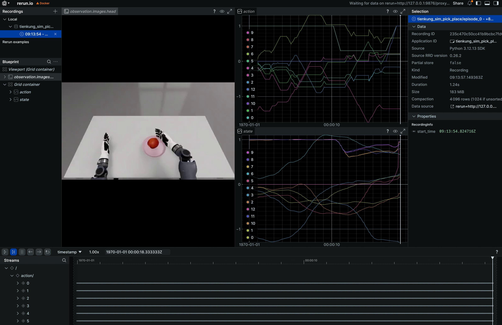
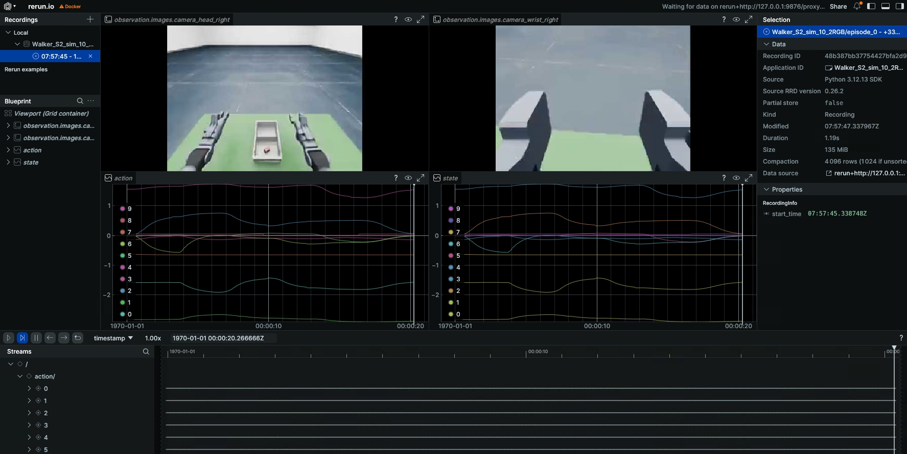
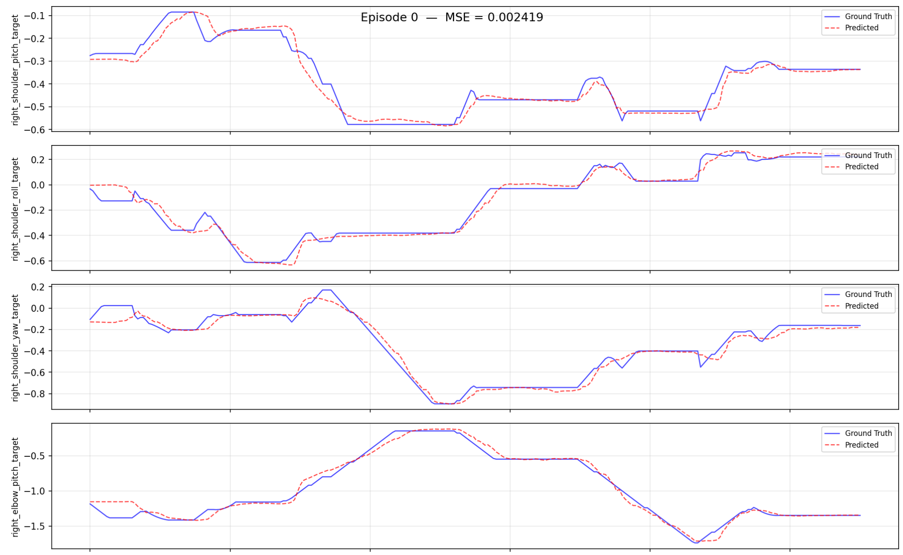
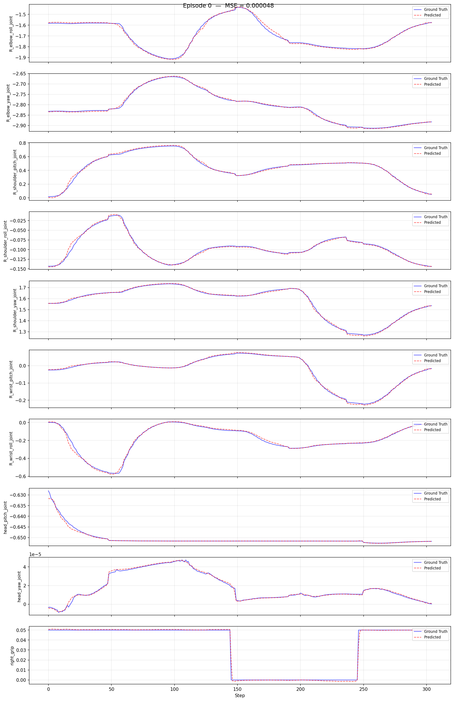

# Imitation Learning Platform

`ubt_IL` is an imitation learning platform built on [HuggingFace LeRobot](https://github.com/huggingface/lerobot). It covers the full pipeline from HDF5 collection data to deployable policies. Conversion, training, and evaluation all run inside the **LeRobot + ROS 2** container; each robot has isolated configurations but follows the same workflow:

```
HDF5 data ─► LeRobot v3 conversion ─► visualization ─► training (ACT / Pi0.5) ─► offline MSE ─► deployment (sim / real)
```

Data comes from [simulation](../sim/index.md) or real-robot teleoperation. Main use cases:

- **Data conversion**: convert simulation / real-robot HDF5 data into the standard LeRobot v3 format
- **Policy training**: ACT recipes for Walker TienKung Pro, Walker TienKung Dex, Walker S2 EDU, and Walker C1 EDU; Pi0.5 VLA for Walker S2 EDU
- **Offline evaluation**: run MSE evaluation after training to filter under-fitted models before real deployment

## Architecture

A single-container pipeline. Every stage is a script plus JSON configuration, organized per robot:

| Stage | Location | Description |
|------|------|------|
| Conversion | `scripts/convert/<robot>/` | `convert.sh` + `configs/*.json`, HDF5 -> LeRobot v3 |
| Visualization | LeRobot visualizer | Replay actions and images to catch bad data before training |
| Training | `scripts/train/<robot>/` | `train.sh` + `configs/*.json`, ACT / Pi0.5 |
| Evaluation | `scripts/eval/eval_policy.py` | Offline MSE evaluation, shared by all robots |
| Deployment | `scripts/deploy/<robot>/` | `rollout.sh` and other inference/deployment scripts |
| Output | `dataset/` · `model/` | LeRobot datasets and model checkpoints |

## Preview

Dataset visualization (LeRobot visualizer):

<div class="grid video-grid" markdown>
<div markdown>

**Walker TienKung Pro**

{.img-uniform}

</div>
<div markdown>

**Walker S2 EDU**

{.img-uniform}

</div>
</div>

Offline MSE evaluation curves:

<div class="grid video-grid" markdown>
<div markdown>

**Walker TienKung Pro**

{.img-uniform .img-uniform--tall}

</div>
<div markdown>

**Walker S2 EDU**

{.img-uniform .img-uniform--tall}

</div>
</div>

Deployment results (trained policies running in simulation or on real robots):

<div class="grid video-grid" markdown>
<div markdown>

**Walker TienKung Pro · Simulation**

<video src="../assets/tienkung仿真部署效果.mp4" controls muted width="100%"></video>

</div>
<div markdown>

**Walker TienKung Pro · Real robot**

<video src="../assets/tienkung真机部署效果.mp4" controls muted width="100%"></video>

</div>
<div markdown>

**Walker S2 EDU · Simulation**

<video src="../assets/walker仿真部署效果.mp4" controls muted width="100%"></video>

</div>
<div markdown>

**Walker S2 EDU · Real robot**

<video src="../assets/walker真机部署效果.mp4" controls muted width="100%"></video>

</div>
</div>

## Documentation

| Section | Description |
|--------|------|
| [Container setup](docker.md) | Shared container build, automatic architecture selection, and Python environments |
| [Walker TienKung Pro](../tienkung/convert-train.md) | 13D/26D conversion configs, ACT training, offline evaluation |
| [Walker TienKung Dex](../tienkung-dex/convert-train.md) | 20D/13D conversion configs (Inspire/BrainCo), ACT training, evaluation |
| [Walker S2 EDU](../walker-s2/convert-train.md) | 10D/33D conversion configs, ACT / Pi0.5 training, evaluation |
| [Walker C1 EDU](../walker-c1/convert-train.md) | 26D/13D conversion configs, ACT training, evaluation |

General reference: [Data Conversion](../common/data-conversion.md) · [HDF5 Layouts](../common/hdf5-layouts.md) · [HF Data & Models](../common/hf-manage.md)

After evaluation, continue with the real-robot workflow: [Walker TienKung Pro](../tienkung/real-workflow.md) / [Walker TienKung Dex](../tienkung-dex/real-workflow.md) / [Walker S2 EDU](../walker-s2/real-workflow.md) / [Walker C1 EDU](../walker-c1/real-workflow.md).
