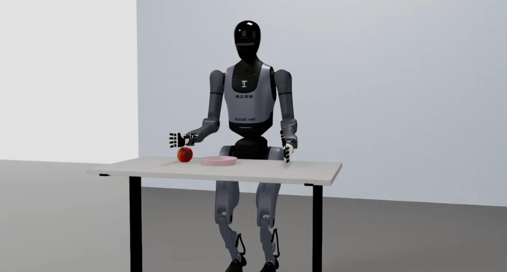
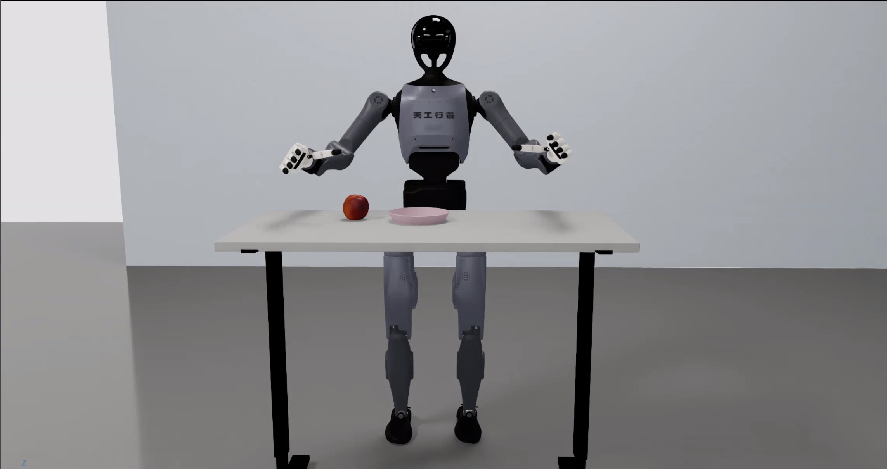
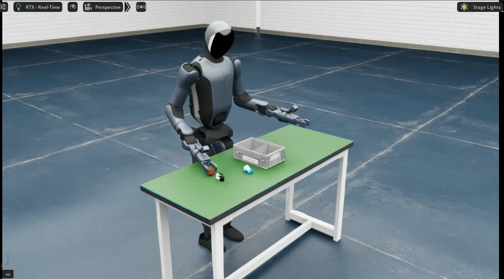
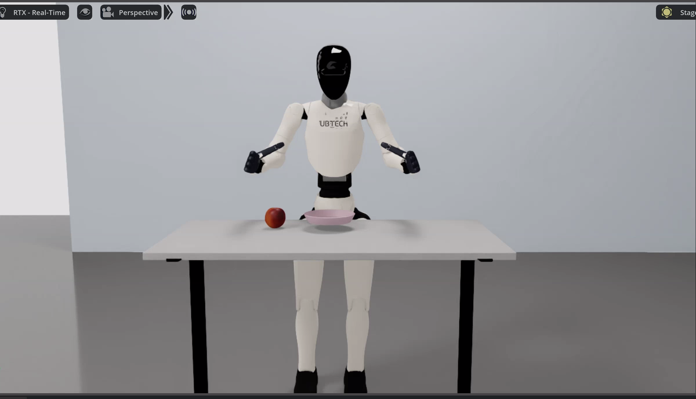

# Thinker-IL-LAB

Thinker is an imitation learning toolchain for humanoid robots. It provides an end-to-end pipeline from simulation data collection to real-robot deployment for the **Walker TienKung Pro**, **Walker TienKung Dex**, **Walker S2 EDU**, and **Walker C1 EDU** platforms.

Built on [NVIDIA Isaac Sim](https://developer.nvidia.com/isaac-sim) and [HuggingFace LeRobot](https://github.com/huggingface/lerobot).

[:fontawesome-brands-github: **GitHub Repository** · LQX-Code-SH/Thinker-IL-LAB](https://github.com/LQX-Code-SH/Thinker-IL-LAB){ .md-button .md-button--primary }
[Get Started :material-arrow-right:](getting-started.md){ .md-button }

## Capabilities

| Capability | Description | Status |
|------|------|------|
| :material-robot-industrial: ROS simulation | High-fidelity Isaac Sim environment for teleoperation and data collection | :material-check-circle: Available |
| :material-gamepad-variant: Teleoperation | Keyboard / space-mouse teleoperation with a unified sim-to-real interface | :material-progress-clock: In progress |
| :material-database: Data collection & conversion | HDF5 / LeRobot data collection, conversion, and cleaning | :material-check-circle: Available |
| :material-brain: Policy training | Imitation learning with LeRobot (ACT / Pi0.5) | :material-check-circle: Available |
| :material-robot: Real-robot deployment | Policy inference and robot control, including a warm-started inference server | :material-check-circle: Available |
| :material-robot: Supported robots | Walker TienKung Pro / Walker TienKung Dex / Walker S2 EDU / Walker C1 EDU | :material-check-circle: Released |

## Gallery

### Simulation preview

<div class="grid video-grid" markdown>
<div markdown>

**Walker TienKung Pro**

{.img-uniform}

</div>
<div markdown>

**Walker TienKung Dex**

{.img-uniform}

</div>
<div markdown>

**Walker S2 EDU**

{.img-uniform}

</div>
<div markdown>

**Walker C1 EDU**

{.img-uniform}

</div>
</div>

### Deployment results

<div class="grid video-grid" markdown>
<div markdown>

**Walker TienKung Pro · Simulation**

<video src="assets/tienkung仿真部署效果.mp4" controls muted width="100%"></video>

</div>
<div markdown>

**Walker TienKung Pro · Real robot**

<video src="assets/tienkung真机部署效果.mp4" controls muted width="100%"></video>

</div>
<div markdown>

**Walker S2 EDU · Simulation**

<video src="assets/walker仿真部署效果.mp4" controls muted width="100%"></video>

</div>
<div markdown>

**Walker S2 EDU · Real robot**

<video src="assets/walker真机部署效果.mp4" controls muted width="100%"></video>

</div>
<div markdown>

**Walker TienKung Dex · Simulation**

<video src="assets/tienkung-dex仿真部署效果.mp4" controls muted width="100%"></video>

</div>
<div markdown>

**Walker TienKung Dex · Real robot**

<video src="assets/tienkung-dex真机部署效果.mp4" controls muted width="100%"></video>

</div>
<div markdown>

**Walker C1 EDU · Simulation**

<video src="assets/walker-c1仿真部署效果.mp4" controls muted width="100%"></video>

</div>
<div markdown>

**Walker C1 EDU · Real robot**

<video src="assets/walker-c1真机部署效果.mp4" controls muted width="100%"></video>

</div>
</div>

### Application case

**Walker S2 EDU · VLA pick-and-place**

<video src="assets/walker-s2应用案例.mp4" controls muted width="100%"></video>

See [Walker S2 EDU application case](walker-s2/application-case.md).

## Architecture

The repository contains two sub-projects: `ubt_sim` (simulation platform) and `ubt_IL` (imitation learning platform).

```
┌──────────────────────────────────────────────────────────────────────────┐
│                          ubt_IL imitation learning                       │
│              data conversion ──► training ──► evaluation ──► deployment   │
└───────────▲───────────────┬──────────────────────▲──────────────┬────────┘
            │               │④ sim deployment       │              │⑤ real deployment
            │① data          ▼ (ROS bridge)          │② real data    │ (ROS bridge)
   ┌────────┴────────────────┐        ┌─────────────┴──────────────▼──────┐
   │      ubt_sim            │        │ Real robots:                      │
   │   (Isaac Sim container) │        │ Walker TienKung Pro /             │
   │                         │        │ Walker TienKung Dex /             │
   │                         │        │ Walker S2 EDU / Walker C1 EDU     │
   │                         │        │ ROS_DOMAIN_ID=0 direct network    │
   └─────────────────────────┘        └───────────────────────────────────┘
```

See [Architecture Overview](architecture.md) for details.

## Start here

- [Getting Started](getting-started.md) - Clone the repository, check requirements, and follow the end-to-end flow
- [:material-robot-outline: Simulation Platform](sim/index.md) - Isaac Sim, teleoperation, and data collection
- [:material-brain: Imitation Learning Platform](il/index.md) - Data conversion, training (ACT / Pi0.5), and evaluation
- [:material-robot: Walker TienKung Pro](tienkung/index.md) - Simulation / conversion / training / deployment / ARM board deployment
- [:material-robot: Walker TienKung Dex](tienkung-dex/index.md) - Single-arm dexterous manipulation: simulation / training / real-robot deployment
- [:material-robot-outline: Walker S2 EDU](walker-s2/index.md) - Simulation / conversion / training / deployment / inference server
- [:material-robot-outline: Walker C1 EDU](walker-c1/index.md) - Dual-arm dexterous manipulation: simulation / training / real-robot deployment

## Acknowledgements

This project builds on the following open-source projects:

- [NVIDIA Isaac Sim](https://developer.nvidia.com/isaac-sim) - High-fidelity robotics simulation
- [HuggingFace LeRobot](https://github.com/huggingface/lerobot) - Imitation learning framework (ACT, data format, training and inference tools)
- [Thinker Studio](https://thinkercosmos.ubtrobot.com/#/studio) - Thinker teleoperation data collection platform
- [Thinker Cosmos Open Source Community](https://thinkercosmos.ubtrobot.com/#/open-source-center?ref=header-nav) - Thinker open-source community

## License

Apache-2.0
