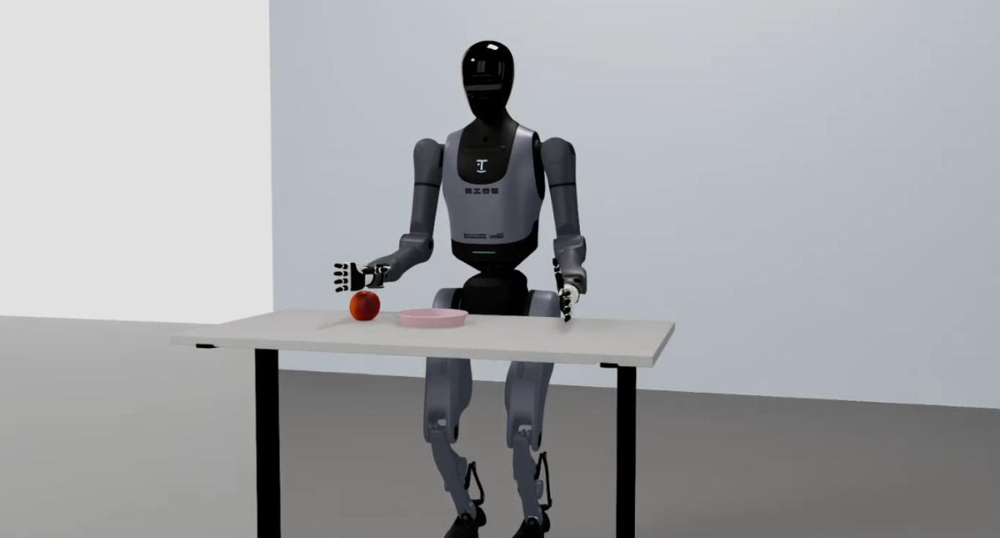
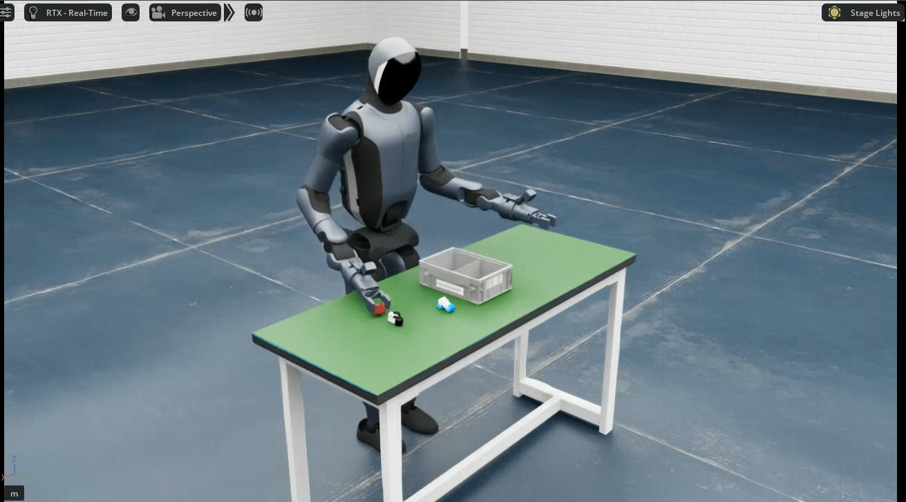

# Simulation Platform

`ubt_sim` is a robotics simulation platform built on [NVIDIA Isaac Sim](https://developer.nvidia.com/isaac-sim) (Isaac Lab 2.2.0). It supports four robots: Walker TienKung Pro, Walker TienKung Dex, Walker S2 EDU, and Walker C1 EDU. A ROS2-ZMQ bridge publishes simulation state and images on **exactly the same topics as the real robot**, so teleoperation and data-collection scripts switch between simulation and hardware without modification, enabling seamless sim-to-real transfer. Main use cases:

- **Simulation data collection**: generate HDF5 training data in batches without occupying the real robot
- **Algorithm validation**: low-risk testing of imitation learning and control policies before real deployment

## Architecture

Three processes (**Python versions must not be mixed**):

```
Isaac Sim (Py3.11)  ──ZMQ──►  ROS2-ZMQ Bridge (Py3.10)  ──ROS2──►  teleop / collection scripts
```

- **Simulation** `/isaac-sim/python.sh`: loads the task scene selected by `UBT_SIM_TASK` (the task name also determines the robot type) and sends camera images directly over ZMQ.
- **Bridge** `/usr/bin/python3`: bidirectional ZMQ↔ROS 2 forwarding, started automatically by `start_sim.sh`.
- **Collection** `/usr/bin/python3`: publishes commands and records 15 Hz HDF5.

## Simulation preview

<div class="grid video-grid" markdown>
<div markdown>

**Walker TienKung Pro**

{.img-uniform}

</div>
<div markdown>

**Walker TienKung Dex**

{.img-uniform}

</div>
<div markdown>

**Walker S2 EDU**

{.img-uniform}

</div>
<div markdown>

**Walker C1 EDU**

{.img-uniform}

</div>
</div>

## Documentation

| Section | Description |
|--------|------|
| [Container setup](docker.md) | Shared container build, startup, and `run.sh` commands |
| [Walker TienKung Pro](../tienkung/sim-setup.md) | Parlor apple-picking scene, launching, batch collection, camera test, preview |
| [Walker TienKung Dex](../tienkung-dex/sim-setup.md) | Inspire/BrainCo hands, apple picking, batch collection, playback |
| [Walker S2 EDU](../walker-s2/sim-setup.md) | Part-sorting scene, batch collection, robot controller tools |
| [Walker C1 EDU](../walker-c1/sim-setup.md) | Parlor pick-and-place, online IK collection, reset and playback |

After collection, continue with the [Imitation Learning Platform](../il/index.md). For full playback options, see [Playback](../common/playback.md).
