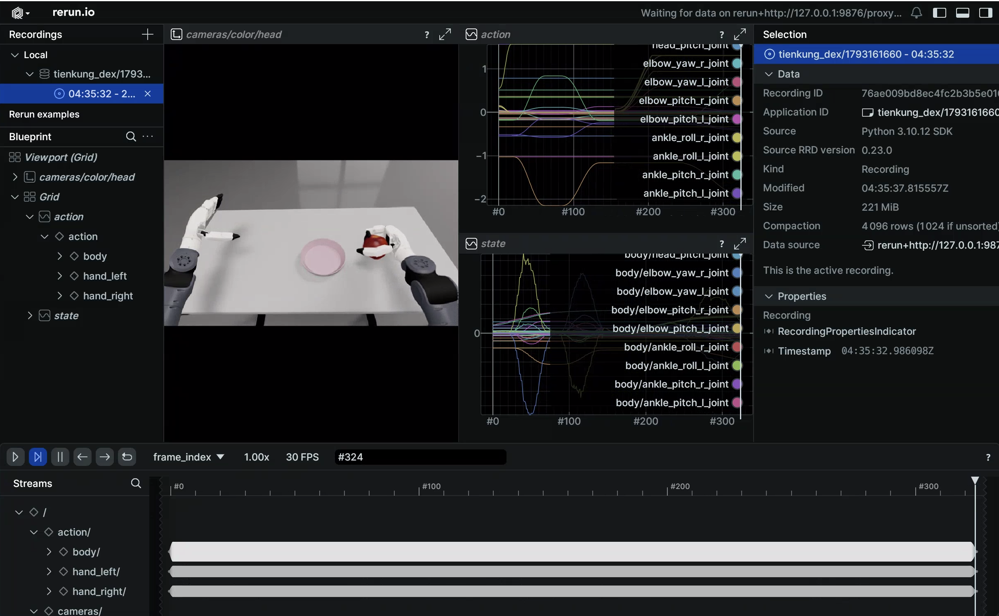
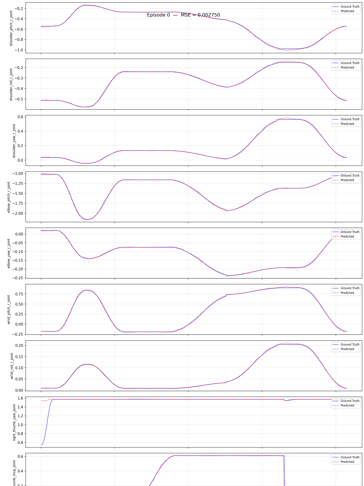

# Walker TienKung Dex: Imitation Learning Platform

> Code: `ubt_IL/scripts/{convert,train,eval,deploy}/tienkung_dex/` (run inside the container)
> Prerequisite: repository cloned and submodules initialized as described in [Getting Started](../getting-started.md); HDF5 data ready ([simulation collection](sim-setup.md) or real-robot collection)

This page documents the shared conversion/training/evaluation/deployment workflow and configuration parameters for Walker TienKung Dex. Data-source-specific commands are embedded in the corresponding workflow pages.

## 1. Environment (ubt_IL container)

See [Imitation Learning Platform · Container Setup](../il/docker.md) for `build` / `start` / `bash`.

- The host project is mounted at `/ubt_IL`.
- Communication: LeRobot (Python 3.12) —ZMQ `5559`/`5560`—> Bridge2 (system Python 3.10) —ROS 2 DDS—> robot/simulator.
- Camera stream: simulation uses **5758** (ubt_sim publishes JPEG directly); hardware uses **5558** (Bridge2 transcodes with `--enable-image`).
- Dex message packages (`ros2_bridge_msgs` / `inspire_hand_msgs` / `brainco_hand_msgs`) are built into `/opt/tienkung_dex_msgs_ws` during the image build; the three `tienkung_dex` lines in `bash run.sh check` should all be `[OK]`.
- To run the policy **on the robot itself (Thor, no container)**, skip this section and create the venv as described in [On-robot deployment](arm-deploy.md).

## 2. Data conversion (HDF5 -> LeRobot)

Script: `/ubt_IL/scripts/convert/tienkung_dex/convert.sh` (shared converter `convert/common/convert_to_lerobot.py`). It converts raw HDF5 into a LeRobot v3 dataset at `/ubt_IL/dataset/<REPO_ID>/`.

**Conversion command**:

```bash
CONFIG=/ubt_IL/scripts/convert/tienkung_dex/configs/tienkung_dex_20d_1RGB_inspire.json \
SRC_ROOT=/ubt_sim/dataset/tienkung_dex \
TGT_PATH=/ubt_IL/dataset \
REPO_ID=tienkung_dex_sim_pick_apple \
TASK_NAME=tienkung_dex_sim_pick_apple \
FPS=15 \
bash /ubt_IL/scripts/convert/tienkung_dex/convert.sh --overwrite
```

**Examples**:

- Simulation data: [Simulation workflow · Data conversion](sim-workflow.md#3-data-conversion)
- Real-robot data: [Real-robot workflow · Data conversion](real-workflow.md#3-data-conversion)

Conversion configs in `/ubt_IL/scripts/convert/tienkung_dex/configs/`:

| Config | Dimension | Hand / scenario | Image |
|----------|------|-------------|------|
| `tienkung_dex_20d_1RGB_inspire.json` | 20D (right arm 7 + right hand 13) | Inspire, simulation (default) | 3×360×640 |
| `tienkung_dex_13d_1RGB_brainco_real.json` | 13D (right arm 7 + right hand 6) | BrainCo, real robot (**verified**) | 3×360×640 |
| `tienkung_dex_real_pick_r13_1RGB.json` | 13D (right arm 7 + right hand 6) | Inspire r13 real robot (pico6) | 3×720×1280 |

**Common environment variables** (defaults can be omitted; see `bash convert.sh -h` and [Data Conversion](../common/data-conversion.md)):

| Variable | Description |
|------|------|
| `SRC_ROOT` | HDF5 root (default `/ubt_IL/dataset/tienkung_dex`; falls back to `/ubt_sim/dataset/tienkung_dex` if absent) |
| `TGT_PATH` | LeRobot output root (default `/ubt_IL/dataset`) |
| `CONFIG` | Conversion config JSON (default `tienkung_dex_20d_1RGB_inspire.json`) |
| `REPO_ID` | Output dataset name (default `tienkung_dex_sim_pick_apple`; keep it consistent with training) |
| `TASK_NAME` | Task name (default `tienkung_dex_sim_pick_apple`, written to each frame's `task` field) |
| `FPS` | Target frame rate (simulation default `15`; use `FPS=30` for 30 fps real-robot data) |
| `ROBOT_TYPE` | Robot type (default `tienkung_dex`, written to metadata) |
| `VCODEC` | Video codec (default `h264`) |
| `HDF5_REL_PATH` | HDF5 path relative to each episode directory (default `trajectory.hdf5`) |
| `TRIM_STATIONARY` | `1` enables stationary-frame trimming (disabled by default) |
| `STATIONARY_DIAGNOSE` | `1` only reports the stationary distribution without writing data (for threshold calibration) |
| `STATIONARY_CAP` / `STATIONARY_THRESH` | Maximum stationary run (default 8 frames) / detection threshold (default 0.03) |
| `RESAMPLE_FPS` | Target frame rate; enables resampling when set (disabled by default) |

!!! tip "Stationary-frame trimming"
    Stationary frames can trap the policy in a local stationary loop. Dex simulation data is **not trimmed by default**: run with `STATIONARY_DIAGNOSE=1` first, then decide whether to set `TRIM_STATIONARY=1`. On 20 episodes with default parameters, trimming reduced 10,937 → 8,269 frames (-24.4%) while preserving the 20D ranges and the maximum per-frame step. Real-robot data can enable it as needed (removing long stationary ready-pose segments at the start and end).

**State / action sources**:

| Field | HDF5 source | Columns |
|------|-----------|-----|
| `observation.state` | `joint_observations/joint_position` + `hand_observations/hand_right_position` (**measured values**) | `[24..30]` + all 13 right-hand columns |
| `action` | `action_observations/joint_position` + `action_observations/hand_right_position` (**commanded values**) | Same |

> **Do not swap them**: `action_*` are the recorded commands, `*_observations` are measurements. Hand actions lead states by up to 1.31 rad, which matches the semantics of `get_observation()` during deployment.

**Output**: a LeRobot v3 dataset under `/ubt_IL/dataset/<REPO_ID>/` (`meta/`, `chunk-000/` data parquet, `videos/`).

## 3. Data visualization

After conversion, inspect dataset quality with `lerobot-dataset-viz`:

```bash
HF_HUB_OFFLINE=1 lerobot-dataset-viz \
  --repo-id <REPO_ID> \
  --episode-index 0 \
  --root /ubt_IL/dataset/<REPO_ID>
```

> `--root` must point to the dataset directory containing `meta/` (the `repo_id` directory itself), not its parent. `--episode-index` is required and visualizes one episode at a time.



**Examples**: [Simulation workflow · Visualization](sim-workflow.md#32-data-visualization) / [Real-robot workflow · Evaluation](real-workflow.md#5-policy-evaluation).

## 4. Policy training (ACT)

Training script: `/ubt_IL/scripts/train/tienkung_dex/train.sh`; configs in `/ubt_IL/scripts/train/tienkung_dex/configs/`.

**Training command** (optional overrides are listed below; unset values come from the config file):

```bash
CONFIG_PATH=/ubt_IL/scripts/train/tienkung_dex/configs/train_config_tienkung_dex_sim_pick_apple.json \
OUTPUT_DIR=/ubt_IL/model/tienkung_dex_sim_pick_apple_act \
STEPS=60000 SAVE_FREQ=10000 BATCH_SIZE=16 \
bash /ubt_IL/scripts/train/tienkung_dex/train.sh
```

Training configs (ACT, `chunk_size=50`, `n_action_steps=20`, `dim_model=512`):

| Config | Dataset | Steps / save interval | Batch |
|----------|--------|------------------|-------|
| `train_config_tienkung_dex_sim_pick_apple.json` | `tienkung_dex_sim_pick_apple` | 60000 / 10000 | 16 |
| `train_config_tienkung_dex_real_pick_apple.json` | `tienkung_dex_real_pick_apple` | 30000 / 5000 | 16 |
| `train_config_tienkung_dex_real_pick_apple_brainco_13d.json` | `tienkung_dex_real_pick_apple_brainco_13d` | 20000 / 5000 | 16 |

> ⚠️ `train.sh` defaults `CONFIG_PATH` to the **simulation config**; real-robot training must specify the real config explicitly.

**Smoke test and resume**:

```bash
# Smoke test: 2 steps, no checkpoint
bash /ubt_IL/scripts/train/tienkung_dex/train.sh --steps=2 --save_checkpoint=false

# Resume (CONFIG_PATH points to train_config.json inside the checkpoint)
CONFIG_PATH=/ubt_IL/model/tienkung_dex_sim_pick_apple_act/checkpoints/last/pretrained_model/train_config.json \
RESUME=true bash /ubt_IL/scripts/train/tienkung_dex/train.sh
```

**Without train.sh** (call `lerobot-train` directly from `/ubt_IL/lerobot`):

```bash
cd /ubt_IL/lerobot
HF_HUB_OFFLINE=1 /lerobot/.venv/bin/lerobot-train \
  --config_path=/ubt_IL/scripts/train/tienkung_dex/configs/train_config_tienkung_dex_sim_pick_apple.json \
  --output_dir=/ubt_IL/model/tienkung_dex_sim_pick_apple_act
```

**Common overrides** (only applied when the environment variable is set; `HF_HUB_OFFLINE=1` is enabled by default):

| Variable | Description |
|------|------|
| `CONFIG_PATH` | Training config JSON (default: simulation config) |
| `DATASET_REPO_ID` / `DATASET_ROOT` | Dataset name / root (must match the conversion `REPO_ID`) |
| `OUTPUT_DIR` | Model output directory (checkpoints under `checkpoints/<step>/pretrained_model/`) |
| `STEPS` / `SAVE_FREQ` | Training steps / checkpoint interval |
| `BATCH_SIZE` / `SEED` | Batch size / random seed |
| `DEVICE` | Training device (default `cuda`) |
| `RESUME` | Resume training (default `false`) |
| `WANDB_ENABLE` | Enable wandb logging (default `false`) |

## 5. Policy evaluation (offline MSE)

Script (shared by all robots): `/ubt_IL/scripts/eval/eval_policy.py`. It runs offline inference over a LeRobot dataset, computes the per-frame MSE between **predicted and ground-truth actions**, and can plot per-episode comparisons.

**Evaluation command**:

```bash
/lerobot/.venv/bin/python /ubt_IL/scripts/eval/eval_policy.py \
  --policy-path /ubt_IL/model/tienkung_dex_sim_pick_apple_act/checkpoints/last/pretrained_model \
  --dataset-path /ubt_IL/dataset/tienkung_dex_sim_pick_apple \
  --episodes 5 \
  --inference-freq 1 \
  --plot \
  --plot-dir /ubt_IL/scripts/eval/output/eval_tienkung_dex_sim_pick_apple_act \
  --output /ubt_IL/scripts/eval/output/eval_tienkung_dex_sim_pick_apple_act/results.json \
  --device cuda
```

`--inference-freq 1` means step-by-step inference, closest to deployment behavior; the default queues by `n_action_steps`.



| Argument | Description |
|------|------|
| `--policy-path` | Trained ACT checkpoint (the `pretrained_model` directory) |
| `--dataset-path` | LeRobot dataset root (containing `meta/info.json`) |
| `--episodes` | Number of episodes to evaluate (default: all) |
| `--inference-freq` | Run inference every N steps to emulate the deployment chunk queue; `1` means every step |
| `--plot` / `--plot-dir` | Per-episode prediction-vs-ground-truth plots (PNG) |
| `--output` | Result JSON (summary + per-episode MSE) |
| `--device` | `cuda` (default; falls back to `cpu` when unavailable) |

> Offline MSE is only for ranking checkpoints from the same training run. The final criterion remains `/sim/task_completed` in simulation or task success on hardware.

## 6. Model deployment

Script: `/ubt_IL/scripts/deploy/tienkung_dex/rollout.sh` (starts Bridge2 automatically). Prerequisite: run `robot_ready.sh` to move to the ready pose **before** running the policy; the order must not be reversed. A **dimension precheck** (policy action dimension vs `JOINT_CONFIG`) runs before deployment.

**Deployment command**:

```bash
POLICY_PATH=<checkpoint pretrained_model directory> \
JOINT_CONFIG=tienkung_dex_20 \
CAMERA_PORT=5758 FPS=15 DURATION=60 \
  bash /ubt_IL/scripts/deploy/tienkung_dex/rollout.sh
```

**Deployment guides**:

- Simulation deployment: [Simulation workflow · Model deployment (sim)](sim-workflow.md#6-model-deployment-simulation)
- Real-robot deployment (BrainCo 13D verified): [Real-robot workflow · Model deployment (real)](real-workflow.md#6-model-deployment-real-robot)
- On-robot deployment (Thor, no container): [On-robot deployment](arm-deploy.md)

**Common environment variables**:

| Variable | Default | Description |
|------|------|------|
| `POLICY_PATH` | **Required** | Checkpoint directory (containing `config.json`) |
| `JOINT_CONFIG` | `tienkung_dex_20` | `tienkung_dex_20` (Inspire 13 rad) / `tienkung_dex_brainco_13` (BrainCo 6 motors) / `tienkung_dex_inspire_13` (Inspire 6D 0~1 → 13 codes); **must match the training DOF** |
| `HAND_VARIANT` | Empty | Empty follows `JOINT_CONFIG`; if set explicitly, the two must agree |
| `HAND_ACTION_MODE` | Empty (auto) | Empty derives from `JOINT_CONFIG`; set `rad13` / `pico6` explicitly when debugging |
| `FPS` | `15` | Control loop rate (= dataset frame rate; use `FPS=30` for 30 fps datasets) |
| `DURATION` | `60` | Run time (seconds) |
| `TASK` | `pick apple` | Task description |
| `CAMERA_PORT` | `5758` | Simulation 5758 (ubt_sim publishes JPEG) / hardware 5558 (Bridge2 transcodes) |
| `IMAGE_ENABLED` | `0` | Set `1` on hardware so Bridge2 encodes the head camera as JPEG |
| `MAX_RELATIVE_TARGET` | Empty (unlimited) | Per-step relative target limit in rad; `0.01` recommended for the first hardware run |
| `INFERENCE_TYPE` | `sync` | **Only `sync` is supported** (the Dex bridge has no chunk consumer) |
| `ZMQ_HOST` | `127.0.0.1` | Bridge address (use the peer IP for cross-machine deployment) |

See [Real-robot workflow §6](real-workflow.md#6-model-deployment-real-robot) for all parameters, the three hand representations, and Bridge2 group switches.

## 7. FAQ

| Symptom | Fix |
|------|------|
| Normalization explodes during training (QUANTILES NaN/Inf) | Constant dimensions in the data; Dex uses only the right arm 7 + right hand, and constant dimensions are already dropped in the conversion config |
| Trajectory contains long stationary segments; the policy stops during deployment | Add `TRIM_STATIONARY=1` during conversion (disabled by default; run `STATIONARY_DIAGNOSE=1` first to inspect the distribution) |
| Hand does not move / fingers globally misaligned | `HAND_VARIANT` / `JOINT_CONFIG` does not match the physical hand, or the plugin and Bridge2 constant copies have drifted (Bridge2 logs "channel table mismatch") |
| No camera image during deployment | Simulation: check whether 5758 has a stream. Hardware: check whether Bridge2 runs with `--enable-image` and uses port 5558 |
| Robot does not move in simulation | Check `ROS_DOMAIN_ID` matches simulation (ubt_sim defaults to 0), whether `robot_ready.sh` ran first, and reset the scene with `/sim/cmd_reset` |
| Arm hits the table right after starting | `robot_ready.sh` was not run, or `--stage-durations` forced the motion to be too fast |
| Inference service rejects `load` | Dex does not support model hot-swap; `shutdown` and `launch` again |
| Training raises `FileExistsError` | `OUTPUT_DIR` already exists with `RESUME=false`; use a new directory or delete the old one |
| Training runs out of memory | Reduce `BATCH_SIZE`; close simulation first if it is occupying GPU memory |
