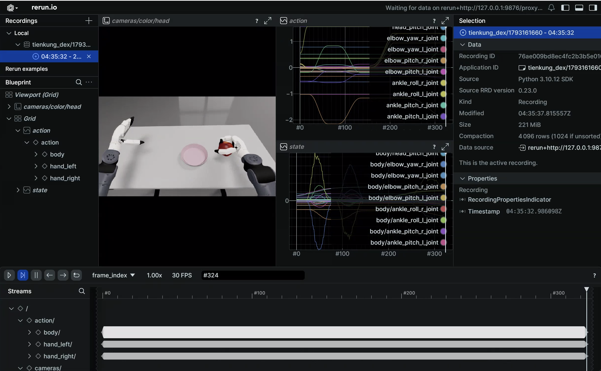
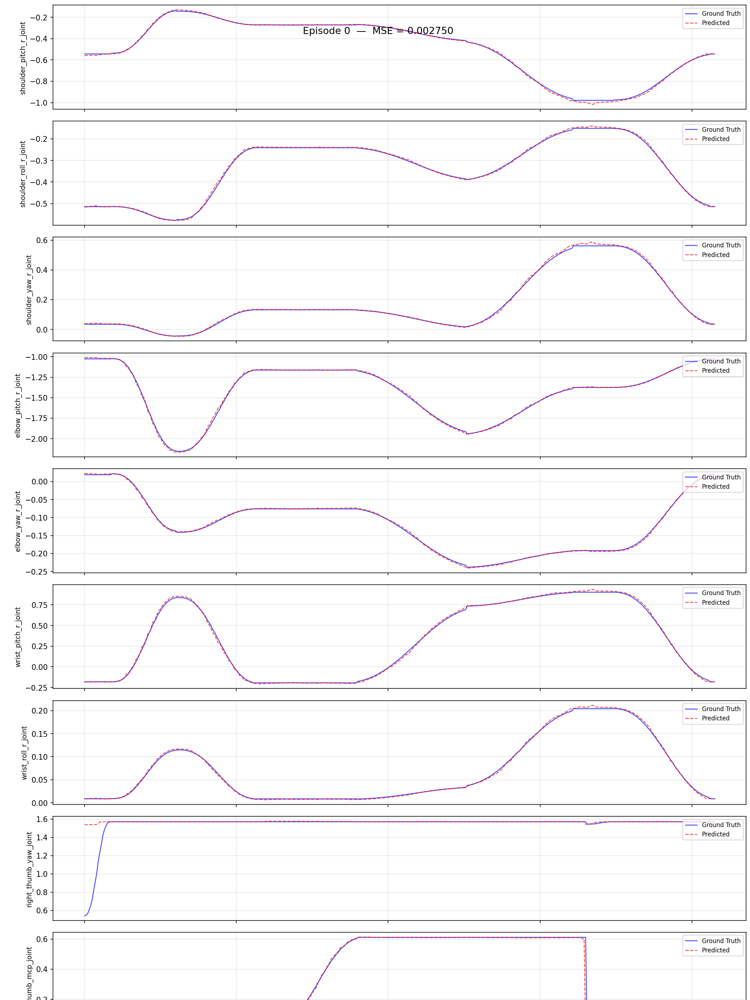

# 天工行者 Dex：模仿学习平台

> 对应代码：`ubt_IL/scripts/{convert,train,eval,deploy}/tienkung_dex/`（容器内执行）
> 前置：已按 [快速开始](../getting-started.md) 克隆代码并初始化子模块；HDF5 数据已就绪（[仿真采集](sim-setup.md)或真机采集）

本页维护天工行者 Dex 转换/训练/评估/部署的**通用流程与配置参数说明**；各环节的具体命令随数据来源嵌在对应工作流章节中，按需跳转。

## 1. 构建环境（ubt_IL 容器）

容器构建流程见 [模仿学习平台 · 容器构建与使用](../il/docker.md)（`build` / `start` / `bash`）。

- 宿主机项目挂载于容器 `/ubt_IL`。
- 通信链路：LeRobot（Python 3.12）—ZMQ `5559`/`5560`—> Bridge2（系统 Python 3.10）—ROS2 DDS—> 机器人/仿真器。
- 相机推流：仿真走 **5758**（ubt_sim 直发 JPEG），真机走 **5558**（Bridge2 带 `--enable-image` 转码）。
- Dex 消息包（`ros2_bridge_msgs` / `inspire_hand_msgs` / `brainco_hand_msgs`）在镜像构建期编译到 `/opt/tienkung_dex_msgs_ws`；`bash run.sh check` 中 `tienkung_dex` 相关三行应全为 `[OK]`。
- 若要在**机器人本体（Thor，无容器）**上跑策略，可跳过本节，按 [机器人本体部署](arm-deploy.md) 建 venv。

## 2. 数据转换（HDF5 -> LeRobot）

脚本：`/ubt_IL/scripts/convert/tienkung_dex/convert.sh`（统一转换器 `convert/common/convert_to_lerobot.py`），将 HDF5 原始数据转换为 LeRobot v3 数据集（产物位于 `/ubt_IL/dataset/<REPO_ID>/`）。

**转换指令**：

```bash
CONFIG=/ubt_IL/scripts/convert/tienkung_dex/configs/tienkung_dex_20d_1RGB_inspire.json \
SRC_ROOT=/ubt_sim/dataset/tienkung_dex \
TGT_PATH=/ubt_IL/dataset \
REPO_ID=tienkung_dex_sim_pick_apple \
TASK_NAME=tienkung_dex_sim_pick_apple \
FPS=15 \
bash /ubt_IL/scripts/convert/tienkung_dex/convert.sh --overwrite
```

**示例**（跳转查看）：

- 仿真数据：[仿真全流程 · 数据转换](sim-workflow.md#3-数据转换hdf5--lerobot)
- 真机数据：[真机全流程 · 数据转换](real-workflow.md#3-数据转换hdf5--lerobot)

转换配置在 `/ubt_IL/scripts/convert/tienkung_dex/configs/` 下：

| 配置文件 | 维度 | 手型 / 场景 | 图像 |
|----------|------|-------------|------|
| `tienkung_dex_20d_1RGB_inspire.json` | 20D（右臂 7 + 右手 13） | 因时 Inspire，仿真（默认） | 3×360×640 |
| `tienkung_dex_13d_1RGB_brainco_real.json` | 13D（右臂 7 + 右手 6） | 强脑 BrainCo，真机（**已验证**） | 3×360×640 |
| `tienkung_dex_real_pick_r13_1RGB.json` | 13D（右臂 7 + 右手 6） | 因时 r13 真机（pico6） | 3×720×1280 |

**常用环境变量**（标「默认」的可省略；完整列表 `bash convert.sh -h`，通用说明见 [数据转换详解](../common/data-conversion.md)）：

| 变量 | 说明 |
|------|------|
| `SRC_ROOT` | HDF5 存放根目录（默认 `/ubt_IL/dataset/tienkung_dex`；不存在时自动回退 `/ubt_sim/dataset/tienkung_dex`） |
| `TGT_PATH` | LeRobot 数据集输出根目录（默认 `/ubt_IL/dataset`） |
| `CONFIG` | 转换配置 JSON（默认 `tienkung_dex_20d_1RGB_inspire.json`） |
| `REPO_ID` | 输出数据集名称（默认 `tienkung_dex_sim_pick_apple`，训练时保持一致） |
| `TASK_NAME` | 任务名称（默认 `tienkung_dex_sim_pick_apple`，写入每帧 `task` 字段） |
| `FPS` | 目标帧率（仿真默认 `15`；真机 30 fps 数据用 `FPS=30`） |
| `ROBOT_TYPE` | 机器人类型（默认 `tienkung_dex`，写入 meta） |
| `VCODEC` | 视频编码器（默认 `h264`） |
| `HDF5_REL_PATH` | HDF5 相对 episode 目录的路径（默认 `trajectory.hdf5`） |
| `TRIM_STATIONARY` | `1` 开启静止帧裁剪（默认关闭） |
| `STATIONARY_DIAGNOSE` | `1` 只统计静止分布不写盘（校准阈值用） |
| `STATIONARY_CAP` / `STATIONARY_THRESH` | 静止游程上限（默认 8 帧）/ 判定阈值（默认 0.03） |
| `RESAMPLE_FPS` | 目标帧率，设置后启用重采样（默认不重采样） |

!!! tip "静止帧裁剪"
    数据集静止帧会使模型推理陷入局部静止。Dex 仿真数据默认**不裁剪**：先 `STATIONARY_DIAGNOSE=1` 看分布，再决定是否 `TRIM_STATIONARY=1`。实测 20 集按默认参数裁剪后 10937 → 8269 帧（-24.4%），20 维 range 与逐帧最大步长均保留。真机数据可按需开启（裁掉首尾保持预备位的长静止段）。

**状态 / 动作的取数**：

| 字段 | HDF5 来源 | 列 |
|------|-----------|-----|
| `observation.state` | `joint_observations/joint_position` + `hand_observations/hand_right_position`（**实测值**） | `[24..30]` + 右手全部 13 列 |
| `action` | `action_observations/joint_position` + `action_observations/hand_right_position`（**指令值**） | 同上 |

> **别把两者互换**：`action_*` 是录制时的指令，`*_observations` 是实测。手部 action 领先 state 最多 1.31 rad，这正是部署时 `get_observation()` 的语义。

**转换产物**：`/ubt_IL/dataset/<REPO_ID>/` 下生成 LeRobot v3 数据集（`meta/`、`chunk-000/`（data parquet）、`videos/`）。

## 3. 数据可视化

转换完成后用 `lerobot-dataset-viz` 检查数据集质量：

```bash
HF_HUB_OFFLINE=1 lerobot-dataset-viz \
  --repo-id <REPO_ID> \
  --episode-index 0 \
  --root /ubt_IL/dataset/<REPO_ID>
```

> `--root` 须指向包含 `meta/` 目录的数据集路径（即 `repo_id` 目录本身），而非父目录；`--episode-index` 为必填项，一次只可视化一集。



**示例**（跳转查看）：[仿真全流程 · 数据可视化](sim-workflow.md#32-数据可视化) / [真机全流程 · 策略评估](real-workflow.md#5-策略评估离线-mse)。

## 4. 模型训练（ACT）

训练脚本：`/ubt_IL/scripts/train/tienkung_dex/train.sh`；训练配置在 `/ubt_IL/scripts/train/tienkung_dex/configs/` 下。

**训练指令**（可选覆盖参数见下文表格，未设置时沿用配置文件内值）：

```bash
CONFIG_PATH=/ubt_IL/scripts/train/tienkung_dex/configs/train_config_tienkung_dex_sim_pick_apple.json \
OUTPUT_DIR=/ubt_IL/model/tienkung_dex_sim_pick_apple_act \
STEPS=60000 SAVE_FREQ=10000 BATCH_SIZE=16 \
bash /ubt_IL/scripts/train/tienkung_dex/train.sh
```

训练配置一览（ACT，`chunk_size=50`、`n_action_steps=20`、`dim_model=512`）：

| 配置文件 | 数据集 | 步数 / 保存间隔 | batch |
|----------|--------|------------------|-------|
| `train_config_tienkung_dex_sim_pick_apple.json` | `tienkung_dex_sim_pick_apple` | 60000 / 10000 | 16 |
| `train_config_tienkung_dex_real_pick_apple.json` | `tienkung_dex_real_pick_apple` | 30000 / 5000 | 16 |
| `train_config_tienkung_dex_real_pick_apple_brainco_13d.json` | `tienkung_dex_real_pick_apple_brainco_13d` | 20000 / 5000 | 16 |

> ⚠️ `train.sh` 默认 `CONFIG_PATH` 指向**仿真配置**，真机训练必须显式指定真机配置。

**冒烟与续训**：

```bash
# 冒烟测试：2 步、不落盘
bash /ubt_IL/scripts/train/tienkung_dex/train.sh --steps=2 --save_checkpoint=false

# 断点续训（CONFIG_PATH 指向 checkpoint 内 train_config.json）
CONFIG_PATH=/ubt_IL/model/tienkung_dex_sim_pick_apple_act/checkpoints/last/pretrained_model/train_config.json \
RESUME=true bash /ubt_IL/scripts/train/tienkung_dex/train.sh
```

**不使用 train.sh**（直接调用 `lerobot-train`，需在 `/ubt_IL/lerobot` 目录下执行）：

```bash
cd /ubt_IL/lerobot
HF_HUB_OFFLINE=1 /lerobot/.venv/bin/lerobot-train \
  --config_path=/ubt_IL/scripts/train/tienkung_dex/configs/train_config_tienkung_dex_sim_pick_apple.json \
  --output_dir=/ubt_IL/model/tienkung_dex_sim_pick_apple_act
```

**常用覆盖参数**（仅当环境变量显式设置时覆盖 config 中的值；`HF_HUB_OFFLINE=1` 默认开启）：

| 环境变量 | 说明 |
|------|------|
| `CONFIG_PATH` | 训练配置 JSON（默认仿真配置） |
| `DATASET_REPO_ID` / `DATASET_ROOT` | 数据集名称 / 根目录（与转换 `REPO_ID` 一致） |
| `OUTPUT_DIR` | 模型输出目录（checkpoint 在 `checkpoints/<step>/pretrained_model/` 下） |
| `STEPS` / `SAVE_FREQ` | 训练步数 / checkpoint 保存间隔 |
| `BATCH_SIZE` / `SEED` | 批大小 / 随机种子 |
| `DEVICE` | 训练设备（默认 `cuda`） |
| `RESUME` | 续训开关（默认 `false`） |
| `WANDB_ENABLE` | wandb 日志开关（默认 `false`） |

## 5. 策略评估（离线 MSE）

脚本（各机型共用）：`/ubt_IL/scripts/eval/eval_policy.py`，在 LeRobot 数据集上离线推理，逐帧对比**预测动作 vs 真值动作**的 MSE，并可生成逐 episode 对比图。

**评估指令**：

```bash
/lerobot/.venv/bin/python /ubt_IL/scripts/eval/eval_policy.py \
  --policy-path /ubt_IL/model/tienkung_dex_sim_pick_apple_act/checkpoints/last/pretrained_model \
  --dataset-path /ubt_IL/dataset/tienkung_dex_sim_pick_apple \
  --episodes 5 \
  --inference-freq 1 \
  --plot \
  --plot-dir /ubt_IL/scripts/eval/output/eval_tienkung_dex_sim_pick_apple_act \
  --output /ubt_IL/scripts/eval/output/eval_tienkung_dex_sim_pick_apple_act/results.json \
  --device cuda
```

`--inference-freq 1` 表示逐帧推理，最接近部署时的行为；默认值会按 `n_action_steps` 排队。



| 参数 | 说明 |
|------|------|
| `--policy-path` | 训练的 ACT checkpoint（`pretrained_model` 目录） |
| `--dataset-path` | LeRobot 数据集根目录（含 `meta/info.json`） |
| `--episodes` | 评估 episode 数（默认全部） |
| `--inference-freq` | 每 N 步推理一次，模拟真实部署的 chunk 队列；`1` 为逐步推理 |
| `--plot` / `--plot-dir` | 逐 episode 预测-vs-真值对比图（PNG） |
| `--output` | 结果 JSON（summary + 逐 episode MSE） |
| `--device` | `cuda`（默认，不可用自动回退 `cpu`） |

> 离线 MSE 只用于同一批 checkpoint 横向择优，最终判据仍是仿真回注的 `/sim/task_completed` 或真机任务完成情况。

## 6. 模型部署

脚本：`/ubt_IL/scripts/deploy/tienkung_dex/rollout.sh`（会自动拉起 Bridge2；前置：先 `robot_ready.sh` 摆到预备位，再跑策略，顺序不能反）。部署前自动做**维度预检**（策略 action 维度 vs `JOINT_CONFIG`）。

**部署指令**：

```bash
POLICY_PATH=<checkpoint 的 pretrained_model 目录> \
JOINT_CONFIG=tienkung_dex_20 \
CAMERA_PORT=5758 FPS=15 DURATION=60 \
  bash /ubt_IL/scripts/deploy/tienkung_dex/rollout.sh
```

**具体部署方法**：

- 仿真部署：[仿真全流程 · 模型部署（仿真）](sim-workflow.md#6-模型部署仿真)
- 真机部署（BrainCo 13D 已验证）：[真机全流程 · 模型部署（真机）](real-workflow.md#6-模型部署真机)
- 机器人本体（Thor，无容器）部署：[机器人本体部署](arm-deploy.md)

**常用环境变量**：

| 变量 | 默认 | 说明 |
|------|------|------|
| `POLICY_PATH` | **必填** | checkpoint 目录（含 `config.json`） |
| `JOINT_CONFIG` | `tienkung_dex_20` | `tienkung_dex_20`（因时 13 rad）/ `tienkung_dex_brainco_13`（强脑 6 电机）/ `tienkung_dex_inspire_13`（因时 6 维 0~1 → 13 码），**须与训练 DOF 一致** |
| `HAND_VARIANT` | 空 | 留空跟随 `JOINT_CONFIG`；显式填写时两者必须一致 |
| `HAND_ACTION_MODE` | 空（自动） | 留空由 `JOINT_CONFIG` 推导；排查时可显式 `rad13` / `pico6` |
| `FPS` | `15` | 控制环频率（= 数据集帧率；真机 30 fps 数据集用 `FPS=30`） |
| `DURATION` | `60` | 运行时长（秒） |
| `TASK` | `pick apple` | 任务描述 |
| `CAMERA_PORT` | `5758` | 仿真 5758（ubt_sim 直发 JPEG）/ 真机 5558（Bridge2 转码） |
| `IMAGE_ENABLED` | `0` | 真机设 `1`，Bridge2 才把头相机编成 JPEG |
| `MAX_RELATIVE_TARGET` | 空（不限） | 单步相对目标限幅 rad；真机首轮建议 `0.01` |
| `INFERENCE_TYPE` | `sync` | **只支持 sync**（Dex 桥接没有 chunk 消费者） |
| `ZMQ_HOST` | `127.0.0.1` | 桥接地址（跨机部署时填对端 IP） |

完整参数、三种手部量纲换算与 Bridge2 组开关见 [真机全流程 §6](real-workflow.md#6-模型部署真机)。

## 7. 常见问题

| 现象 | 处理 |
|------|------|
| 训练时归一化炸裂（QUANTILES NaN/Inf） | 数据含恒定维度；Dex 只取右臂 7 + 右手，恒定维已在转换配置里剔除 |
| 轨迹含长静止段，部署时动作停止 | 转换时加 `TRIM_STATIONARY=1`（默认关闭；先 `STATIONARY_DIAGNOSE=1` 看分布） |
| 手不动 / 手指整体错位 | `HAND_VARIANT` / `JOINT_CONFIG` 与实物手型不一致，或插件与 Bridge2 的常量副本漂移（Bridge2 启动日志会报「通道表不一致」） |
| 部署无相机图像 | 仿真看 5758 是否有流；真机看 Bridge2 是否带 `--enable-image`、端口是否 5558 |
| 仿真里机器人不动 | `ROS_DOMAIN_ID` 是否与仿真一致（ubt_sim 默认 0）；`robot_ready.sh` 是否先跑过；`/sim/cmd_reset` 复位场景 |
| 手臂起步就撞桌子 | 没跑 `robot_ready.sh`，或用了 `--stage-durations` 强行动作过快 |
| 常驻服务 `load` 被拒 | Dex 不支持热切换模型，`shutdown` 后重新 `launch` |
| 训练报 `FileExistsError` | 从头训练时 `OUTPUT_DIR` 已存在且 `RESUME=false`；换新目录或删旧目录 |
| 训练 OOM | 降 `BATCH_SIZE`；GPU 显存被仿真占满时先关仿真 |
