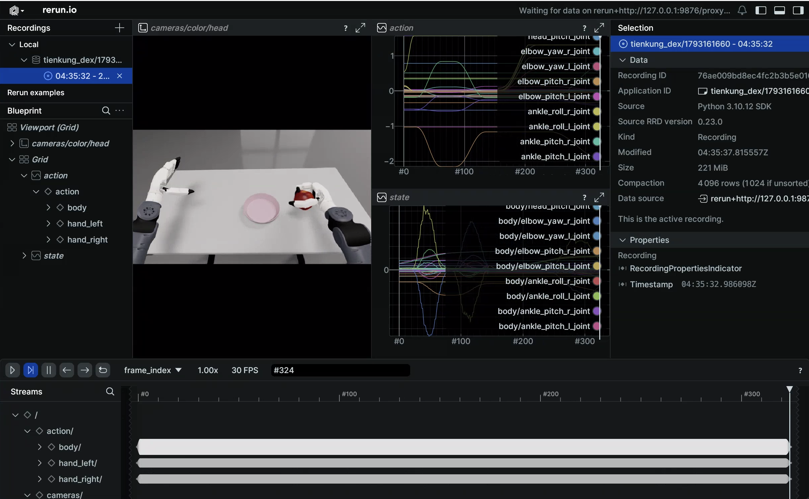

# Walker TienKung Dex: Simulation Platform

Walker TienKung Dex simulation is built on NVIDIA Isaac Sim 5.0 (Isaac Lab 2.2.0). A ROS2-ZMQ bridge publishes simulation state and images on **exactly the same ROS 2 topics as the real robot**, enabling sim-to-real consistent teleoperation and data collection. Everything runs in a Docker container and supports both the Inspire RH5DG2 (67 revolute joints) and BrainCo Revo2 (53 revolute joints) hands.


Three-process architecture (**Python versions must not be mixed**):

```
Isaac Sim (Py3.11)  ──ZMQ──►  ROS2-ZMQ Bridge (Py3.10)  ──ROS2──►  teleop / collection scripts
```

## Quick start

> Commands are split into two parts: build/enter the container on the **host**; launch simulation and collect data inside the **container** (container root is `/ubt_sim`).

### 1. Build and start the container (host)

```bash
cd ubt_sim/docker
bash run.sh build      # build the ROS 2 + Isaac Sim image
bash run.sh start      # create/start the container
bash run.sh init       # build ros2_bridge_msgs / Inspire / BrainCo messages and the C++ image bridge (first time only)
bash run.sh check      # verify GPU / ROS 2 / message packages / numpy<2
```

See [Simulation Platform · Container Setup](../sim/docker.md) for the build workflow.

> ⚠️ **`run.sh init` is mandatory**: the Dex bridge exits if `/opt/ubt_sim/tienkung_dex_msgs/install/setup.bash` is missing. It also writes the robot message workspaces into the container's `/root/.bashrc`, so interactive shells source them automatically.
>
> ⚠️ **Must be changed before real-robot integration**: set the `docker/fastdds_no_shm.xml` whitelist to the robot's direct-link NIC IP (restart the container after editing). Pure simulation only needs `127.0.0.1`.

### 2. Launch simulation (container)

```bash
# Enter the container
cd ubt_sim/docker/
bash run.sh bash

# Start simulation and the ROS2-ZMQ bridge
UBT_SIM_TASK=UBTSim-TienkungDex-Parlor-v0 bash scripts/start_sim.sh
```

The two scenes correspond to the two hand variants:

| Task ID | Hand | Joints | Config |
|---------|------|--------|------|
| `UBTSim-TienkungDex-Parlor-v0` | Inspire RH5DG2 | 67 | `config/tienkung_dex/parlor.yaml` |
| `UBTSim-TienkungDex-Brainco-Parlor-v0` | BrainCo Revo2 | 53 | `config/tienkung_dex/brainco_parlor.yaml` |

`start_sim.sh` infers the variant from the task name (`Brainco` → brainco) and passes `--variant` to the bridge. Press **`R`** to reset the robot/scene.

Demo (picking an apple from the table):

<video src="../../assets/tienkung-dex仿真部署效果.mp4" controls muted width="100%"></video>

Common environment variables:

| Variable | Default | Description |
|------|------|------|
| `UBT_SIM_TASK` | `UBTSim-TienkungPro-Parlor-v0` | Set to `UBTSim-TienkungDex-Parlor-v0` to enable DEX |
| `UBT_SIM_NUM_ENVS` | `1` | Number of parallel environments |
| `UBT_SIM_LOAD_ONLY` | Unset | Render only, no ROS (`--device cpu` by default) |
| `UBT_SIM_NO_BRIDGE` | Unset | Set to 1 to skip starting the bridge |
| `UBT_SIM_TIENKUNG_DEX_CMD_PORT` / `_STATUS_PORT` / `_IMAGE_PORT` / `_JPEG_PORT` | 5755/5756/5757/5758 | ZMQ ports (must match `bridge_config.yaml`) |
| `ROS_DOMAIN_ID` | `0` | Default 0 (same domain as hardware); simulation and deployment containers must use the same value; set both to `146` to isolate |

> A shell entered with `run.sh bash` presets `ROS_DOMAIN_ID` from `docker/env.sh` (default 0). When launching from there, explicitly `export ROS_DOMAIN_ID=0` to avoid mixing with hardware.

### 3. Data collection (container, system Python 3.10)

```bash
# Batch collection: each episode runs reset -> ready pose -> grasp -> place on plate -> ready pose, and is saved only on success
bash teleoperation/control/tienkung_dex/save_data.sh --batch 20
```

- Sampling rate 15 Hz; one `camera_head` RGB stream plus depth; right arm 7 + right hand 13 (Inspire) or 6 (BrainCo).
- Output: `/ubt_sim/dataset/tienkung_dex/<epoch>/trajectory.hdf5`, with attributes for joint names / fps / hand variant / task.
- With 20 collected episodes, proceed directly to conversion.

### 4. Camera test (container)

```bash
# Live preview (cv2.imshow, requires X11; press Q/ESC to exit)
/usr/bin/python3 teleoperation/control/tienkung_dex/tienkung_dex_controller.py camera --preview

# Save 5 frames
/usr/bin/python3 teleoperation/control/tienkung_dex/tienkung_dex_controller.py camera --save --count 5
```

Camera topics: `/ob_camera_head/color/image_raw` (rgb8) and `/ob_camera_head/depth/image_raw` (16UC1, millimetres).

### 5. Dataset preview and playback (container)



```bash
# Preview the dataset (Rerun Web Viewer)
/usr/bin/python3 teleoperation/tools/playback_tienkung_dex.py --mode preview --web-port 9090

# Replay on the same topics as hardware (run the ready pose first)
/usr/bin/python3 teleoperation/control/tienkung_dex/tienkung_dex_controller.py play ready
/usr/bin/python3 teleoperation/tools/playback_tienkung_dex.py \
    --episode dataset/tienkung_dex/<timestamp>/trajectory.hdf5 --mode control
```

The message workspaces are written into `/root/.bashrc` by `run.sh init` and loaded automatically in interactive shells. See [Playback](../common/playback.md) for all options and real-robot notes.

## Simulation modules

| Module | Path | Description |
| --- | --- | --- |
| Docker orchestration | `ubt_sim/docker/run.sh` | Image build, container lifecycle, message compilation |
| Simulation launcher | `ubt_sim/scripts/start_sim.sh` | Detects the hand variant from `UBT_SIM_TASK` and starts the bridge |
| Task definitions | `ubt_sim/source/ubt_sim/task/tienkung_dex_parlor/`, `tienkung_dex_brainco_parlor/` | Apple-picking scenes for both hands |
| Runtime config | `ubt_sim/config/tienkung_dex/parlor.yaml`, `brainco_parlor.yaml` | Scene/camera/device parameters |
| ROS2-ZMQ bridge | `ubt_sim/teleoperation/bridges/tienkung_dex/` | Bridge script + `bridge_config.yaml` |
| Control and collection | `ubt_sim/teleoperation/control/tienkung_dex/` | `tienkung_dex_controller.py` / `save_data.sh` / `reset.py` |
| Playback | `ubt_sim/teleoperation/tools/playback_tienkung_dex.py` | Preview / action playback |
| Data output | `ubt_sim/dataset/tienkung_dex/<timestamp>/trajectory.hdf5` | Collected episodes |

## ZMQ ports

| Port | Purpose |
| --- | --- |
| 5755 | Control commands (bridge PUB → sim SUB) |
| 5756 | Robot state (sim PUB → bridge SUB) |
| 5757 | Raw camera images (sim publishes RGB + uint16 depth; the C++ image bridge converts them to ROS topics) |
| 5758 | JPEG stream (published by simulation, for debugging) |

> The `ubt_IL` Dex plugin uses 5559/5560 (actions/state) + 5558 (real-robot camera JPEG). See [Architecture · ZMQ ports](../architecture.md#zmq-ports) for the cross-robot overview.

## ROS 2 topics

| Direction | Topic | Type |
|---|---|---|
| sub | `/arm/cmd` | `ArmCtrl` (right arm; same family as hardware) |
| sub | `/head/cmd` | `HeadCtrl` |
| sub | `/waist/cmd` | `ArmCtrl` |
| sub | `/leg/cmd` | `ArmCtrl` (published in simulation, not on hardware) |
| sub | `/right_hand/angle_set`, etc. | Inspire / BrainCo hand messages |
| pub | `/robot_state` | `RobotState` (about 200 Hz) |
| pub | `/ob_camera_head/color/image_raw` | `sensor_msgs/Image` (rgb8) |
| pub | `/ob_camera_head/depth/image_raw` | `sensor_msgs/Image` (16UC1, millimetres) |
| pub | `/sim/task_completed` | `std_msgs/Float32` (apple-center to plate-center distance; task success metric) |

## Troubleshooting

- **Simulation reports missing USD**: pull all Git LFS assets (`git lfs pull`); `--variant` must match the task ID.
- **`bash run.sh check` / bridge reports missing message packages**: rerun `bash run.sh init`; verify `numpy<2`, `ros2_bridge_msgs`, and the Inspire/BrainCo hand packages.
- **Collection script fails to import rclpy / message types**: use `/usr/bin/python3`, not Isaac Sim Python.
- **`save_data.sh --batch` trips the consecutive-failure breaker**: usually the bridge is not ready. Verify the simulation window is running and `pgrep -f tienkung_dex_ros2_zmq_bridge` returns a process. `run.sh bridge-start` only starts the Pro bridge; Dex must be started via `start_sim.sh` or the bridge script directly.
- **Head/arm still catching up after the trajectory ends**: the simulation loop runs at about 11 Hz (RTF≈0.11); wall-clock trajectories exceed joint velocity limits when converted to simulation time. This is a time-base issue and does not affect hardware.
- **Keyboard teleoperation / preview has no window**: requires X11 and `DISPLAY`; run `xhost +` on the host. On headless machines use `save_data.sh --batch`.
- **Hardware receives no topics**: check that the `docker/fastdds_no_shm.xml` whitelist contains the direct-link NIC IP and that `ROS_DOMAIN_ID=0`.

After collection, continue with [Imitation Learning Platform](convert-train.md).
