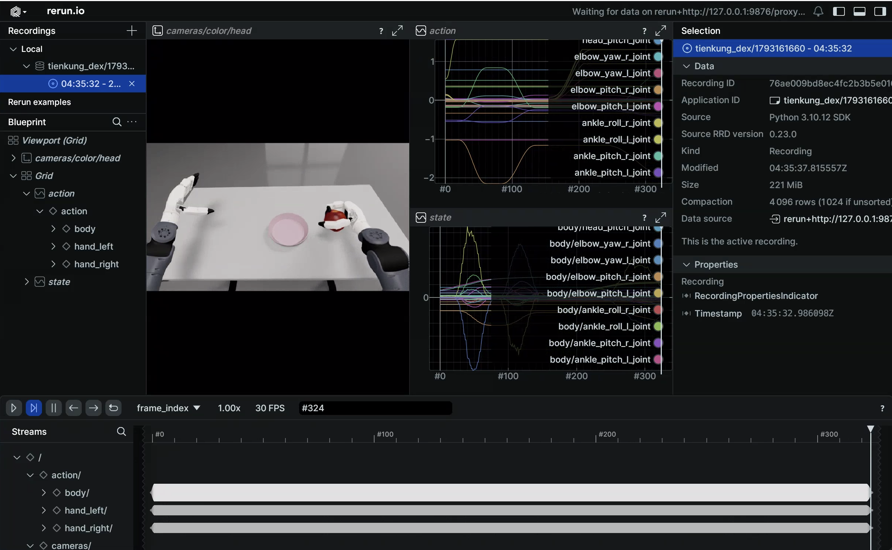

# 天工行者 Dex：仿真平台

天工行者 Dex 仿真基于 NVIDIA Isaac Sim 5.0（Isaac Lab 2.2.0）构建，通过 ROS2-ZMQ 桥接将仿真状态与图像以**与真机一致的 ROS2 话题**对外发布，实现 sim-to-real 一致的遥操作与数据采集。整套环境运行在 Docker 容器内，支持 Inspire RH5DG2（67 revolute）与 BrainCo Revo2（53 revolute）两种灵巧手。


三进程架构（Python 不可混用）：

```
Isaac Sim (Py3.11)  ──ZMQ──►  ROS2-ZMQ Bridge (Py3.10)  ──ROS2──►  遥操作/采集脚本
```

## 快速开始

> 命令分两段：构建/进入容器在**宿主机**执行；启动仿真与采集在**容器内**执行（容器内根路径为 `/ubt_sim`）。

### 1. 构建并启动容器（宿主机）

```bash
cd ubt_sim/docker
bash run.sh build      # 构建 ROS2 + Isaac Sim 镜像
bash run.sh start      # 创建/启动容器
bash run.sh init       # 编译 ros2_bridge_msgs / 因时 / 强脑消息包与 C++ 图像桥，首次执行一次
bash run.sh check      # 校验环境（GPU / ROS2 / 消息包 / numpy<2 等）
```

容器构建流程见 [仿真平台 · 容器构建与使用](../sim/docker.md)。

> ⚠️ **`run.sh init` 不能跳过**：Dex 桥接找不到 `/opt/ubt_sim/tienkung_dex_msgs/install/setup.bash` 会直接退出。它同时把各机型消息工作空间写进容器 `/root/.bashrc`，交互式 shell 自动 source。
>
> ⚠️ **真机联调前必须修改**：把 `docker/fastdds_no_shm.xml` 白名单改成实机直连网卡 IP（改完重启容器生效）。纯仿真只用 `127.0.0.1`。

### 2. 启动仿真（容器内）

```bash
# 进入容器
cd ubt_sim/docker/
bash run.sh bash

# 拉起仿真和 ROS2-ZMQ 桥接
UBT_SIM_TASK=UBTSim-TienkungDex-Parlor-v0 bash scripts/start_sim.sh
```

两个场景（手部变体）分别对应不同的灵巧手：

| 任务 ID | 手部 | 关节数 | 配置 |
|---------|------|--------|------|
| `UBTSim-TienkungDex-Parlor-v0` | Inspire RH5DG2 | 67 | `config/tienkung_dex/parlor.yaml` |
| `UBTSim-TienkungDex-Brainco-Parlor-v0` | BrainCo Revo2 | 53 | `config/tienkung_dex/brainco_parlor.yaml` |

`start_sim.sh` 会从任务名推断变体（含 `Brainco` → brainco），并把 `--variant` 传给桥接。**按 `R` 键**可复位机器人/场景。

运行效果（桌面抓苹果）：

<video src="../../assets/tienkung-dex仿真部署效果.mp4" controls muted width="100%"></video>

常用环境变量：

| 变量 | 默认 | 说明 |
|------|------|------|
| `UBT_SIM_TASK` | `UBTSim-TienkungPro-Parlor-v0` | 设为 `UBTSim-TienkungDex-Parlor-v0` 启用 DEX |
| `UBT_SIM_NUM_ENVS` | `1` | 并行环境数 |
| `UBT_SIM_LOAD_ONLY` | 未设置 | 仅渲染，不接 ROS（默认 `--device cpu`） |
| `UBT_SIM_NO_BRIDGE` | 未设置 | 置 1 时不启动桥接 |
| `UBT_SIM_TIENKUNG_DEX_CMD_PORT` / `_STATUS_PORT` / `_IMAGE_PORT` / `_JPEG_PORT` | 5755/5756/5757/5758 | ZMQ 端口（须与 `bridge_config.yaml` 一致） |
| `ROS_DOMAIN_ID` | `0` | 默认 0（与真机同域）；仿真与部署容器必须用同一个值，需要隔离时两边都设成 `146` |

> `run.sh bash` 进入的 shell 会把 `ROS_DOMAIN_ID` 预设为 `docker/env.sh` 的值（默认 0），从那里启动请显式 `export ROS_DOMAIN_ID=0`，避免与真机串台。

### 3. 数据采集（容器内，使用系统 Python 3.10）

```bash
# 批量采集：每集自动「复位 -> 预备位 -> 抓 -> 放到盘上 -> 回预备位」并落盘，失败集不保存
bash teleoperation/control/tienkung_dex/save_data.sh --batch 20
```

- 采集频率 15 Hz；单路 `camera_head` RGB + 深度，右臂 7 + 右手 13（因时）或 6（强脑）。
- 产物：`/ubt_sim/dataset/tienkung_dex/<epoch>/trajectory.hdf5`，attrs 带关节名 / fps / 手型 / task。
- 已有 20 集采集结果时可直接进入转换。

### 4. 相机测试（容器内）

```bash
# 实时预览（cv2.imshow，需 X11，按 Q/ESC 退出）
/usr/bin/python3 teleoperation/control/tienkung_dex/tienkung_dex_controller.py camera --preview

# 保存 5 帧
/usr/bin/python3 teleoperation/control/tienkung_dex/tienkung_dex_controller.py camera --save --count 5
```

相机话题为 `/ob_camera_head/color/image_raw`（rgb8）与 `/ob_camera_head/depth/image_raw`（16UC1，毫米）。

### 5. 数据集预览与回放（容器内）



```bash
# 预览数据集（Rerun Web Viewer）
/usr/bin/python3 teleoperation/tools/playback_tienkung_dex.py --mode preview --web-port 9090

# 真机同款话题回放（先初始化预备动作，再回放）
/usr/bin/python3 teleoperation/control/tienkung_dex/tienkung_dex_controller.py play ready
/usr/bin/python3 teleoperation/tools/playback_tienkung_dex.py \
    --episode dataset/tienkung_dex/<时间戳>/trajectory.hdf5 --mode control
```

消息工作空间已随 `run.sh init` 写进 `/root/.bashrc`，交互式 shell 自动加载。完整参数与真机说明见 [数据可视化与回放](../common/playback.md)。

## 仿真模块

| 模块 | 路径 | 说明 |
| --- | --- | --- |
| Docker 编排 | `ubt_sim/docker/run.sh` | 镜像构建、容器生命周期、消息包编译 |
| 仿真启动器 | `ubt_sim/scripts/start_sim.sh` | 按 `UBT_SIM_TASK` 识别手型变体、拉起桥接 |
| 任务定义 | `ubt_sim/source/ubt_sim/task/tienkung_dex_parlor/`、`tienkung_dex_brainco_parlor/` | 两种手型的抓苹果场景 |
| 运行时配置 | `ubt_sim/config/tienkung_dex/parlor.yaml`、`brainco_parlor.yaml` | 场景/相机/设备参数 |
| ROS2-ZMQ 桥接 | `ubt_sim/teleoperation/bridges/tienkung_dex/` | 桥接脚本 + `bridge_config.yaml` |
| 控制与采集 | `ubt_sim/teleoperation/control/tienkung_dex/` | `tienkung_dex_controller.py` / `save_data.sh` / `reset.py` |
| 数据回放 | `ubt_sim/teleoperation/tools/playback_tienkung_dex.py` | 预览 / 动作回放 |
| 数据输出 | `ubt_sim/dataset/tienkung_dex/<时间戳>/trajectory.hdf5` | 采集产物 |

## ZMQ 端口

| 端口 | 用途 |
| --- | --- |
| 5755 | 控制指令（bridge PUB → 仿真 SUB） |
| 5756 | 机器人状态（仿真 PUB → bridge SUB） |
| 5757 | 相机原图（仿真发布 RGB + uint16 深度，C++ 图像桥转 ROS 话题） |
| 5758 | JPEG 直连（仿真发布，调试用） |

> `ubt_IL` 侧 Dex 插件使用 5559/5560（动作/状态）+ 5558（真机相机 JPEG）；跨机型端口总览见 [系统架构 · ZMQ 端口一览](../architecture.md#zmq-端口一览)。

## ROS2 话题

| 方向 | 话题 | 类型 |
|---|---|---|
| sub | `/arm/cmd` | `ArmCtrl`（右臂；真机同族） |
| sub | `/head/cmd` | `HeadCtrl` |
| sub | `/waist/cmd` | `ArmCtrl` |
| sub | `/leg/cmd` | `ArmCtrl`（仿真可发，真机不发） |
| sub | `/right_hand/angle_set` 等 | 因时 / 强脑手消息 |
| pub | `/robot_state` | `RobotState`（约 200 Hz） |
| pub | `/ob_camera_head/color/image_raw` | `sensor_msgs/Image`（rgb8） |
| pub | `/ob_camera_head/depth/image_raw` | `sensor_msgs/Image`（16UC1，毫米） |
| pub | `/sim/task_completed` | `std_msgs/Float32`（苹果中心到盘心距离，仿真任务判定） |

## 故障排查

- **仿真启动报 USD 缺失**：确认已用 Git LFS 拉全资产（`git lfs pull`）；`--variant` 与任务 ID 必须匹配。
- **`bash run.sh check` / 桥接报消息包缺失**：容器内重跑 `bash run.sh init`；确认 `numpy<2`、`ros2_bridge_msgs`、因时/强脑手消息包均已就绪。
- **采集脚本报 rclpy / 消息类型导入失败**：确认用的是 `/usr/bin/python3` 而非 Isaac Sim Python。
- **`save_data.sh --batch` 连续失败熔断**：多为桥接未就绪。先确认仿真窗口在运行、`pgrep -f tienkung_dex_ros2_zmq_bridge` 有进程；`run.sh bridge-start` 只起 Pro 桥，Dex 需从 `start_sim.sh` 启动或手动起桥接脚本。
- **轨迹走完头/臂还在追**：仿真主循环约 11 Hz（RTF≈0.11），按墙钟时长下发的轨迹换算到仿真时间会超出关节速度上限；这是时间基准问题，真机不受影响。
- **键盘遥操作/预览无窗口**：需要 X11 与 `DISPLAY`，宿主机执行 `xhost +`；无显示器时改用 `save_data.sh --batch`。
- **真机收不到话题**：检查 `docker/fastdds_no_shm.xml` 白名单是否为实机直连网卡 IP，并确认 `ROS_DOMAIN_ID=0`。

采集完成后进入下一步：[模仿学习平台](convert-train.md)。
