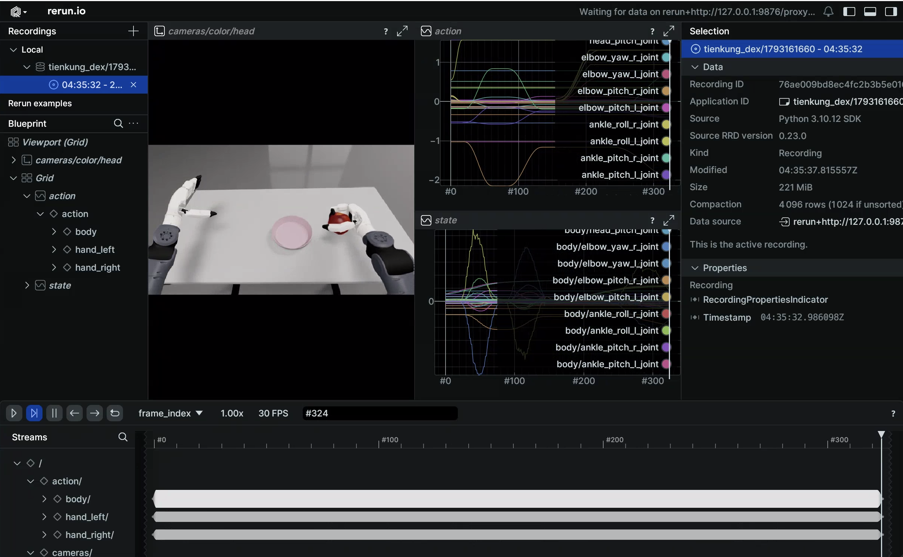
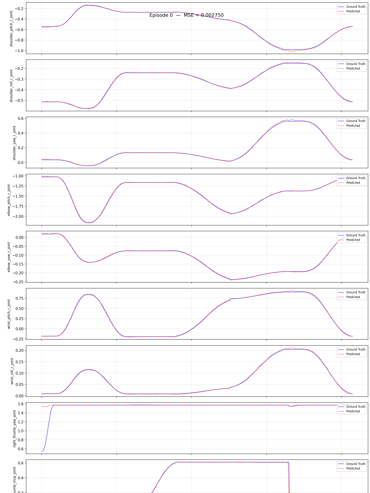

# Walker TienKung Dex Simulation Workflow: Collect -> Convert -> Train -> Evaluate -> Deploy

> Robot: **Walker TienKung Dex** — right arm 7 + right hand 13 (Inspire)
> Data source: **Isaac Sim collection** (`ubt_sim`, task `UBTSim-TienkungDex-Parlor-v0`)
> Container: `lerobot-tienkung` (built/started by `ubt_IL/docker/run.sh`, project mounted at `/ubt_IL`)

## Contents

- [0. Workflow overview](#0-workflow-overview)
- [1. Prerequisite: simulation collection (ubt_sim)](#1-prerequisite-simulation-collection)
- [2. Start the container (ubt_IL)](#2-start-the-container)
- [3. Data conversion (HDF5 -> LeRobot)](#3-data-conversion)
  - [3.1 Conversion command](#31-conversion-command)
  - [3.2 Data visualization](#32-data-visualization)
  - [3.3 Stationary-frame trimming (TRIM_STATIONARY, off by default)](#33-stationary-frame-trimming)
- [4. Policy training](#4-model-training)
- [5. Policy evaluation (offline MSE)](#5-policy-evaluation)
- [6. Model deployment (simulation)](#6-model-deployment-simulation)
- [7. FAQ](#7-faq)

<a id="0-workflow-overview"></a>

## 0. Workflow overview

```
ubt_sim collection (trajectory.hdf5)
      │  right arm 7 + right hand 13 (other dimensions are constant and dropped)
      ▼
scripts/convert/tienkung_dex/convert.sh  ──► dataset/tienkung_dex_sim_pick_apple (20 episodes / 20D / 15 fps)
      ▼
scripts/train/tienkung_dex/train.sh      ──► model/tienkung_dex_sim_pick_apple_act
      ▼
scripts/eval/eval_policy.py              ──► offline MSE + per-dimension curves
      ▼
robot_ready.sh → rollout.sh              ──► feedback into simulation, judge success
```

Two constraints to remember:

1. **Keep only effective dimensions in the action space.** The left arm / waist / head / legs have a range ≤ 0.007 rad in the data (dead dimensions); including them breaks QUANTILES normalization (`NaN`/`Inf` ruins training). The current conversion config excludes them.
2. **Move the robot to the ready pose before deployment** (`robot_ready.sh`); otherwise the initial pose mismatch may cause a collision with the table.

<a id="1-prerequisite-simulation-collection"></a>

## 1. Prerequisite: simulation collection (ubt_sim)

See [Simulation Platform](sim-setup.md) for the environment, task scenes, reset, and playback.

```bash
# ① Launch simulation inside the ubt_sim container (with the task name)
cd ubt_sim
UBT_SIM_TASK=UBTSim-TienkungDex-Parlor-v0 bash scripts/start_sim.sh

# ② Collect data
bash teleoperation/control/tienkung_dex/save_data.sh --batch 20         # 20 episodes
```

Output: `ubt_sim/dataset/tienkung_dex/<epoch>/trajectory.hdf5`, with attributes for joint names / fps / hand variant / task.

> With 20 collected episodes, jump directly to section 3.

<a id="2-start-the-container"></a>

## 2. Start the container (ubt_IL)

```bash
cd ubt_IL/docker
bash run.sh build      # first time
bash run.sh start
bash run.sh check      # expect [OK] for "tienkung_dex plugin / bridge / ROS2 msgs"
bash run.sh bash
```

<a id="3-data-conversion"></a>

## 3. Data conversion (HDF5 -> LeRobot)

> `ubt_sim/` is **mounted read-only** at `/ubt_sim` by `docker/run.sh`; convert directly inside the container.
> If `ls /ubt_sim` fails, the container was created with an old mount; rebuild with `bash run.sh rm && bash run.sh start`.
> `SRC_ROOT` is optional: when the default `ubt_IL/dataset/tienkung_dex` does not exist, `convert.sh` falls back to `/ubt_sim/dataset/tienkung_dex`.

<a id="31-conversion-command"></a>

### 3.1 Conversion command

```bash
cd /ubt_IL

# Convert one episode first to validate the pipeline
SRC_ROOT=/ubt_sim/dataset/tienkung_dex \
bash /ubt_IL/scripts/convert/tienkung_dex/convert.sh --save_one true --overwrite

# Then convert everything
SRC_ROOT=/ubt_sim/dataset/tienkung_dex \
bash /ubt_IL/scripts/convert/tienkung_dex/convert.sh --overwrite
```

Defaults: `CONFIG=configs/tienkung_dex_20d_1RGB_inspire.json`, `REPO_ID=tienkung_dex_sim_pick_apple`, `FPS=15`, `HDF5_REL_PATH=trajectory.hdf5`, `ROBOT_TYPE=tienkung_dex`.

On the simulation side, the Inspire hand records the 13 hand joints of the hardware channel driver, while the BrainCo hand uses 6 joint values. Output is written to `/ubt_IL/dataset/tienkung_dex_sim_pick_apple/`.

Validation:

```bash
python - <<'PY'
import json
info = json.load(open("/ubt_IL/dataset/tienkung_dex_sim_pick_apple/meta/info.json"))
print(info["total_episodes"], info["features"]["observation.state"]["shape"],
      info["features"]["observation.images.head"]["shape"])
PY
```

Expected output: `20 [20] [3, 360, 640]` (the episode count depends on how much data was collected).

<a id="32-data-visualization"></a>

### 3.2 Data visualization

`--episode-index` is required (**one episode at a time**; choose `0~19` for 20 episodes):

```bash
# Inside the container, open the rerun window directly (the container needs X access with DISPLAY set)
HF_HUB_OFFLINE=1 lerobot-dataset-viz \
  --repo-id tienkung_dex_sim_pick_apple \
  --episode-index 0 \
  --root /ubt_IL/dataset/tienkung_dex_sim_pick_apple
```



<a id="33-stationary-frame-trimming"></a>

### 3.3 Stationary-frame trimming (TRIM_STATIONARY, off by default)

Stationary-frame trimming prevents long stationary actions from trapping the policy in a local stationary loop. `convert.sh` exposes all `--stationary-*` options. Measurements on 20 episodes from Oct 2026 (`STATIONARY_DIAGNOSE=1`):

| Metric | Value |
|---|---|
| Leading stationary run | 0 frames (recording starts from the ready pose) |
| Trailing stationary run | mean 13 frames / max 14 |
| In-segment stationary runs | 160 runs across 20 episodes; mean 23 frames, max 56; 120 runs ≥10 frames |
| Frames classified as stationary | 36%–39% |

Actual effect of enabling trimming with defaults (`thr=0.03`, `W=5`, `cap=8`):

```bash
TRIM_STATIONARY=1 bash /ubt_IL/scripts/convert/tienkung_dex/convert.sh --overwrite
```

- 10,937 frames -> **8,269 frames (-24.4%)**, 411–416 frames per episode (originally 539–563).
- **No motion lost**: all 20D ranges preserved; the maximum per-frame step matches the raw data (hands identical, arms at most +0.0056 rad).
- Hand-closing motion is not trimmed: fingers close over 4.5 s, moving about 0.075 within a 5-frame window (threshold 0.03), so it is classified as motion.

Still disabled by default. **Note**: stationary trimming only handles "long stationary runs" and cannot fix adjacent duplicate frames (15 Hz recording runs on an ~11 Hz simulation loop, so duplicates are spread across the whole motion) — that is a sampling-rate issue, not a pause issue.

Tuning order: run `STATIONARY_DIAGNOSE=1` to inspect the distribution first, then decide whether to enable it; `STATIONARY_CAP` / `STATIONARY_THRESH` are the two most frequently changed parameters.

<a id="4-model-training"></a>

## 4. Policy training

```bash
# Default config: 20 episodes / 20D / 60000 steps / checkpoint every 10000
bash /ubt_IL/scripts/train/tienkung_dex/train.sh

# Override common parameters
OUTPUT_DIR=/ubt_IL/model/tienkung_dex_sim_pick_apple_act_v2 \
STEPS=50000 SAVE_FREQ=10000 BATCH_SIZE=16 bash /ubt_IL/scripts/train/tienkung_dex/train.sh

# Resume (CONFIG_PATH points to train_config.json inside the checkpoint)
CONFIG_PATH=/ubt_IL/model/tienkung_dex_sim_pick_apple_act/checkpoints/last/pretrained_model/train_config.json \
RESUME=true bash /ubt_IL/scripts/train/tienkung_dex/train.sh
```

| Environment variable | Default |
|----------|------|
| `CONFIG_PATH` | `configs/train_config_tienkung_dex_sim_pick_apple.json` |
| `OUTPUT_DIR` | `/ubt_IL/model/tienkung_dex_sim_pick_apple_act` |
| `STEPS` / `SAVE_FREQ` | `60000` / `10000` |
| `BATCH_SIZE` | Value from the config (16) |
| `RESUME` | `false` |
| `WANDB_ENABLE` | `false` |

Output: `checkpoints/<step>/pretrained_model` (with `config.json` + `model.safetensors`) + `checkpoints/last`.

> 20 episodes are about 8.3k frames; 60k steps at batch 16 is ≈ **116 epochs**, far beyond typical training. This is a "rather long than short" strategy: save every 10k steps (10k/20k/30k/40k/50k/60k, six checkpoints) and pick the best by offline MSE + simulation feedback. To reduce overfitting risk, `STEPS=15000` (≈29 epochs) is enough.

<a id="5-policy-evaluation"></a>

## 5. Policy evaluation (offline MSE)

```bash
/lerobot/.venv/bin/python /ubt_IL/scripts/eval/eval_policy.py \
  --policy-path /ubt_IL/model/tienkung_dex_sim_pick_apple_act/checkpoints/last/pretrained_model \
  --dataset-path /ubt_IL/dataset/tienkung_dex_sim_pick_apple \
  --episodes 5 --inference-freq 1 --plot \
  --plot-dir /ubt_IL/scripts/eval/output/eval_tienkung_dex_sim_pick_apple_act \
  --output /ubt_IL/scripts/eval/output/eval_tienkung_dex_sim_pick_apple_act/results.json \
  --device cuda
```

`--inference-freq 1` means step-by-step inference, closest to deployment behavior; the default queues by `n_action_steps`.

Example output (020000 checkpoint, episode 0, prediction vs ground truth):



Comparison of two checkpoints (5 episodes / `--inference-freq 1`):

| Checkpoint | Mean MSE (5 episodes) | Episode 0 |
|------------|------------------|---------|
| 010000 | 0.003661 | 0.003219 |
| 020000 | **0.002130** | 0.002750 |

This simulation deployment used 020000. Offline MSE is computed on the training set; a low absolute value does not guarantee closed-loop success — it only ranks checkpoints from the same run. The final criterion is `/sim/task_completed` after feedback deployment.

Check: in the 20D per-dimension curves, **hand dimensions should not be flat all the way**; otherwise the conversion columns are likely mis-sliced or the model did not learn the hand.

<a id="6-model-deployment-simulation"></a>

## 6. Model deployment (simulation)

```bash
# ① Inside the ubt_sim container: start simulation (separate terminal)
cd ubt_sim
UBT_SIM_TASK=UBTSim-TienkungDex-Parlor-v0 bash scripts/start_sim.sh

# ② Inside the inference container: move to the ready pose (four stages + hand pose), check the camera view, and confirm ROS_DOMAIN_ID
bash /ubt_IL/scripts/deploy/tienkung_dex/robot_ready.sh
/usr/bin/python3 /ubt_IL/scripts/deploy/tienkung_dex/preview_camera.py

# ③ Run the policy
POLICY_PATH=/ubt_IL/model/tienkung_dex_sim_pick_apple_act/checkpoints/last/pretrained_model \
JOINT_CONFIG=tienkung_dex_20 FPS=15 DURATION=60 \
bash /ubt_IL/scripts/deploy/tienkung_dex/rollout.sh

# ④ Reset the scene (robot returns HOME, not the ready pose)
/usr/bin/python3 /ubt_IL/scripts/deploy/tienkung_dex/reset.py

# ⑤ Rerun the ready pose before the next episode: after reset head_pitch returns to ~0.000, losing the training view (45° down)
bash /ubt_IL/scripts/deploy/tienkung_dex/robot_ready.sh
```

> `reset.py` only sends `/sim/cmd_reset` to the simulator so the scene and robot return to their initial state; it **does not** restore the ready pose. For consecutive episodes, ②③⑤ form one group — do not jump from ④ straight to the next episode.

Warm-started inference service (warm up once, then start/stop in seconds):

```bash
POLICY_PATH=/ubt_IL/model/tienkung_dex_sim_pick_apple_act/checkpoints/last/pretrained_model \
JOINT_CONFIG=tienkung_dex_20 FPS=15 \
bash /ubt_IL/scripts/deploy/tienkung_dex/inference_server.sh

bash /ubt_IL/scripts/deploy/tienkung_dex/inference_client.sh status
bash /ubt_IL/scripts/deploy/tienkung_dex/inference_client.sh start
bash /ubt_IL/scripts/deploy/tienkung_dex/inference_client.sh stop
bash /ubt_IL/scripts/deploy/tienkung_dex/inference_client.sh shutdown
```

Success criterion: `/sim/task_completed` error < 0.15 m, with at least 3 of 5 episodes successful.

Demo:

<video src="../../assets/tienkung-dex仿真部署效果.mp4" controls muted width="100%"></video>

### Control rate

The dataset is 15 Hz and the simulation loop runs at about 11 Hz (RTF≈0.11). Start with `FPS=15` and monitor the actual publish rate printed by rollout and the `/robot_state` rate; if the actual rate is far below 15, the same motion is stretched on the simulation timeline (the arm appears to lag), and you can adjust `FPS` then — **keep the dataset at 15 Hz**.

<a id="7-faq"></a>

## 7. FAQ

| Symptom | Check |
|------|------|
| `robot_ready.sh` reports "Bridge2 is running" | `robot_ready.py` and Bridge2 both write `/arm/cmd` and cannot run together; stop rollout first (`--force` skips the check; use with care) |
| Arm does not move in simulation | Is `ROS_DOMAIN_ID` consistent with simulation (ubt_sim defaults to 0)? Is `/robot_state` publishing (`ros2 topic hz /robot_state`)? |
| No camera image | Is 5758 publishing a JPEG stream? Is the camera type `dex_camera` (not `image_server`)? |
| Action dimension precheck fails | `JOINT_CONFIG` does not match training (20 ↔ 13) |
| Hand motion globally misaligned | `HAND_VARIANT` does not match the physical hand; Bridge2 prints the "right-hand channel → joint" table at startup |
| Arm jumps far in one step after deployment | `MAX_RELATIVE_TARGET` is empty and the plugin does not limit steps; set `0.05` for simulation debugging |
| Training runs out of memory | Reduce `BATCH_SIZE`; close simulation first if it is occupying GPU memory |
