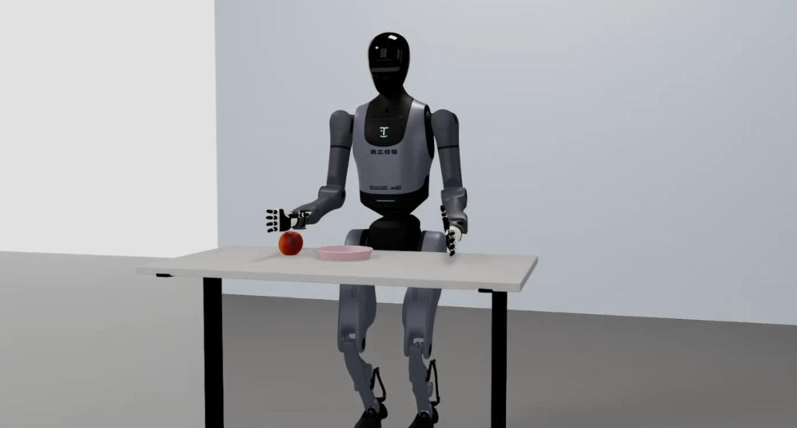

# Walker TienKung Pro

Walker TienKung Pro is a humanoid robot with 50 DOF and two 12-DOF five-finger dexterous hands.

## Specifications

| Item | Specification |
|------|------|
| DOF | 50 |
| End effectors | 2 × 12-DOF five-finger dexterous hands |
| Common training dimensions | 26D (both arms 7+7 + both hands 6+6) / 13D (right arm 7 + right hand 6, single arm) |
| LeRobot plugin | `ubt_IL/tienkung/lerobot_robot_tienkung` |
| USD model | `ubt_sim/assets/robots/tienkung_pro/tienkung_pro_v2.usd` |
| State/action order (26D) | `[left arm 7 | right arm 7 | left hand 6 | right hand 6]` |

> In single-arm data (for example, right-hand-only collection), the locked dimensions are constant, which breaks normalization during training (QUANTILES NaN/Inf). Convert such data with the 13D config to drop the dead dimensions.

## Simulation task

| Task ID | Scene | Description |
|---------|------|------|
| `UBTSim-TienkungPro-Parlor-v0` | Parlor | Apple-picking teleoperation + data collection (default) |

## Documentation

Platform entry points (shared architecture and commands are on the platform overview pages):

- [Simulation Platform · Walker TienKung Pro](sim-setup.md) - Container build, launching simulation, batch HDF5 collection, camera test, data preview ([platform overview](../sim/index.md))
- [Imitation Learning Platform · Walker TienKung Pro](convert-train.md) - HDF5 -> LeRobot conversion, ACT training, offline evaluation ([platform overview](../il/index.md))

In order of use:

1. [Simulation workflow](sim-workflow.md) - End to end: simulation collection -> conversion -> training -> evaluation -> sim deployment
2. [Real-robot workflow](real-workflow.md) - End to end: real collection -> conversion -> training -> evaluation -> real deployment
3. [ARM board deployment](arm-deploy.md) - Docker-free deployment on Jetson AGX Orin (dual Python stack)

## Deployment results

**Simulation**

<video src="../assets/tienkung仿真部署效果.mp4" controls muted width="100%"></video>

**Real robot**

<video src="../assets/tienkung真机部署效果.mp4" controls muted width="100%"></video>
