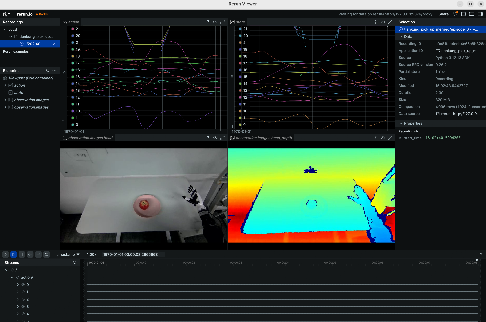
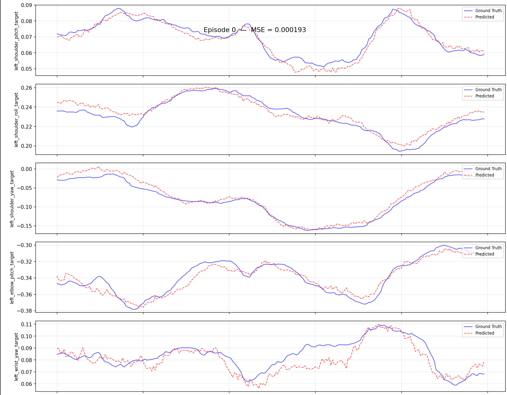

# Walker TienKung Pro Real-Robot Workflow: Collect -> Convert -> Train -> Evaluate -> Deploy

> Robot: **Walker TienKung Pro hardware**

This guide covers the complete, copy-pasteable flow from **raw real-robot HDF5** to a **LeRobot dataset**, **ACT training**, **offline evaluation**, and finally **real-robot deployment**. Conversion/training/evaluation run in the `ubt_IL` container; deployment offers a "container" option and a "Jetson host" option.

## Contents

- [0. Workflow overview](#0-workflow-overview)
- [1. Prerequisite: real-robot data collection](#1-prerequisite-real-robot-data-collection)
- [2. Start the container (ubt_IL)](#2-start-the-container)
- [3. Data conversion (HDF5 -> LeRobot)](#3-data-conversion)
  - [3.1 Conversion command](#31-conversion-command)
  - [3.2 Data visualization](#32-data-visualization)
- [4. Policy training](#4-model-training)
- [5. Policy evaluation (offline MSE)](#5-policy-evaluation)
- [6. Model deployment (real robot)](#6-real-robot-deployment)
  - [Option A: remote container (x86 workstation -> robot)](#6a-remote-container)
  - [Option B: on-robot Jetson AGX Orin](#6b-jetson-agx-orin)
- [7. FAQ](#7-faq)

---

<a id="0-workflow-overview"></a>

## 0. Workflow overview

```mermaid
Real-robot collection (hdf5) --> Data conversion (LeRobot dataset) --> Model training [train.sh ACT] --> Policy evaluation [eval_policy.py] --> Model deployment [rollout.sh] --> Real-robot deployment [robot]
```

---

<a id="1-prerequisite-real-robot-data-collection"></a>

## 1. Prerequisite: real-robot data collection

Data is currently collected with the [Thinker Studio](https://thinkercosmos.ubtrobot.com/#/studio) teleoperation platform (see the official documentation), which can export LeRobot v3.0 datasets directly. You can also place collected real-robot HDF5 data under `/ubt_IL/dataset/hdf5/` (or any `SRC_ROOT`) and proceed to conversion.

---

<a id="2-start-the-container"></a>

## 2. Start the container (ubt_IL)

```bash
cd ubt_IL/docker

# ⚠️ Must be checked before building: edit interfaceWhiteList in ubt_IL/docker/fastdds_no_shm.xml
# and set <address> to 192.168.41.99 (TienKung direct-link subnet). The file is copied into the image
# at build time, so changes after the build have no effect.
bash run.sh build      # first time
bash run.sh start
bash run.sh bash       # enter the container; run conversion/training/evaluation there
```

---

<a id="3-data-conversion"></a>

## 3. Data conversion (HDF5 -> LeRobot)

<a id="31-conversion-command"></a>

### 3.1 Conversion command

Script: `/ubt_IL/scripts/convert/tienkung_pro/convert.sh`
Configs: `/ubt_IL/scripts/convert/tienkung_pro/configs/`, including field filtering and mapping; choose or adapt one for your training needs.

```bash
# Real-robot conversion
SRC_ROOT=/ubt_IL/dataset/hdf5 \
TGT_PATH=/ubt_IL/dataset \
CONFIG=/ubt_IL/scripts/convert/tienkung_pro/configs/tienkung_pro_26d_1RGB_real.json \
REPO_ID=real_pick_place \
FPS=15 \
ROBOT_TYPE=tienkung \
TASK_NAME=real_pick_place \
bash /ubt_IL/scripts/convert/tienkung_pro/convert.sh

# Stationary frames can trap the policy in a local stationary loop; enable trimming with TRIM_STATIONARY=1
TRIM_STATIONARY=1 \
SRC_ROOT=/ubt_IL/dataset/hdf5 \
TGT_PATH=/ubt_IL/dataset \
CONFIG=/ubt_IL/scripts/convert/tienkung_pro/configs/tienkung_pro_26d_1RGB_real.json \
REPO_ID=real_pick_place \
FPS=15 \
ROBOT_TYPE=tienkung \
TASK_NAME=real_pick_place \
bash /ubt_IL/scripts/convert/tienkung_pro/convert.sh
```

**Environment variables** (defaults can be omitted; see `bash convert.sh -h` for the rest):

| Variable | Recommended for hardware | Description |
|------|-----------|------|
| `SRC_ROOT` | `/ubt_IL/dataset/hdf5` | Real HDF5 root (one subdirectory per episode containing `trajectory.hdf5`) |
| `TGT_PATH` | `/ubt_IL/dataset` (default) | LeRobot output root |
| `CONFIG` | `configs/tienkung_pro_26d_1RGB_real.json` | 26D dual arm, head RGB only, action mapped to `master` (gripper invert/repeat/pad); use `tienkung_pro_13d_1RGB.json` for 13D real models |
| `REPO_ID` | `real_pick_place` | Output dataset name (keep it consistent with training) |
| `FPS` | `15` | Target frame rate |
| `ROBOT_TYPE` | `tienkung` | Robot type |
| `TASK_NAME` | `real_pick_place` | Task name (written to each frame's `task` field and used as the language condition) |
| `VCODEC` | `h264` (default) | Video codec |
| `HDF5_REL_PATH` | `trajectory.hdf5` (default) | HDF5 path relative to each episode directory |
| `TRIM_STATIONARY` | Empty (off) / `1` | Stationary-frame trimming: truncate runs longer than the cap (default 8 frames) |
| `STATIONARY_DIAGNOSE` | Empty / `1` | Only report the stationary distribution without writing data (for threshold calibration) |
| `RESAMPLE_FPS` | Empty (no resampling) | Target frame rate; enables resampling |

> Multiple real-robot batches can be converted into the same `REPO_ID` and then merged (e.g. `real_merged`); use `tienkung_pro_13d_1RGB.json` for 13D real models.

**Output**: a LeRobot v3 dataset under `/ubt_IL/dataset/<REPO_ID>/` (`meta/`, `chunk-000/` data parquet, `videos/`).

<a id="32-data-visualization"></a>

### 3.2 Data visualization

Use `lerobot-dataset-viz` inside the container to inspect the converted dataset. Checking data before training is important to avoid training blindly:

```bash
# Inside the container:
HF_HUB_OFFLINE=1 lerobot-dataset-viz \
  --repo-id <dataset name> \
  --episode-index 0 \
  --root /ubt_IL/dataset/<dataset name>
```

Example:

```bash
# Visualize the merged TienKung pick-up dataset
HF_HUB_OFFLINE=1 lerobot-dataset-viz \
  --repo-id tienkung_pick_up_merged \
  --episode-index 0 \
  --root /ubt_IL/dataset/tienkung_pick_up_merged
```



> **Note**: `--root` must point to the dataset directory containing `meta/` (the `repo_id` directory itself), not its parent. `HF_HUB_OFFLINE=1` disables access to the HuggingFace Hub.

---

<a id="4-model-training"></a>

## 4. Policy training

Training script: `/ubt_IL/scripts/train/tienkung_pro/train.sh`
Configs: `/ubt_IL/scripts/train/tienkung_pro/configs/`; choose or adapt one for your training needs.

> **Note**: `train.sh` defaults `CONFIG_PATH` to the **simulation config**; real-robot training must specify `CONFIG_PATH` explicitly.

```bash
# Real-robot 26D training (common config overrides)
CONFIG_PATH=/ubt_IL/scripts/train/tienkung_pro/configs/train_config_tienkung_pro_real_pick_place.json \
DATASET_REPO_ID=tienkung_pick_up_merged \
DATASET_ROOT=/ubt_IL/dataset/tienkung_pick_up_merged \
OUTPUT_DIR=/ubt_IL/model/tienkung_pick_up_merged \
bash /ubt_IL/scripts/train/tienkung_pro/train.sh

# Resume (CONFIG_PATH points to train_config.json inside the checkpoint)
CONFIG_PATH=/ubt_IL/model/tienkung_pick_up_merged/checkpoints/last/pretrained_model/train_config.json \
RESUME=true \
bash /ubt_IL/scripts/train/tienkung_pro/train.sh
```

**Without train.sh** (call `lerobot-train` directly with `--xxx=yyy` overrides; run from `/ubt_IL/lerobot`):

```bash
# Train from scratch
cd /ubt_IL/lerobot
HF_HUB_OFFLINE=1 /lerobot/.venv/bin/lerobot-train \
  --config_path=/ubt_IL/scripts/train/tienkung_pro/configs/train_config_tienkung_pro_real_pick_place.json \
  --dataset.repo_id=tienkung_pick_up_merged \
  --dataset.root=/ubt_IL/dataset/tienkung_pick_up_merged \
  --output_dir=/ubt_IL/model/tienkung_pick_up_merged

# Resume
HF_HUB_OFFLINE=1 /lerobot/.venv/bin/lerobot-train \
  --config_path=/ubt_IL/model/tienkung_pick_up_merged/checkpoints/last/pretrained_model/train_config.json \
  --resume=true
```

**Common overrides** (environment variables for `train.sh`; unset values come from the config file):

| Variable | Config default | Description |
|------|-----|------|
| `CONFIG_PATH` | Simulation config (`train_config_tienkung_pro_sim_pick_place.json`) | Training config JSON; **real-robot training must specify the real config explicitly** |
| `DATASET_REPO_ID` / `DATASET_ROOT` | `tienkung_pick_up_merged` / `/ubt_IL/dataset/tienkung_pick_up_merged` | Dataset name / root (`DATASET_ROOT` must be the dataset directory containing `meta/`, matching the conversion `REPO_ID`) |
| `OUTPUT_DIR` | `/ubt_IL/model/tienkung_pick_up_merged` | Model output directory (checkpoints under `checkpoints/last/pretrained_model/`) |
| `STEPS` | `100000` | Training steps |
| `SAVE_FREQ` | `10000` | Checkpoint save interval (steps) |
| `BATCH_SIZE` | `8` | Batch size |
| `RESUME` | `false` | Resume training (`true` makes `CONFIG_PATH` point to `train_config.json` inside the checkpoint) |

---

<a id="5-policy-evaluation"></a>

## 5. Policy evaluation (offline MSE)

Script: `/ubt_IL/scripts/eval/eval_policy.py`. It runs offline inference over a LeRobot dataset, computes the per-frame MSE between **predicted and ground-truth actions**, and can plot per-episode comparisons. Quantify policy quality before deployment.

```bash
# Inside the container (LeRobot venv Python)
/lerobot/.venv/bin/python /ubt_IL/scripts/eval/eval_policy.py \
  --policy-path /ubt_IL/model/tienkung_pick_up_act/checkpoints/last/pretrained_model \
  --dataset-path /ubt_IL/dataset/tienkung_pick_up_merged \
  --episodes 5 \
  --inference-freq 1 \
  --plot \
  --plot-dir /ubt_IL/scripts/eval/output/eval_tienkung_pick_up_act \
  --output /ubt_IL/scripts/eval/output/eval_tienkung_pick_up_act/results.json \
  --device cuda
```

Example output (per-episode prediction vs ground truth):



**Main arguments**:

| Argument | Description |
|------|------|
| `--policy-path` | Trained ACT checkpoint (the `pretrained_model` directory) |
| `--dataset-path` | LeRobot dataset root (containing `meta/info.json`) |
| `--episodes` | Number of episodes to evaluate (default: all) |
| `--inference-freq` | Run inference every N steps to emulate the deployment chunk queue; defaults to `policy.n_action_steps`; `1` means every step |
| `--plot` / `--plot-dir` | Per-episode prediction-vs-ground-truth plots (PNG) |
| `--output` | Result JSON (summary + per-episode MSE) |
| `--device` | `cuda` (default; falls back to `cpu` when unavailable) |

Output: the console prints Mean/Std/Min/Max MSE and per-joint MSE; `--output` saves the result JSON and `--plot` saves comparison plots.

---

<a id="6-real-robot-deployment"></a>

## 6. Model deployment (real robot)

#### Prerequisites:
 - The robot is powered on and in half-body motion-control mode.
 - Operation sequence: power on and press A for self-check -> press D to home -> place the robot on the ground, hold A to enter standing mode -> toggle F down and hold A to enter half-body motion control -> toggle E up and proceed. See the [TienKung operation guide](https://docs.ubtrobot.com/walker-tienkung/docs/user-guide/8) for remote details.

<a id="6a-remote-container"></a>

### Option A: remote container (x86 workstation -> robot)

#### Preparation:

 - Make sure the workstation and robot are on the same subnet (e.g. `192.168.41.x`). Set `ROS_DOMAIN_ID=0` and verify the deployment machine can subscribe to robot ROS topics.
 - Start ImageServer on the robot to provide the JPEG stream.

```bash
# 0. Build the container
# ⚠️ Robot-specific: check the network config before building. Edit interfaceWhiteList in
# ubt_IL/docker/fastdds_no_shm.xml and set <address> to 192.168.41.99 (TienKung direct-link
# subnet) so it matches the robot subnet. The file is copied into the image at build time;
# changes after the build have no effect, so edit before building.
cd ubt_IL/docker
bash run.sh build
bash run.sh start
bash run.sh bash

# 0.1 Verify the network config after building
echo $FASTRTPS_DEFAULT_PROFILES_FILE
cat /opt/fastdds_no_shm.xml
bash run.sh restart

# 1. Start the camera service on the robot (real deployment only)
# Note: tienkung_pro has three control boards (motion x86, Orin1, Orin2 at 192.168.41.1/2/3);
# the camera must run on Orin1. SSH: ssh nvidia@192.168.41.2 (password: nvidia).
scp ubt_IL/scripts/deploy/tienkung_pro/image_server.py nvidia@192.168.41.2:~
ssh nvidia@192.168.41.2 'python3 image_server.py'
python3 /ubt_IL/scripts/deploy/tienkung_pro/image_client.py --server 192.168.41.2 	# test camera path (127.0.0.1 is the simulator default)

# If the pyorbbec camera driver is not installed on the robot, install the dependencies
python3 -m pip install evdev
python3 -m pip install pyorbbecsdk2
```
#### Deployment inference:

Script: `/ubt_IL/scripts/deploy/tienkung_pro/rollout.sh`

```bash
# 1. Initialize the pose (raise the arm above the table) -- inference container; /usr/bin/python3 has ROS access
/usr/bin/python3 /ubt_IL/scripts/deploy/tienkung_pro/reset.py

# 2. Real deployment: set ZMQ_HOST to the robot address (rollout.sh defaults to the simulator 127.0.0.1)
POLICY_PATH=/ubt_IL/model/tienkung_pick_up_act/checkpoints/100000/pretrained_model \
JOINT_CONFIG=tienkung_26 \
ZMQ_HOST=192.168.41.2 \
TASK="pick and place" \
FPS=15 \
DURATION=60 \
bash /ubt_IL/scripts/deploy/tienkung_pro/rollout.sh

# (Optional) Replay dataset actions on hardware
/usr/bin/python3 /ubt_IL/scripts/deploy/tienkung_pro/replay.py \
  --dataset /ubt_IL/dataset/tienkung_pick_up_merged --episode 0 --rate 30
```

**Environment variables**:

| Variable | Recommended for hardware | Description |
|------|-----------|------|
| `POLICY_PATH` | `/ubt_IL/model/tienkung_pick_up_act/checkpoints/last/pretrained_model` | Trained ACT checkpoint |
| `JOINT_CONFIG` | `tienkung_26` | 26D; use `tienkung_13` for 13D models, matching the training DOF |
| `STRATEGY` | `base` | Autonomous execution |
| `ZMQ_HOST` | `192.168.41.2` | **Robot address** (the script defaults to the simulator `127.0.0.1`; hardware must override it) |
| `FPS` | `15` | Control rate (aligned with training fps) |
| `DURATION` | `60` | Run time (seconds) |
| `TASK` | `pick and place` | Task description |

**Demo** (real-robot deployment):

<video src="../../assets/tienkung真机部署效果.mp4" controls muted width="100%"></video>

<a id="6b-jetson-agx-orin"></a>

### Option B: on-robot Jetson AGX Orin

Scripts: `/ubt_IL/scripts/deploy/tienkung_pro/arm_64/` (self-contained bundle; see [ARM board deployment](arm-deploy.md))

> Target: Jetson AGX Orin (192.168.41.2). A conda env `env_vla` (Python 3.12) runs LeRobot, and system Python 3.10 runs the camera/ROS 2 side; the two are decoupled over ZMQ.

```bash
# 0. Environment setup
ssh nvidia@192.168.41.2   # password: nvidia
mkdir /home/nvidia/vla/   # create the working directory
# Copy the project code here
scp *project code* nvidia@192.168.41.2:/home/nvidia/vla/
# Build the conda env env_vla
cd /home/nvidia/vla/Thinker-IL-LAB/ubt_IL/scripts/deploy/tienkung_pro/arm_64
bash setup_env.sh

# 1. Start the camera service on the robot (real deployment only)
conda activate env_vla
bash /home/nvidia/vla/Thinker-IL-LAB/ubt_IL/scripts/deploy/tienkung_pro/arm_64/image_server_host.sh

# If the pyorbbec camera driver is not installed on the robot (install once)
python3 -m pip install evdev
python3 -m pip install pyorbbecsdk2

# (Optional) Camera preview test
bash /home/nvidia/vla/Thinker-IL-LAB/ubt_IL/scripts/deploy/tienkung_pro/arm_64/image_client_host.sh --show

# 2. Robot ready pose (raise the right arm)
bash /home/nvidia/vla/Thinker-IL-LAB/ubt_IL/scripts/deploy/tienkung_pro/arm_64/robot_ready.sh

# 3. Run inference
conda activate env_vla
# Deploy the 26-DOF model (default)
POLICY_PATH=/home/nvidia/vla/Thinker-IL-LAB/ubt_IL/model/tienkung_pick_up_act/checkpoints/100000/pretrained_model  DURATION=60 bash /home/nvidia/vla/Thinker-IL-LAB/ubt_IL/scripts/deploy/tienkung_pro/arm_64/rollout_host.sh

# 4. (Optional) Replay recorded actions on hardware
/usr/bin/python3 /home/nvidia/vla/Thinker-IL-LAB/ubt_IL/scripts/deploy/tienkung_pro/replay.py --dataset /home/nvidia/vla/Thinker-IL-LAB/ubt_IL/dataset/tienkung_pick_up_the_apple_all --episode 0 --rate 30
```

#### Key parameters

| Variable | Default | Description |
| --------------- | --------------------------------------------------------------------------------------- | ------------------------------------------------------- |
| `POLICY_PATH` | `$PROJECT_ROOT/model/tienkung_pick_up_act/checkpoints/last/pretrained_model` | ACT checkpoint |
| `JOINT_CONFIG`| `tienkung_26` | Joint DOF config (`tienkung_26` = full 26; `tienkung_13` = right arm 7 + right hand 6); custom configs are supported and must match the training DOF |
| `STRATEGY` | `base` | Inference strategy (`base` autonomous; `sentry`/`highlight`/`dagger` for recording or interaction) |
| `TASK` | `sim_pick_place` | Task description (injected as the policy condition) |
| `ZMQ_HOST` | `127.0.0.1` | image_server address (change to the robot IP when the camera runs there) |
| `DURATION` | `60` | Run time (seconds) |
| `FPS` | `30` | Control loop rate (aligned with training fps) |
| `DISPLAY_CAM` | `true` | Camera display (set `false` for SSH without X) |

---

<a id="7-faq"></a>

## 7. FAQ

| Symptom | Possible cause / fix |
|------|-----------------|
| Conversion reports a missing depth stream | Real HDF5 has no depth; use `tienkung_pro_26d_1RGB_real.json` (RGB only). Using the sim config reports a missing `camera_head_depth` |
| Action dimensions are wrong after conversion | The real `master` gripper is mapped to 6D via invert/repeat/pad; confirm the real config was used, not the sim config |
| Normalization explodes during training (QUANTILES NaN/Inf) | Constant dimensions (e.g. the commanded-but-frozen left arm in 26D) give std=0 and division by zero; convert with the 13D config (`tienkung_pro_13d_1RGB.json`) to drop dead dimensions |
| Long stationary segments (prefix/tail) | Stationary frames trap the policy; add `TRIM_STATIONARY=1` during conversion |
| Training raises `FileExistsError` | `OUTPUT_DIR` already exists with `RESUME=false`; use a new directory or delete the old one |
| Real deployment does not respond | Is `ZMQ_HOST` pointing to the robot `192.168.41.2` (script default 127.0.0.1)? Is Bridge2 running (`pgrep -f ros2_deploy_bridge`)? Is the robot control board powered and networked? |
| Real deployment motion is wrong | `JOINT_CONFIG` does not match the training DOF (26D ↔ 13D); camera path unverified (run `image_client.py` first) |
| Real deployment motion stops | The policy may be stuck in a local loop; improve the dataset to reduce pauses |
| Jetson inference crashes (numpy) | numpy was upgraded to 2.x; rerun `setup_env.sh` and keep `numpy==1.26.4` |
| `conda activate` fails on Jetson | In non-interactive shells, run `source $CONDA_BASE/etc/profile.d/conda.sh` before activating (the scripts handle this) |
