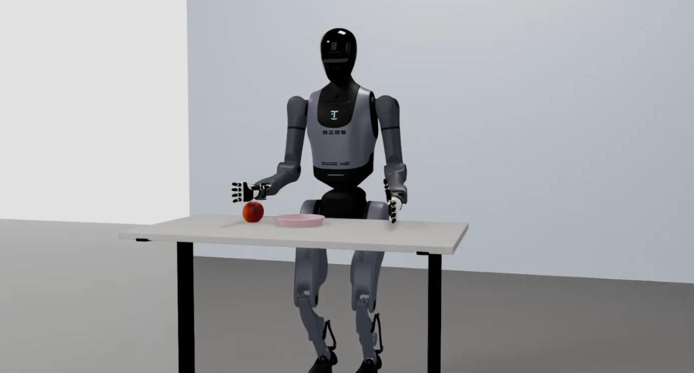
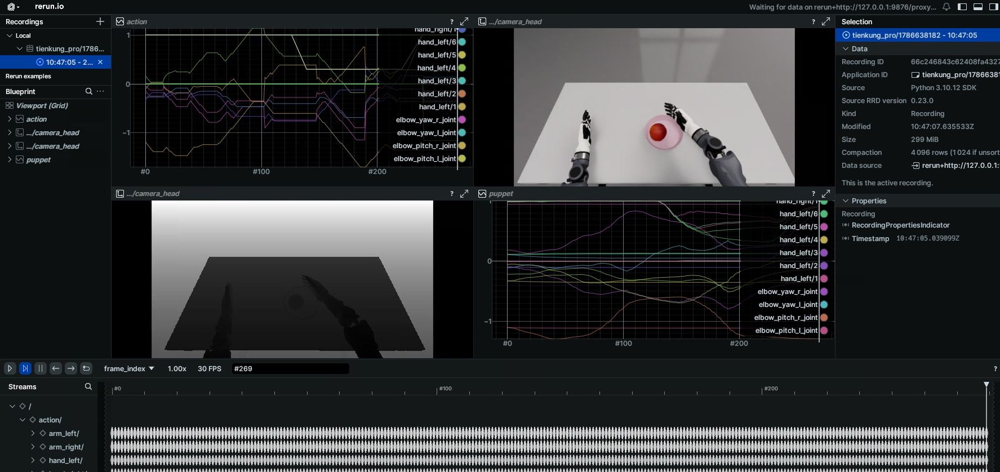

# Walker TienKung Pro: Simulation Platform

The Walker TienKung Pro simulation is built on NVIDIA Isaac Sim (Isaac Lab 2.2.0). A ROS2-ZMQ bridge publishes simulation state and images on **exactly the same ROS 2 topics as the real robot**, enabling sim-to-real consistent teleoperation and data collection. The whole environment runs in a Docker container.



## Quick start

> Commands are split into two parts: build/enter the container on the **host**; launch simulation and collect data inside the **container** (container root is `/ubt_sim`).

### 1. Build and start the container (host)

See [Simulation Platform · Container Setup](../sim/docker.md) for `build` / `start` / `init` / `check` / `bash`.

> ⚠️ **Must be changed before building**: edit `interfaceWhiteList` in `ubt_sim/docker/fastdds_no_shm.xml` and set `<address>` to `192.168.41.99` (the TienKung direct-link subnet). The file is copied into the image at build time; changes after the build have no effect.

### 2. Launch simulation (container)

```bash
bash run.sh bash                       # enter the container (ROS 2 environment sourced automatically)
bash /ubt_sim/scripts/start_sim.sh     # launch simulation and start the ROS2-ZMQ bridge automatically
```

- The simulation loads `UBTSim-TienkungPro-Parlor-v0` (parlor apple picking).
- Press **`R`** to reset the robot (1 s debounce).
- When the simulation window closes, the exit trap in `start_sim.sh` stops the bridge automatically.

Demo (pick-and-place task):

<video src="../../assets/tienkung.mp4" controls muted width="100%"></video>

Common environment variables/arguments (combinable):

| Variable | Purpose | Default |
| --- | --- | --- |
| `UBT_SIM_TASK` | Task name (also determines the robot type) | `UBTSim-TienkungPro-Parlor-v0` |
| `--headless` | Run without a window | Common on headless servers |
| `--perf_stats` | Print performance statistics | Frame-rate debugging |
| `--device cpu\|cuda\|cuda:N` | Execution device | For switching GPUs outside load-only mode |

### 3. Data collection (container, system Python 3.10)

```bash
/usr/bin/python3 /ubt_sim/teleoperation/control/tienkung_pro/reset.py                  # reset the robot to zero
/usr/bin/python3 /ubt_sim/teleoperation/control/tienkung_pro/pick_place_save_data.py   # one pick-and-place + recording
bash /ubt_sim/teleoperation/control/tienkung_pro/save_data.sh                # batch loop (400 iterations by default)
```

- **`reset.py`**: resets the robot pose only.
- **`pick_place_save_data.py`**: performs one complete pick-and-place (random apple position → grasp → place → return) and records both arms/hands, actions, head RGB+depth images, and timestamps at 15 Hz. It saves only when the **task succeeds** (apple in the plate, distance < 0.12 m); failed episodes are discarded with exit code 1.
- **`save_data.sh`**: calls `pick_place_save_data.py` in a loop for batch collection.
- Output: `/ubt_sim/dataset/tienkung_pro/<timestamp>/trajectory.hdf5`.
- Use `--headless` during collection to increase rendering speed and improve dataset throughput.

### 4. Camera test (container)

```bash
# Test the direct camera stream
python3 /ubt_sim/teleoperation/image/image_client.py
# Test the ROS 2 image path and save 3 JPEGs
/usr/bin/python3 /ubt_sim/teleoperation/image/test_ros_image.py
```

The direct JPEG stream from simulation (`127.0.0.1:5558`, published by the simulation process without the bridge) opens a window showing the head camera and prints latency/drop statistics. Simulation must already be running.

### 5. Dataset preview and playback (container)

Reads `dataset/tienkung_pro/<timestamp>/trajectory.hdf5`, previews cameras + joint curves (Rerun), or replays recorded actions on simulation/hardware topics.



```bash
# Preview an HDF5 episode
/usr/bin/python3 /ubt_sim/teleoperation/tools/playback_tienkung_pro.py \
    --episode dataset/tienkung_pro/1786638182 --mode preview --web-port 9090

# Action playback (simulation/hardware)
/usr/bin/python3 /ubt_sim/teleoperation/tools/playback_tienkung_pro.py \
    --episode dataset/tienkung_pro/1786638182 --mode control
```

See [Playback](../common/playback.md) for all options and safety notes.

## Simulation modules

| Module | Path | Description |
| --- | --- | --- |
| Docker orchestration | `ubt_sim/docker/run.sh` | Image build, container lifecycle, bridge start/stop |
| Environment variables | `ubt_sim/docker/env.sh` | Container name, image, `ROS_DOMAIN_ID` |
| Simulation launcher | `ubt_sim/scripts/start_sim.sh` | Detects the robot, starts the bridge, launches `sim_runner.py` |
| Task definition | `ubt_sim/source/ubt_sim/task/tienkung_pro_parlor/` | Parlor apple-picking scene and rewards |
| Runtime config | `ubt_sim/config/tienkung_pro/parlor.yaml` | Scene/camera/device parameters |
| ROS2-ZMQ bridge | `ubt_sim/teleoperation/bridges/tienkung_pro/` | Bridge script + `bridge_config.yaml` |
| Teleoperation and collection | `ubt_sim/teleoperation/control/tienkung_pro/` | `reset.py` / `pick_place_save_data.py` / `save_data.sh` |
| Camera client | `ubt_sim/teleoperation/image/image_client.py` | Direct JPEG stream (5558) debugging |
| Data output | `ubt_sim/dataset/tienkung_pro/<timestamp>/trajectory.hdf5` | Collected episodes |

## ZMQ ports

| Port | Purpose |
| --- | --- |
| 5555 | Control commands (bridge PUB) |
| 5556 | Robot state (bridge SUB) |
| 5557 | Raw camera images (C++ bridge) |
| 5558 | Direct JPEG (published by simulation, no bridge) |

See [Architecture · ZMQ ports](../architecture.md#zmq-ports) for the cross-robot overview.

## Troubleshooting

- **`bash run.sh check` reports errors**: follow the prompt and rerun `bash run.sh init`; verify `numpy<2`, `bodyctrl_msgs`, and the **Walker SDK ROS 2 message packages**.
- **Collection script fails to import rclpy / message types**: use `/usr/bin/python3`, not Isaac Sim Python, and confirm `bash run.sh init` built the message packages.
- **`save_data.sh` trips the consecutive-failure breaker**: usually the bridge is not ready. Verify the simulation window is running and the bridge process exists (`pgrep -f tienkung_pro_ros2_zmq_bridge`), or run `bash run.sh bridge-start` separately.
- **X11 unavailable / no simulation window**: run `xhost +` on the host and verify `DISPLAY` is forwarded; on headless machines only `UBT_SIM_LOAD_ONLY=1` preview is available.

After collection, continue with [Imitation Learning Platform](convert-train.md).
