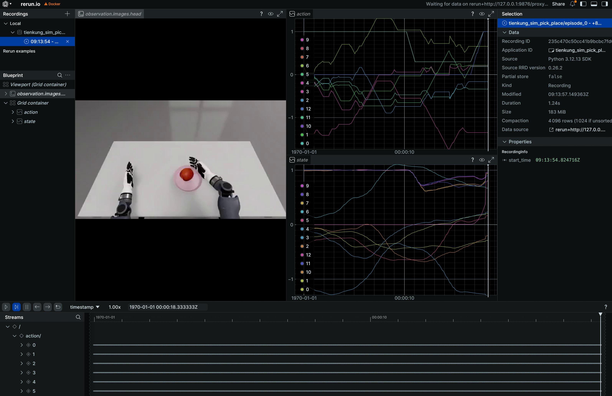
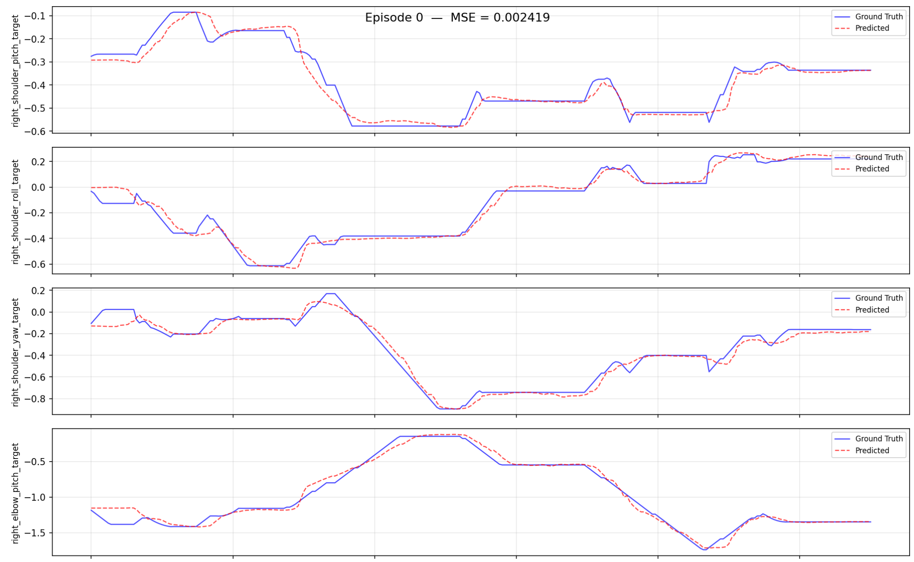

# Walker TienKung Pro Simulation Workflow: Collect -> Convert -> Train -> Evaluate -> Deploy

> Robot: **Walker TienKung Pro**
> Data source: **Isaac Sim collection** (`ubt_sim`)
> Container: `lerobot-tienkung` (built/started by `docker/run.sh`, project mounted at `/ubt_IL`)

This guide covers the complete, reproducible workflow from **raw simulation HDF5** to a **LeRobot dataset**, **ACT training**, **offline evaluation**, and finally **simulator deployment**. All conversion/training/evaluation/deployment scripts run inside the `ubt_IL` container.

## Contents

- [0. Workflow overview](#0-workflow-overview)
- [1. Prerequisite: simulation collection (ubt_sim)](#1-prerequisite-simulation-collection)
- [2. Start the container (ubt_IL)](#2-start-the-container)
- [3. Data conversion (HDF5 -> LeRobot)](#3-data-conversion)
  - [3.1 Conversion command](#31-conversion-command)
  - [3.2 Data visualization](#32-data-visualization)
- [4. Policy training](#4-model-training)
- [5. Policy evaluation (offline MSE)](#5-policy-evaluation)
- [6. Model deployment (simulation)](#6-sim-deployment)
- [7. FAQ](#7-faq)

---

<a id="0-workflow-overview"></a>

## 0. Workflow overview

```mermaid

Simulation collection (hdf5) --> Data conversion (LeRobot dataset) --> Model training [train.sh ACT] --> Policy evaluation [eval_policy.py] --> Model deployment [rollout.sh feedback] --> Simulator deployment [Isaac Sim]

```

---

<a id="1-prerequisite-simulation-collection"></a>

## 1. Prerequisite: simulation collection (ubt_sim)

Simulation HDF5 data is collected by **`ubt_sim`** (see [Simulation Platform](sim-setup.md)). Key points:

```bash
# ① Inside the ubt_sim container, start simulation (starts the ROS2-ZMQ bridge automatically)
bash /ubt_sim/scripts/start_sim.sh          # add --headless to speed up collection

# ② Collect data (system Python 3.10)
/usr/bin/python3 /ubt_sim/teleoperation/control/tienkung_pro/reset.py                  # reset
bash /ubt_sim/teleoperation/control/tienkung_pro/save_data.sh                          # batch loop (400 iterations by default)
```

- An episode is saved only after a successful pick-and-place (apple in the plate, distance < 0.12 m); failures are discarded with exit code 1.
- Output: `/ubt_sim/dataset/tienkung_pro/<timestamp>/trajectory.hdf5`.

After collection, place the HDF5 data where the container can access it (e.g. `/ubt_IL/dataset/tienkung_pro/`, the default `SRC_ROOT` in section 3), then proceed to conversion.

---

<a id="2-start-the-container"></a>

## 2. Start the container (ubt_IL)

```bash
cd ubt_IL/docker
bash run.sh build      # first time
bash run.sh start
bash run.sh bash       # enter the container; run the remaining commands there
```

---

<a id="3-data-conversion"></a>

## 3. Data conversion (HDF5 -> LeRobot)

<a id="31-conversion-command"></a>

### 3.1 Conversion command

Script: `/ubt_IL/scripts/convert/tienkung_pro/convert.sh`
Configs: `/ubt_IL/scripts/convert/tienkung_pro/configs/`, including field filtering and mapping; choose or adapt one for your training needs.

```bash
# Simulation conversion
CONFIG=/ubt_IL/scripts/convert/tienkung_pro/configs/Tien_Kung_13_1RGB_sim.json \
SRC_ROOT=/ubt_IL/dataset/tienkung_pro \
TGT_PATH=/ubt_IL/dataset \
REPO_ID=tienkung_sim_pick_place \
TASK_NAME=tienkung_sim_pick_place \
bash /ubt_IL/scripts/convert/tienkung_pro/convert.sh

# Stationary frames can trap the policy in a local stationary loop; enable trimming with TRIM_STATIONARY=1
TRIM_STATIONARY=1 \
CONFIG=/ubt_IL/scripts/convert/tienkung_pro/configs/Tien_Kung_13_1RGB_sim.json \
SRC_ROOT=/ubt_IL/dataset/tienkung_pro \
TGT_PATH=/ubt_IL/dataset \
REPO_ID=tienkung_sim_pick_place \
TASK_NAME=tienkung_sim_pick_place \
bash /ubt_IL/scripts/convert/tienkung_pro/convert.sh
```

**Environment variables** (defaults can be omitted; see `bash convert.sh -h` for the rest):

| Variable | Recommended for simulation | Description |
|------|-----------|------|
| `SRC_ROOT` | `/ubt_IL/dataset/tienkung_pro` (default) | Simulation HDF5 root (one subdirectory per episode containing `trajectory.hdf5`) |
| `TGT_PATH` | `/ubt_IL/dataset` (default) | LeRobot output root |
| `CONFIG` | `configs/Tien_Kung_13_1RGB_sim.json` | 13D single arm + single hand, one RGB; use `tienkung_pro_26d_1RGB.json` for dual-arm 26D |
| `REPO_ID` | `tienkung_sim_pick_place` | Output dataset name (keep it consistent with training) |
| `FPS` | `15` | Target frame rate |
| `ROBOT_TYPE` | `tienkung` | Robot type |
| `TASK_NAME` | `tienkung_sim_pick_place` | Task name (written to each frame's `task` field and used as the language condition) |
| `VCODEC` | `h264` | Video codec |
| `HDF5_REL_PATH` | `trajectory.hdf5` (default) | HDF5 path relative to each episode directory |
| `TRIM_STATIONARY` | Empty (off) / `1` | Stationary-frame trimming: truncate runs longer than the cap (default 8 frames) |
| `STATIONARY_DIAGNOSE` | Empty / `1` | Only report the stationary distribution without writing data (for threshold calibration) |
| `RESAMPLE_FPS` | Empty (no resampling) | Target frame rate; enables resampling |

**Output**: a LeRobot v3 dataset under `/ubt_IL/dataset/<REPO_ID>/` (`meta/`, `chunk-000/` data parquet, `videos/`).

<a id="32-data-visualization"></a>

### 3.2 Data visualization

Use `lerobot-dataset-viz` inside the container to inspect the converted dataset. Checking data before training is important to avoid training blindly:

```bash
# Inside the container:
HF_HUB_OFFLINE=1 lerobot-dataset-viz \
  --repo-id <dataset name> \
  --episode-index 0 \
  --root /ubt_IL/dataset/<dataset name>
```

Example:

```bash
# Visualize the dataset converted in section 3.1
HF_HUB_OFFLINE=1 lerobot-dataset-viz \
  --repo-id tienkung_sim_pick_place \
  --episode-index 0 \
  --root /ubt_IL/dataset/tienkung_sim_pick_place
```



> **Note**: `--root` must point to the dataset directory containing `meta/` (the `repo_id` directory itself), not its parent. `HF_HUB_OFFLINE=1` disables access to the HuggingFace Hub.

---

<a id="4-model-training"></a>

## 4. Policy training

Training script: `/ubt_IL/scripts/train/tienkung_pro/train.sh`
Configs: `/ubt_IL/scripts/train/tienkung_pro/configs/`; choose or adapt one for your training needs.

```bash
# Train with the default config
bash /ubt_IL/scripts/train/tienkung_pro/train.sh

# Specify a config path explicitly and override common parameters
CONFIG_PATH=/ubt_IL/scripts/train/tienkung_pro/configs/train_config_tienkung_pro_sim_pick_place.json \
OUTPUT_DIR=/ubt_IL/model/tienkung_sim_pick_place_act \
STEPS=80000 SAVE_FREQ=20000 BATCH_SIZE=8 \
bash /ubt_IL/scripts/train/tienkung_pro/train.sh

# Resume (CONFIG_PATH points to train_config.json inside the checkpoint)
CONFIG_PATH=/ubt_IL/model/tienkung_sim_pick_place_act/checkpoints/last/pretrained_model/train_config.json \
RESUME=true \
bash /ubt_IL/scripts/train/tienkung_pro/train.sh
```

**Without train.sh** (call `lerobot-train` directly and use `--xxx=yyy` overrides; run from `/ubt_IL/lerobot`):

```bash
# Train from scratch
cd /ubt_IL/lerobot
HF_HUB_OFFLINE=1 /lerobot/.venv/bin/lerobot-train \
  --config_path=/ubt_IL/scripts/train/tienkung_pro/configs/train_config_tienkung_pro_sim_pick_place.json \
  --output_dir=/ubt_IL/model/tienkung_sim_pick_place_act \
  --steps=80000 --save_freq=20000 --batch_size=8

# Resume
HF_HUB_OFFLINE=1 /lerobot/.venv/bin/lerobot-train \
  --config_path=/ubt_IL/model/tienkung_sim_pick_place_act/checkpoints/last/pretrained_model/train_config.json \
  --resume=true
```

**Common overrides** (environment variables for `train.sh`; unset values come from the config file):

| Variable | Config default | Description |
|------|-----|------|
| `CONFIG_PATH` | `configs/train_config_tienkung_pro_sim_pick_place.json` | Training config JSON (the `train.sh` default) |
| `DATASET_REPO_ID` / `DATASET_ROOT` | `tienkung_sim_pick_place` / `/ubt_IL/dataset/tienkung_sim_pick_place` | Dataset name / root (must match the conversion `REPO_ID` in section 3) |
| `OUTPUT_DIR` | `/ubt_IL/model/tienkung_sim_pick_place_act` | Model output directory (checkpoints under `checkpoints/last/pretrained_model/`) |
| `STEPS` | `50000` | Training steps |
| `SAVE_FREQ` | `10000` | Checkpoint save interval (steps) |
| `BATCH_SIZE` | `16` | Batch size |
| `RESUME` | `false` | Resume training (`true` makes `CONFIG_PATH` point to `train_config.json` inside the checkpoint) |

---

<a id="5-policy-evaluation"></a>

## 5. Policy evaluation (offline MSE)

Script: `/ubt_IL/scripts/eval/eval_policy.py`. It runs offline inference over a LeRobot dataset, computes the per-frame MSE between **predicted and ground-truth actions**, and can plot per-episode comparisons. Quantify policy quality before deployment.

```bash
# Inside the container (LeRobot venv Python)
/lerobot/.venv/bin/python /ubt_IL/scripts/eval/eval_policy.py \
  --policy-path /ubt_IL/model/tienkung_sim_pick_place_right13_act/checkpoints/last/pretrained_model \
  --dataset-path /ubt_IL/dataset/tienkung_sim_pick_place \
  --episodes 5 \
  --inference-freq 1 \
  --plot \
  --plot-dir /ubt_IL/scripts/eval/output/eval_tienkung_sim_pick_place_right13_act \
  --output /ubt_IL/scripts/eval/output/eval_tienkung_sim_pick_place_right13_act/results.json \
  --device cuda

```

Example output (per-episode prediction vs ground truth):



**Main arguments**:

| Argument | Description |
|------|------|
| `--policy-path` | Trained ACT checkpoint (the `pretrained_model` directory) |
| `--dataset-path` | LeRobot dataset root (containing `meta/info.json`) |
| `--episodes` | Number of episodes to evaluate (default: all) |
| `--inference-freq` | Run inference every N steps to emulate the deployment chunk queue; defaults to `policy.n_action_steps`; `1` means every step |
| `--plot` / `--plot-dir` | Per-episode prediction-vs-ground-truth plots (PNG) |
| `--output` | Result JSON (summary + per-episode MSE) |
| `--device` | `cuda` (default; falls back to `cpu` when unavailable) |

Output: the console prints Mean/Std/Min/Max MSE and per-joint MSE; `--output` saves the result JSON and `--plot` saves comparison plots.

---

<a id="6-sim-deployment"></a>

## 6. Model deployment (simulation)

Script: `/ubt_IL/scripts/deploy/tienkung_pro/rollout.sh`. Simulation deployment uses the `ubt_sim` module instead of the real robot. It exposes the same ROS topics and communication method as hardware, so it validates the policy before real deployment and avoids damage from incorrect motions. The simulation container runs independently and communicates with the training/inference container over the local loopback `127.0.0.1`. See [Simulation Platform](sim-setup.md) for simulation usage.

**Deployment steps** (run in the simulation and inference containers separately):

```bash
# 1. Start simulation (skip if already running) -- host, enter the simulation container
cd ubt_sim/docker 
bash run.sh start
bash run.sh bash
bash /ubt_sim/scripts/start_sim.sh      # inside the container: start simulation and the ROS2-ZMQ bridge

# 2. Start the inference container -- host
cd ubt_IL/docker
bash run.sh start
bash run.sh bash

# 3. Initialize the pose (raise the arm above the table) -- inference container; /usr/bin/python3 has ROS access
/usr/bin/python3 /ubt_IL/scripts/deploy/tienkung_pro/reset.py

# Deploy the 13-DOF model (right arm 7 + right hand 6, matching the conversion config)
POLICY_PATH=/ubt_IL/model/tienkung_sim_pick_place_right13_act/checkpoints/last/pretrained_model \
  JOINT_CONFIG=tienkung_13 bash /ubt_IL/scripts/deploy/tienkung_pro/rollout.sh

# (Optional) Verify the camera path
python /ubt_IL/scripts/deploy/tienkung_pro/image_client.py --count 60

# (Optional) Replay dataset actions in simulation
/usr/bin/python3 /ubt_IL/scripts/deploy/tienkung_pro/replay.py \
  --dataset /ubt_IL/dataset/tienkung_sim_pick_place --episode 0 --rate 30
```

**Environment variables**:

| Variable | Recommended for simulation | Description |
|------|-----------|------|
| `POLICY_PATH` | `/ubt_IL/model/tienkung_sim_pick_place_act/checkpoints/last/pretrained_model` | Trained ACT checkpoint |
| `JOINT_CONFIG` | `tienkung_26` | 26D; use `tienkung_13` for 13D models, matching the training DOF |
| `STRATEGY` | `base` | Autonomous execution |
| `ZMQ_HOST` | `127.0.0.1` | **Simulator address** (hardware uses `192.168.41.2`) |
| `FPS` | `15` | Control rate (aligned with training fps) |
| `DURATION` | `60` | Run time (seconds) |
| `TASK` | `sim pick and place` | Task description |

After deployment, watch the simulated robot execute the pick-and-place policy; use `reset.py` to reset and `replay.py` to validate playback.

Demo:

<video src="../../assets/tienkung仿真部署效果.mp4" controls muted width="100%"></video>

---

<a id="7-faq"></a>

## 7. FAQ

| Stage | Symptom | Possible cause / fix |
|------|------|-----------------|
| Collection | Many duplicate frames, low frame rate | Reduce the number of rendered cameras, use headless collection, or use a high-performance multi-GPU machine |
| Collection | Normalization explodes during training (QUANTILES NaN/Inf) | Constant dimensions: the left arm is commanded-but-frozen in 26D and the left gripper is always 1.0, so std=0 causes division by zero. Convert with the 13D single-arm config (`Tien_Kung_13_1RGB_sim.json`) to drop dead dimensions |
| Collection | Long stationary segments (prefix/tail) | Stationary frames trap the policy; add `TRIM_STATIONARY=1` during conversion |
| Conversion | `FileNotFoundError` (HDF5) | Wrong `SRC_ROOT`; make sure HDF5 was synced from ubt_sim to a container-accessible directory |
| Training | Occasional non-convergence | Insufficient simulation data; increase `save_data.sh` iterations; confirm `image_transforms` is enabled for generalization |
| Deployment | No camera image | Simulator not running / camera stream not started; verify the 5558 path with `image_client.py` |
| Deployment | Motion stutters | Try asynchronous inference with RTC trajectory blending |
| Deployment | Motion stops | The policy may be stuck in a local loop; improve the dataset to reduce pauses |
| Deployment | Simulator does not respond | Check whether the bridge is running and whether loopback networking is connected |
