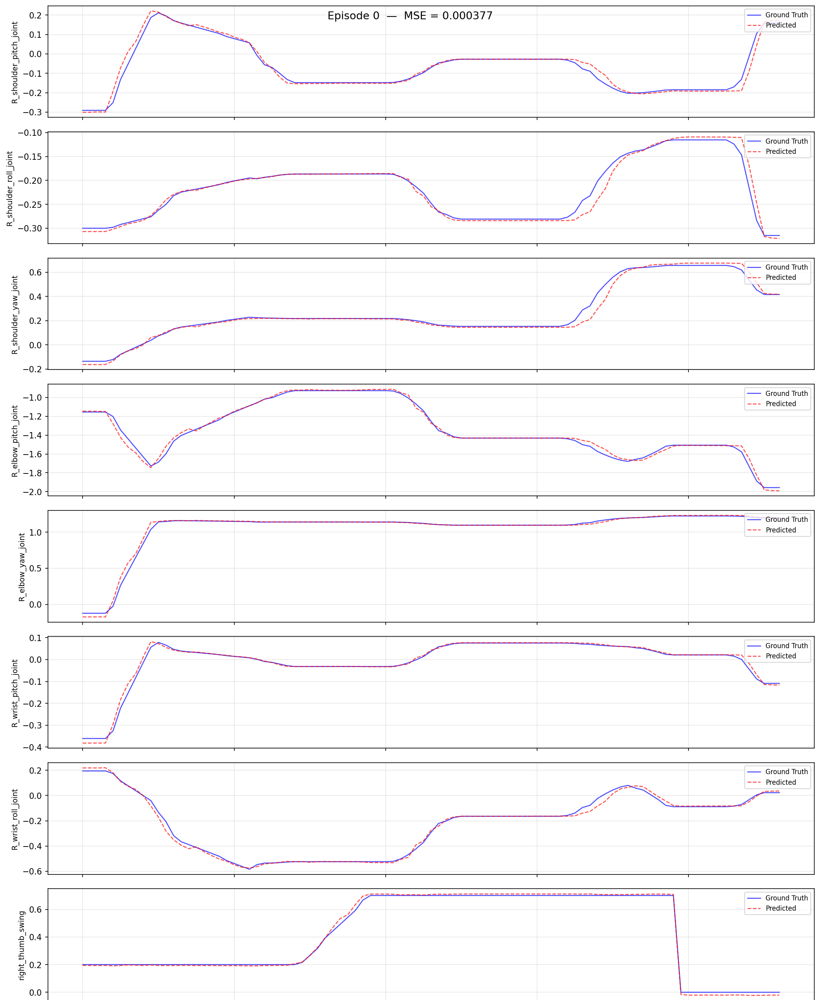

# Walker C1 EDU: Imitation Learning Platform

> Code: `ubt_IL/scripts/{convert,train,eval,deploy}/walker_c1/` (run inside the container)
> Prerequisite: repository cloned and submodules initialized as described in [Getting Started](../getting-started.md); HDF5 data ready ([simulation collection](sim-setup.md) or real-robot collection)

This page documents the shared conversion/training/evaluation/deployment workflow and configuration parameters for Walker C1 EDU. Data-source-specific commands are embedded in the corresponding workflow pages.

## 1. Environment (ubt_IL container)

See [Imitation Learning Platform · Container Setup](../il/docker.md) for `build` / `start` / `check` / `bash`.

- The host project is mounted at `/ubt_IL`; `entrypoint.sh` installs `lerobot` and `lerobot_robot_walker_c1` (editable) and builds/loads `mc_task_msgs` / `mc_state_msgs` (reusing the `walker_s2/walker_sdk_ros2` workspace).
- Communication: LeRobot (Python 3.12) —ZMQ `5661`/`5662`—> Bridge2 (system Python 3.10) —ROS 2 DDS—> robot/simulator. Images go through `walker_c1_camera_relay.py` over ZMQ `5663`.
- **Thor (C1 onboard compute)** is detected by `docker/run.sh`, which switches to `Dockerfile.thor` (L4T r38 / sm_110). Do **not** use the Orin `Dockerfile.arm64`.
- `bash run.sh check` should report `[OK] walker_c1 plugin` / `[OK] walker_c1 bridge` / `[OK] walker ROS2 msgs` / `[OK] torch`; the RMW line is `[INFO]`.
- If the plugin is missing, reinstall it manually: `python /ubt_IL/walker_c1/init_walker_c1.py` (expects `Robot type: walker_c1` / `Camera type: walker_c1_camera`).

## 2. Data conversion (HDF5 -> LeRobot)

Script: `/ubt_IL/scripts/convert/walker_c1/convert.sh` (shared converter `convert/common/convert_to_lerobot.py`). It converts raw HDF5 data into a LeRobot v3 dataset at `/ubt_IL/dataset/<REPO_ID>/`.

**Conversion command**:

```bash
DIM=26 \
CONFIG=/ubt_IL/scripts/convert/walker_c1/configs/walker_c1_sim_26d_1RGB.json \
SRC_ROOT=/ubt_IL/dataset/walker_c1 \
TGT_PATH=/ubt_IL/dataset \
REPO_ID=walker_c1_sim_26d_1RGB \
TASK_NAME=walker_c1_sim_pick_place \
bash /ubt_IL/scripts/convert/walker_c1/convert.sh --overwrite
```

**Examples**:

- Simulation data: [Simulation workflow · Data conversion](sim-workflow.md#3-data-conversion)
- Real-robot data: [Real-robot workflow · Data conversion](real-workflow.md#4-data-conversion)

Conversion configs in `/ubt_IL/scripts/convert/walker_c1/configs/`:

| Config | Dimension | Image | Scenario |
|----------|------|------|------|
| `walker_c1_sim_26d_1RGB.json` | 26D (both arms 14 + both hands 12) | 3×240×320 | Simulation (default, `DIM=26`) |
| `walker_c1_sim_13d_1RGB.json` | 13D (right arm 7 + right hand 6) | 3×240×320 | Simulation, single-arm task (`DIM=13`) |
| `walker_c1_real_26d_1RGB.json` | 26D | 3×512×640 | Real robot |
| `walker_c1_real_13d_1RGB.json` | 13D | 3×512×640 | Real robot (**verified**, 30 fps) |

**Common environment variables** (defaults can be omitted; see `bash convert.sh -h` and [Data Conversion](../common/data-conversion.md)):

| Variable | Description |
|------|------|
| `SRC_ROOT` | HDF5 root (default `/ubt_IL/dataset/walker_c1`; falls back to `/ubt_sim/dataset/walker_c1` if absent) |
| `TGT_PATH` | LeRobot output root (default `/ubt_IL/dataset`) |
| `CONFIG` | Conversion config JSON (defaults to a sim config based on `DIM`) |
| `DIM` | `26` (default) / `13`; determines the default `CONFIG` and `REPO_ID` |
| `REPO_ID` | Output dataset name (default `walker_c1_sim_<DIM>d_1RGB`; keep it consistent with training) |
| `TASK_NAME` | Task name (default `walker_c1_sim_pick_place`, written to each frame's `task` field) |
| `FPS` | Target frame rate (default `15`; use `FPS=30` for 30 fps real-robot data) |
| `ROBOT_TYPE` | Robot type (default `walker_c1`, written to metadata) |
| `VCODEC` | Video codec (default `h264`) |
| `HDF5_REL_PATH` | HDF5 path relative to each episode directory (default `trajectory.hdf5`) |
| `TAIL_TRIM` | Drop N frames from the end of each episode (default `10`). C1 ends with a fast release → retreat → ready reset; without trimming, the policy learns to fling the arm after finishing the task. |
| `TRIM_STATIONARY` | `1` enables stationary-frame trimming (see below) |
| `STATIONARY_DIAGNOSE` | `1` only reports the stationary distribution without writing data (for threshold calibration) |
| `RESAMPLE_FPS` | Target frame rate; enables resampling when set (disabled by default) |

!!! tip "Stationary-frame trimming"
    Stationary frames in a dataset can trap the policy in a local stationary loop. Set `TRIM_STATIONARY=1` to trim stationary runs longer than the cap (default 8 frames). Prefix the conversion command with `TRIM_STATIONARY=1 \`.

**Output**: a LeRobot v3 dataset under `/ubt_IL/dataset/<REPO_ID>/` (`meta/`, `chunk-000/` data parquet, `videos/`).

## 3. Data visualization

After conversion, inspect dataset quality with `lerobot-dataset-viz`. Checking data before training is important to avoid training on bad data:

```bash
HF_HUB_OFFLINE=1 lerobot-dataset-viz \
  --repo-id <REPO_ID> \
  --episode-index 0 \
  --root /ubt_IL/dataset/<REPO_ID>
```

> **Note**: `--root` must point to the dataset directory containing `meta/` (the `repo_id` directory itself), not its parent. `HF_HUB_OFFLINE=1` disables access to the HuggingFace Hub.


**Examples**: [Simulation workflow · Visualization](sim-workflow.md#32-data-visualization) / [Real-robot workflow · Visualization](real-workflow.md#42-data-visualization).

## 4. Policy training (ACT)

Training script: `/ubt_IL/scripts/train/walker_c1/train.sh`; configs in `/ubt_IL/scripts/train/walker_c1/configs/`.

**Training command** (optional overrides are listed below; unset values come from the config file):

```bash
CONFIG=/ubt_IL/scripts/train/walker_c1/configs/train_config_walker_c1_sim_act_26d_1RGB.json \
DATASET_REPO_ID=walker_c1_sim_26d_1RGB \
OUTPUT_DIR=/ubt_IL/model/walker_c1_sim_26d_act_1RGB \
STEPS=30000 SAVE_FREQ=5000 BATCH_SIZE=8 \
bash /ubt_IL/scripts/train/walker_c1/train.sh
```

Training configs (ACT; `chunk_size=n_action_steps=100` depending on the config):

| Config | Dataset | Steps / save interval | Batch |
|----------|--------|------------------|-------|
| `train_config_walker_c1_sim_act_26d_1RGB.json` | `walker_c1_sim_26d_1RGB` | 30000 / 5000 | 8 |
| `train_config_walker_c1_sim_act_13d_1RGB.json` | `walker_c1_sim_13d_1RGB` | 30000 / 10000 | 8 |
| `train_config_walker_c1_real_act_13d_1RGB.json` | `walker_c1_real_13d_1RGB` | 30000 / 10000 | 8 |

> ⚠️ `train.sh` defaults to the **simulation 26D config**. For real-robot training you must set `CONFIG=` explicitly.

**Smoke test and resume**:

```bash
# Smoke test: 2 steps, no checkpoint
bash /ubt_IL/scripts/train/walker_c1/train.sh --steps=2 --save_checkpoint=false

# Resume (CONFIG points to train_config.json inside the checkpoint)
CONFIG=/ubt_IL/model/walker_c1_sim_26d_act_1RGB/checkpoints/last/pretrained_model/train_config.json \
RESUME=true \
bash /ubt_IL/scripts/train/walker_c1/train.sh
```

**Without train.sh** (call `lerobot-train` directly from `/ubt_IL/lerobot`):

```bash
cd /ubt_IL/lerobot
HF_HUB_OFFLINE=1 /lerobot/.venv/bin/lerobot-train \
  --config_path=/ubt_IL/scripts/train/walker_c1/configs/train_config_walker_c1_sim_act_26d_1RGB.json \
  --output_dir=/ubt_IL/model/walker_c1_sim_26d_act_1RGB \
  --steps=30000 --save_freq=5000 --batch_size=8
```

**Common overrides** (only applied when the environment variable is set; `HF_HUB_OFFLINE=1` is enabled by default):

| Variable | Description |
|------|------|
| `CONFIG` | Training config JSON (default `train_config_walker_c1_sim_act_26d_1RGB.json`) |
| `DATASET_REPO_ID` / `DATASET_ROOT` | Dataset name / root (must match the conversion `REPO_ID`) |
| `OUTPUT_DIR` | Model output directory (checkpoints under `checkpoints/<step>/pretrained_model/`) |
| `STEPS` / `SAVE_FREQ` | Training steps / checkpoint interval |
| `BATCH_SIZE` / `SEED` | Batch size / random seed |
| `DEVICE` | Training device (default `cuda`) |
| `RESUME` | Resume training (default `false`) |
| `WANDB_ENABLE` | Enable wandb logging (default `false`) |

## 5. Policy evaluation (offline MSE)

Script (shared by all robots): `/ubt_IL/scripts/eval/eval_policy.py`. It runs offline inference over a LeRobot dataset, computes the per-frame MSE between **predicted and ground-truth actions**, and can plot per-episode comparisons. Quantify policy quality before deployment.

**Evaluation command**:

```bash
/lerobot/.venv/bin/python /ubt_IL/scripts/eval/eval_policy.py \
  --policy-path /ubt_IL/model/walker_c1_sim_26d_act_1RGB/checkpoints/last/pretrained_model \
  --dataset-path /ubt_IL/dataset/walker_c1_sim_26d_1RGB \
  --episodes 5 \
  --inference-freq 15 \
  --plot \
  --plot-dir /ubt_IL/scripts/eval/output/eval_walker_c1_sim_26d_act \
  --output /ubt_IL/scripts/eval/output/eval_walker_c1_sim_26d_act/results.json \
  --device cuda
```

`--inference-freq 15` emulates a 15 Hz deployment cadence; `1` means step-by-step inference.



| Argument | Description |
|------|------|
| `--policy-path` | Trained ACT checkpoint (the `pretrained_model` directory) |
| `--dataset-path` | LeRobot dataset root (containing `meta/info.json`) |
| `--episodes` | Number of episodes to evaluate (default: all) |
| `--inference-freq` | Run inference every N steps to emulate the deployment chunk queue; defaults to `policy.n_action_steps`; `1` means every step |
| `--plot` / `--plot-dir` | Per-episode prediction-vs-ground-truth plots (PNG) |
| `--output` | Result JSON (summary + per-episode MSE) |
| `--device` | `cuda` (default; falls back to `cpu` when unavailable) |

Once evaluation passes, continue with [§6 Model deployment](#6-model-deployment).

## 6. Model deployment

Script: `/ubt_IL/scripts/deploy/walker_c1/rollout.sh`. It loads a checkpoint and sends actions to Isaac Sim or the real robot through the ROS2-ZMQ bridge. A **dimension precheck** runs before deployment, and `sdk_guard.sh` validates the half_sdk state. Helper tools: `robot_ready.sh` (three-stage ready pose), `robot_home.sh` (return home), `preview_camera.py` (camera path check), `inference_server.sh` (warm-started inference service).

**Deployment command** (optional variables are listed below; unset values use script defaults):

```bash
WALKER_C1_REAL=1 \
POLICY_PATH=<checkpoint pretrained_model directory> \
ROBOT_MODEL=walker_c1_13d \
DURATION=10 FPS=30 \
  bash /ubt_IL/scripts/deploy/walker_c1/rollout.sh
```

**Deployment guides**:

- Simulation deployment (feedback into the simulator; recommended first): [Simulation workflow · Sim deployment](sim-workflow.md#6-sim-deployment)
- Real-robot deployment (half_sdk guard and safety precheck): [Real-robot workflow · Deployment](real-workflow.md#6-deployment) · [Real-robot deployment](deploy.md)
- Inference server (warm start / external calls): [Inference server](inference-server.md)

**Common environment variables**:

| Variable | Default | Description |
|------|------|------|
| `POLICY_PATH` | **Required, no default** | Checkpoint directory (containing `config.json`) |
| `ROBOT_MODEL` | Real: `walker_c1_13d` / sim: `walker_c1_26d` | ROBOT_MODELS key (also used as `--robot.joint_config`); **must match the training DOF** |
| `ROBOT_CONFIG` | `configs/<ROBOT_MODEL>.json` | Hardware config JSON |
| `ROBOT_TYPE` | `walker_c1` | Plugin registration name |
| `WALKER_C1_REAL` | `1` | `1` = real robot (13d/task/act_async/guard/real camera); `0` = simulation/offline |
| `EPISODES` | `1` | Number of episodes; the base strategy does not support multi-episode runs, so values >1 use an outer loop with a reset per episode |
| `DURATION` | `30` | Maximum seconds per episode |
| `FPS` | `15` | Control rate (use `FPS=30` for 30 fps datasets) |
| `RESET_MODE` | Real: `task` / sim: `sim-scene` | Reset before each episode: `sim-scene` / `task` / `both` / `none` |
| `INFERENCE_TYPE` | Real: `act_async` / sim: `sync` | `sync` / `act_async` (chunk -> bridge blending at 300 Hz) |
| `INFERENCE_HZ` | Real: `1` / sim: `2` | act_async replanning rate |
| `EXECUTION_HORIZON` | `0` | Truncate act_async chunks after N steps (0 = no truncation) |
| `CAMERA_TOPIC` / `CAMERA_MSG_TYPE` | Real: head left + `shm_msgs/Image6m` | Simulation must override to `/sensor/camera/head/color/raw` + `sensor_msgs/Image` |
| `SDK_GUARD` | Real: `1` / sim: `auto` | half_sdk guard: `1` enforce / `auto` only when a real robot is detected / `0` skip |
| `SDK_AUTO_SWITCH` | `0` | `1` = run `sdk_mode.sh half_sdk` automatically when the guard fails, then recheck |
| `WALKER_C1_SINGLE_ACTION_SMOOTH_S` | `0.15` | Smoothing window (seconds) for a single `sync` action; only affects `sync`; `0` triggers a warning |

See [Real-robot deployment](deploy.md) for all variables, the ROBOT_MODELS registry, and safety prechecks.

## 7. FAQ

| Symptom | Fix |
|------|------|
| `joint_config 'walker_c1_26d' not registered` | Plugin not installed: `python /ubt_IL/walker_c1/init_walker_c1.py` |
| Conversion fails with a dimension mismatch (`31 6`) | The data was not collected by ubt_sim walker_c1; verify the source or set `CONFIG=` explicitly |
| Training fails because a camera key is missing | `observation.images.camera_head` was not written; check `meta/info.json` |
| Normalization explodes (QUANTILES NaN/Inf) | Constant dimensions in the data (the left hand stays near 0 in this task). Use the 13D config or drop dead dimensions |
| rollout precheck reports a dimension mismatch | Policy dimension and `ROBOT_MODEL` disagree; confirm whether training used the 26D or 13D dataset |
| Camera timeout | Check the topic name, `ROS_DOMAIN_ID`, and QoS (must be BEST_EFFORT); on the real robot use `head_stereo_left/color/raw` + `shm_msgs/Image6m` |
| `torch.cuda.is_available()` is False | The container lacks `NVIDIA_VISIBLE_DEVICES` / `NVIDIA_DRIVER_CAPABILITIES`; start it with `run.sh start` |
| The left hand never moves | The left hand stays near 0 in the current collection batch (the task only uses the right hand); this is expected |
