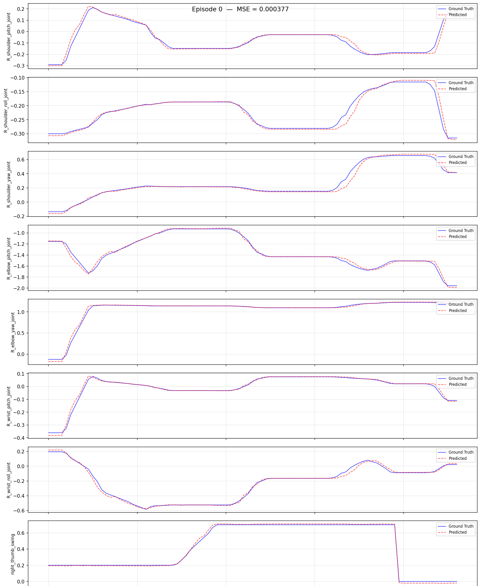

# Walker C1 EDU 共创者：模仿学习平台

> 对应代码：`ubt_IL/scripts/{convert,train,eval,deploy}/walker_c1/`（容器内执行）
> 前置：已按 [快速开始](../getting-started.md) 克隆代码并初始化子模块；HDF5 数据已就绪（[仿真采集](sim-setup.md)或真机采集）

本页维护 Walker C1 EDU 共创者 转换/训练/评估/部署的**通用流程与配置参数说明**；各环节的具体命令随数据来源嵌在对应工作流章节中，按需跳转。

## 1. 构建环境（ubt_IL 容器）

容器构建流程见 [模仿学习平台 · 容器构建与使用](../il/docker.md)（`build` / `start` / `check` / `bash`）。

- 宿主机项目挂载于容器 `/ubt_IL`；`entrypoint.sh` 自动安装 `lerobot` 与 `lerobot_robot_walker_c1`（editable），并编译/加载 `mc_task_msgs` / `mc_state_msgs`（复用 `walker_s2/walker_sdk_ros2` 工作空间）。
- 通信链路：LeRobot（Python 3.12）—ZMQ `5661`/`5662`—> Bridge2（系统 Python 3.10）—ROS2 DDS—> 机器人/仿真器；相机经 `walker_c1_camera_relay.py` 走 ZMQ `5663`。
- **Thor 机型（C1 本体）**由 `docker/run.sh` 自动切到 `Dockerfile.thor`（L4T r38 / sm_110），**不要**用 Orin 的 `Dockerfile.arm64`。
- `bash run.sh check` 应包含：`[OK] walker_c1 plugin` / `[OK] walker_c1 bridge` / `[OK] walker ROS2 msgs` / `[OK] torch`；RMW 行为 `[INFO]`。
- 插件缺失时可手动重装：`python /ubt_IL/walker_c1/init_walker_c1.py`（应输出 `Robot type: walker_c1` / `Camera type: walker_c1_camera`）。

## 2. 数据转换（HDF5 -> LeRobot）

脚本：`/ubt_IL/scripts/convert/walker_c1/convert.sh`（统一转换器 `convert/common/convert_to_lerobot.py`），将 HDF5 原始数据转换为 LeRobot v3 数据集（产物位于 `/ubt_IL/dataset/<REPO_ID>/`）。

**转换指令**：

```bash
DIM=26 \
CONFIG=/ubt_IL/scripts/convert/walker_c1/configs/walker_c1_sim_26d_1RGB.json \
SRC_ROOT=/ubt_IL/dataset/walker_c1 \
TGT_PATH=/ubt_IL/dataset \
REPO_ID=walker_c1_sim_26d_1RGB \
TASK_NAME=walker_c1_sim_pick_place \
bash /ubt_IL/scripts/convert/walker_c1/convert.sh --overwrite
```

**示例**（跳转查看）：

- 仿真数据：[仿真全流程 · 数据转换](sim-workflow.md#3-数据转换hdf5---lerobot)
- 真机数据：[真机全流程 · 数据转换](real-workflow.md#4-数据转换hdf5---lerobot)

转换配置在 `/ubt_IL/scripts/convert/walker_c1/configs/` 下：

| 配置文件 | 维度 | 图像 | 场景 |
|----------|------|------|------|
| `walker_c1_sim_26d_1RGB.json` | 26D（双臂 14 + 双手 12） | 3×240×320 | 仿真（默认，`DIM=26`） |
| `walker_c1_sim_13d_1RGB.json` | 13D（右臂 7 + 右手 6） | 3×240×320 | 仿真单臂任务（`DIM=13`） |
| `walker_c1_real_26d_1RGB.json` | 26D | 3×512×640 | 真机 |
| `walker_c1_real_13d_1RGB.json` | 13D | 3×512×640 | 真机（**已验证**，30 fps） |

**常用环境变量**（标「默认」的可省略；完整列表 `bash convert.sh -h`，通用说明见 [数据转换详解](../common/data-conversion.md)）：

| 变量 | 说明 |
|------|------|
| `SRC_ROOT` | HDF5 存放根目录（默认 `/ubt_IL/dataset/walker_c1`；不存在时自动回退 `/ubt_sim/dataset/walker_c1`） |
| `TGT_PATH` | LeRobot 数据集输出根目录（默认 `/ubt_IL/dataset`） |
| `CONFIG` | 转换配置 JSON（缺省按 `DIM` 自动选择 sim 配置） |
| `DIM` | `26`（默认）/ `13`，决定默认 `CONFIG` 与 `REPO_ID` |
| `REPO_ID` | 输出数据集名称（默认 `walker_c1_sim_<DIM>d_1RGB`，训练时保持一致） |
| `TASK_NAME` | 任务名称（默认 `walker_c1_sim_pick_place`，写入每帧 `task` 字段） |
| `FPS` | 目标帧率（默认 `15`；真机 30 fps 数据用 `FPS=30`） |
| `ROBOT_TYPE` | 机器人类型（默认 `walker_c1`，写入 meta） |
| `VCODEC` | 视频编码器（默认 `h264`） |
| `HDF5_REL_PATH` | HDF5 相对 episode 目录的路径（默认 `trajectory.hdf5`） |
| `TAIL_TRIM` | 裁掉每集末尾 N 帧（默认 `10`）；C1 末段是 release → retreat → ready 快速复位动作，不裁会让策略学到任务完成后猛甩手臂 |
| `TRIM_STATIONARY` | `1` 开启静止帧裁剪（见下） |
| `STATIONARY_DIAGNOSE` | `1` 只统计静止分布不写盘（校准阈值用） |
| `RESAMPLE_FPS` | 目标帧率，设置后启用重采样（默认不重采样） |

!!! tip "静止帧裁剪"
    数据集静止帧会使模型推理陷入局部静止，可开启 `TRIM_STATIONARY=1` 裁剪（静止游程超过 cap 时截断，默认 cap 8 帧）。在转换命令前加 `TRIM_STATIONARY=1 \` 即可。

**转换产物**：`/ubt_IL/dataset/<REPO_ID>/` 下生成 LeRobot v3 数据集（`meta/`、`chunk-000/`（data parquet）、`videos/`）。

## 3. 数据可视化

转换完成后用 `lerobot-dataset-viz` 检查数据集质量，训练前检查数据质量非常重要，避免盲目训练：

```bash
HF_HUB_OFFLINE=1 lerobot-dataset-viz \
  --repo-id <REPO_ID> \
  --episode-index 0 \
  --root /ubt_IL/dataset/<REPO_ID>
```

> **注意**：`--root` 须指向包含 `meta/` 目录的数据集路径（即 `repo_id` 目录本身），而非父目录。`HF_HUB_OFFLINE=1` 用于禁止访问 HuggingFace Hub。


**示例**（跳转查看）：[仿真全流程 · 数据可视化](sim-workflow.md#32-数据可视化) / [真机全流程 · 数据可视化](real-workflow.md#42-数据可视化)。

## 4. 模型训练（ACT）

训练脚本：`/ubt_IL/scripts/train/walker_c1/train.sh`；训练配置在 `/ubt_IL/scripts/train/walker_c1/configs/` 下。

**训练指令**（可选覆盖参数见下文表格，未设置时沿用配置文件内值）：

```bash
CONFIG=/ubt_IL/scripts/train/walker_c1/configs/train_config_walker_c1_sim_act_26d_1RGB.json \
DATASET_REPO_ID=walker_c1_sim_26d_1RGB \
OUTPUT_DIR=/ubt_IL/model/walker_c1_sim_26d_act_1RGB \
STEPS=30000 SAVE_FREQ=5000 BATCH_SIZE=8 \
bash /ubt_IL/scripts/train/walker_c1/train.sh
```

训练配置一览（ACT，`chunk_size=n_action_steps=100` 视配置而定）：

| 配置文件 | 数据集 | 步数 / 保存间隔 | batch |
|----------|--------|------------------|-------|
| `train_config_walker_c1_sim_act_26d_1RGB.json` | `walker_c1_sim_26d_1RGB` | 30000 / 5000 | 8 |
| `train_config_walker_c1_sim_act_13d_1RGB.json` | `walker_c1_sim_13d_1RGB` | 30000 / 10000 | 8 |
| `train_config_walker_c1_real_act_13d_1RGB.json` | `walker_c1_real_13d_1RGB` | 30000 / 10000 | 8 |

> ⚠️ `train.sh` 默认为**仿真 26D 配置**，真机训练必须用 `CONFIG=` 显式指定真机配置。

**冒烟与续训**：

```bash
# 冒烟测试：2 步、不落盘
bash /ubt_IL/scripts/train/walker_c1/train.sh --steps=2 --save_checkpoint=false

# 断点续训（CONFIG 指向 checkpoint 内 train_config.json）
CONFIG=/ubt_IL/model/walker_c1_sim_26d_act_1RGB/checkpoints/last/pretrained_model/train_config.json \
RESUME=true \
bash /ubt_IL/scripts/train/walker_c1/train.sh
```

**不使用 train.sh**（直接调用 `lerobot-train`，需在 `/ubt_IL/lerobot` 目录下执行）：

```bash
cd /ubt_IL/lerobot
HF_HUB_OFFLINE=1 /lerobot/.venv/bin/lerobot-train \
  --config_path=/ubt_IL/scripts/train/walker_c1/configs/train_config_walker_c1_sim_act_26d_1RGB.json \
  --output_dir=/ubt_IL/model/walker_c1_sim_26d_act_1RGB \
  --steps=30000 --save_freq=5000 --batch_size=8
```

**常用覆盖参数**（仅当环境变量显式设置时覆盖 config 中的值；`HF_HUB_OFFLINE=1` 默认开启）：

| 环境变量 | 说明 |
|------|------|
| `CONFIG` | 训练配置 JSON（默认 `train_config_walker_c1_sim_act_26d_1RGB.json`） |
| `DATASET_REPO_ID` / `DATASET_ROOT` | 数据集名称 / 根目录（与转换 `REPO_ID` 一致） |
| `OUTPUT_DIR` | 模型输出目录（checkpoint 在 `checkpoints/<step>/pretrained_model/` 下） |
| `STEPS` / `SAVE_FREQ` | 训练步数 / checkpoint 保存间隔 |
| `BATCH_SIZE` / `SEED` | 批大小 / 随机种子 |
| `DEVICE` | 训练设备（默认 `cuda`） |
| `RESUME` | 续训开关（默认 `false`） |
| `WANDB_ENABLE` | wandb 日志开关（默认 `false`） |

## 5. 策略评估（离线 MSE）

脚本（各机型共用）：`/ubt_IL/scripts/eval/eval_policy.py`，在 LeRobot 数据集上离线推理，逐帧对比**预测动作 vs 真值动作**的 MSE，并可生成逐 episode 对比图。部署前先量化策略质量。

**评估指令**：

```bash
/lerobot/.venv/bin/python /ubt_IL/scripts/eval/eval_policy.py \
  --policy-path /ubt_IL/model/walker_c1_sim_26d_act_1RGB/checkpoints/last/pretrained_model \
  --dataset-path /ubt_IL/dataset/walker_c1_sim_26d_1RGB \
  --episodes 5 \
  --inference-freq 15 \
  --plot \
  --plot-dir /ubt_IL/scripts/eval/output/eval_walker_c1_sim_26d_act \
  --output /ubt_IL/scripts/eval/output/eval_walker_c1_sim_26d_act/results.json \
  --device cuda
```

`--inference-freq 15` 模拟 15 Hz 部署节奏；`1` 为逐步推理。



| 参数 | 说明 |
|------|------|
| `--policy-path` | 训练的 ACT checkpoint（`pretrained_model` 目录） |
| `--dataset-path` | LeRobot 数据集根目录（含 `meta/info.json`） |
| `--episodes` | 评估 episode 数（默认全部） |
| `--inference-freq` | 每 N 步推理一次，模拟真实部署的 chunk 队列；默认取 `policy.n_action_steps`，`1` 为逐步推理 |
| `--plot` / `--plot-dir` | 逐 episode 预测-vs-真值对比图（PNG） |
| `--output` | 结果 JSON（summary + 逐 episode MSE） |
| `--device` | `cuda`（默认，不可用自动回退 `cpu`） |

评估通过后，进入 [§6 模型部署](#6-模型部署)。

## 6. 模型部署

脚本：`/ubt_IL/scripts/deploy/walker_c1/rollout.sh`，加载 checkpoint，经 ROS2-ZMQ 桥接将动作发给 Isaac Sim 或真机。部署前自动做**维度预检**，并与 `sdk_guard.sh` 配合校验 half_sdk 状态。配套工具：`robot_ready.sh`（三段摆位）、`robot_home.sh`（回 home）、`preview_camera.py`（相机通路验证）、`inference_server.sh`（常驻预热推理服务）。

**部署指令**（可选环境变量见下文表格，未设置时沿用脚本默认值）：

```bash
WALKER_C1_REAL=1 \
POLICY_PATH=<checkpoint 的 pretrained_model 目录> \
ROBOT_MODEL=walker_c1_13d \
DURATION=10 FPS=30 \
  bash /ubt_IL/scripts/deploy/walker_c1/rollout.sh
```

**具体部署方法**（跳转查看）：

- 仿真部署（回注仿真器验证，建议先做）：[仿真全流程 · 仿真部署](sim-workflow.md#6-仿真部署闭环验证)
- 真机部署（half_sdk 门禁与安全预检）：[真机全流程 · 部署](real-workflow.md#6-部署) · [真机部署](deploy.md)
- 推理服务器（常驻预热/外部调用）：[推理服务器](inference-server.md)

**常用环境变量**：

| 变量 | 默认 | 说明 |
|------|------|------|
| `POLICY_PATH` | **必填，无默认值** | checkpoint 目录（含 `config.json`） |
| `ROBOT_MODEL` | 真机 `walker_c1_13d` / 仿真 `walker_c1_26d` | ROBOT_MODELS 键（同时作为 `--robot.joint_config`），**须与训练 DOF 一致** |
| `ROBOT_CONFIG` | `configs/<ROBOT_MODEL>.json` | 硬件配置 JSON |
| `ROBOT_TYPE` | `walker_c1` | 插件注册名 |
| `WALKER_C1_REAL` | `1` | `1`=真机（含 13d/task/act_async/门禁/真机相机）；`0`=仿真/离线 |
| `EPISODES` | `1` | 集数；base strategy 不支持多集，>1 时由外层循环 + 每集复位实现 |
| `DURATION` | `30` | 每集最长秒数 |
| `FPS` | `15` | 控制频率（真机 30 fps 数据集用 `FPS=30`） |
| `RESET_MODE` | 真机 `task` / 仿真 `sim-scene` | 每集前复位：`sim-scene` / `task` / `both` / `none` |
| `INFERENCE_TYPE` | 真机 `act_async` / 仿真 `sync` | `sync` / `act_async`（chunk → bridge 融合 300 Hz） |
| `INFERENCE_HZ` | 真机 `1` / 仿真 `2` | act_async 重规划频率 |
| `EXECUTION_HORIZON` | `0` | act_async chunk 截断步数（0=不截断） |
| `CAMERA_TOPIC` / `CAMERA_MSG_TYPE` | 真机头左目 + `shm_msgs/Image6m` | 仿真需覆盖为 `/sensor/camera/head/color/raw` + `sensor_msgs/Image` |
| `SDK_GUARD` | 真机 `1` / 仿真 `auto` | half_sdk 门禁：`1` 强制 / `auto` 检测到真机才校验 / `0` 跳过 |
| `SDK_AUTO_SWITCH` | `0` | `1`=门禁不通过时自动执行 `sdk_mode.sh half_sdk` 再复检 |
| `WALKER_C1_SINGLE_ACTION_SMOOTH_S` | `0.15` | sync 单动作平滑窗口（秒）；仅影响 `sync`，置 0 会告警 |

完整环境变量、ROBOT_MODELS 注册表与安全预检说明见 [真机部署](deploy.md)。

## 7. 常见问题

| 现象 | 处理 |
|------|------|
| `joint_config 'walker_c1_26d' not registered` | 插件未安装：`python /ubt_IL/walker_c1/init_walker_c1.py` |
| 转换报「维度 = '31 6' 要求不符」 | 数据不是 ubt_sim walker_c1 采集；确认来源或 `CONFIG=` 显式指定 |
| 训练报相机 key 不存在 | 转换配置的 `observation.images.camera_head` 未被写入：检查 `meta/info.json` |
| 训练时归一化炸裂（QUANTILES NaN/Inf） | 数据含恒定维度（该任务左手全程 ≈0 属数据特性）；改用 13D 配置或剔除死维度 |
| rollout 预检维度不符 | 策略维度与 `ROBOT_MODEL` 不一致；确认训练用的是 26D 还是 13D 数据集 |
| 相机超时 | 话题名/`ROS_DOMAIN_ID`/QoS（必须 BEST_EFFORT）；真机是 `head_stereo_left/color/raw` + `shm_msgs/Image6m` |
| `torch.cuda.is_available()` 为 False | 容器缺 `NVIDIA_VISIBLE_DEVICES` / `NVIDIA_DRIVER_CAPABILITIES`；用 `run.sh start` 启动 |
| 左手完全不动 | 当前采集批次左手全程 ≈0（任务只用右手），属于数据特性 |
