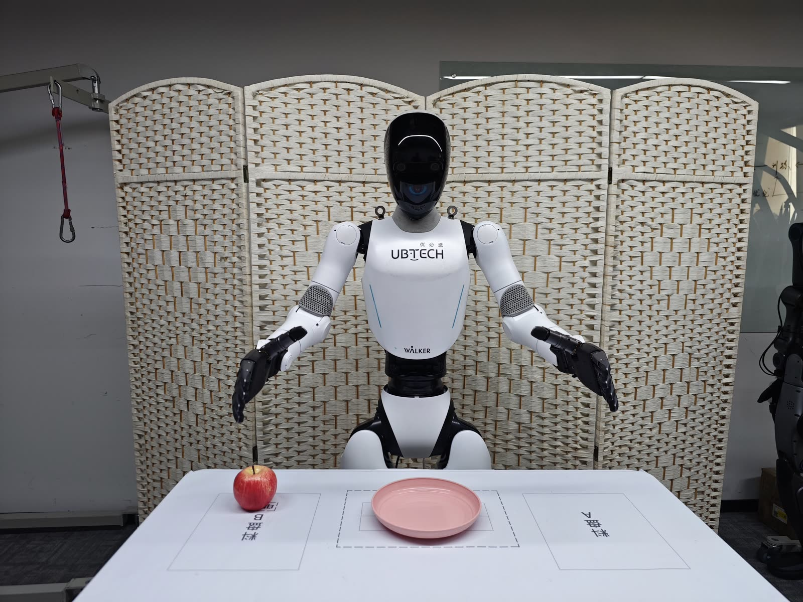
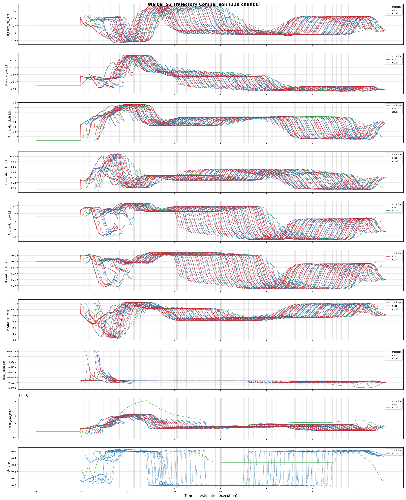

# Walker C1 EDU: Real-Robot Deployment (Rollout)

> Deployment script: `ubt_IL/scripts/deploy/walker_c1/rollout.sh`, shared by simulation and real-robot deployment (differences are described in the workflow pages). This page covers all parameters, the half_sdk guard, safety prechecks, and online evaluation.



## Prerequisites

- The robot is **powered, standing**, and switched to **developer mode + half_sdk** (C1 arms accept ROS 2 commands only in `HalfSdkActive`).
- Place the robot in a safe position; use `DURATION=10` for the first short validation; keep the emergency stop within reach.
- The real-robot deployment container runs on the robot's **Thor board**. Copy the project and model to the board, then build and start the container (`run.sh` detects Thor and switches to `Dockerfile.thor`).
- `ROS_DOMAIN_ID` defaults to `0` on hardware. DDS must match the main control stack (`rmw_cyclonedds_cpp` + `cyclonedds_thor.xml`, injected automatically by the container).

## Deployment matrix

| Scenario | Key command |
|------|----------|
| Real robot, 13D model (right arm + right hand) | `WALKER_C1_REAL=1 ROBOT_MODEL=walker_c1_13d` |
| Real robot, 26D model (both arms + both hands) | `WALKER_C1_REAL=1 ROBOT_MODEL=walker_c1_26d` |
| Feedback into simulation | `WALKER_C1_REAL=0 SDK_GUARD=0 RESET_MODE=sim-scene` |
| Long-running deployment | Use the [inference server](inference-server.md) (no cold start) |

## Deployment steps (real robot)

```bash
# 0. Switch to SDK control (developer mode -> legs STAND -> half_sdk; idempotent)
bash /ubt_IL/scripts/deploy/walker_c1/sdk_mode.sh half_sdk
bash /ubt_IL/scripts/deploy/walker_c1/sdk_mode.sh check      # 0 = deployable, 2 = not satisfied

# 1. Camera check (real head left, shm_msgs/Image6m)
python3 /ubt_IL/scripts/deploy/walker_c1/preview_camera.py --once --save-frame /tmp/c1.jpg \
  --msg-type image6m --topic /sensor/camera/head_stereo_left/color/raw

# 2. Move to the ready pose (three stages; dry-run first to inspect targets and durations)
bash /ubt_IL/scripts/deploy/walker_c1/robot_ready.sh --dry-run
bash /ubt_IL/scripts/deploy/walker_c1/robot_ready.sh

# 3. Deploy the real-robot 13D model (async inference)
WALKER_C1_REAL=1 SDK_GUARD=1 \
POLICY_PATH=/ubt_IL/model/walker_c1_real_13d_act_1RGB/checkpoints/last/pretrained_model \
ROBOT_MODEL=walker_c1_13d \
INFERENCE_TYPE=act_async INFERENCE_HZ=1 \
FPS=30 DURATION=10 \
  bash /ubt_IL/scripts/deploy/walker_c1/rollout.sh

# 4. Return home (14 arm joints at 0, arms straight down, hands open)
bash /ubt_IL/scripts/deploy/walker_c1/robot_home.sh --dry-run
bash /ubt_IL/scripts/deploy/walker_c1/robot_home.sh
```

## Demo

<video src="../../assets/walker-c1真机部署效果.mp4" controls muted width="100%"></video>

## SDK modes (half_sdk)

| `developModeState` | Arm commands | Notes |
|---|---|---|
| `NormalActive` (`normal`) | Ignored | Built-in motion control owns the body; only CC-API skills can be invoked |
| `HalfSdkActive` (`half_sdk`) | Executed | **The only mode for VLA**: SDK controls head/arms/waist, the system keeps balance (requires `legStatus=standing`) |
| `FullSdkActive` (`full_sdk`) | Executed | All motors handed over, built-in balance disabled; the robot must be suspended. **Do not use for VLA** |

```bash
bash sdk_mode.sh status     # work mode / motion permission / legs / e-stop
bash sdk_mode.sh check      # validate only, 0 = deployable, 2 = not satisfied
bash sdk_mode.sh half_sdk   # develop -> legs STAND -> half_sdk
bash sdk_mode.sh normal     # back to normal (keep developer mode)
bash sdk_mode.sh work-mode joystick   # exit developer mode
```

- By default commands run over SSH in the robot developer container (`ubt@192.168.11.3:2222`). For CI/scripted use, set `WALKER_C1_SDK_PASSWORD` for non-interactive login.
- `half_sdk` is idempotent: if already in half_sdk it only prints the state. If the legs are not `standing`, it first runs skill `A000004` to switch to STAND (`--no-leg-stand` disables this).

### Deployment guard

`rollout.sh`, `robot_ready.sh` / `robot_home.sh` (without `--dry-run`), and `inference_server.sh` call `sdk_guard.sh` before startup and refuse to run outside half_sdk:

```bash
SDK_GUARD=1        # real-robot default (1 when WALKER_C1_REAL=1): enforce
SDK_GUARD=auto     # validate only when a real robot is detected (simulation default)
SDK_GUARD=0        # skip (offline debugging only)
SDK_AUTO_SWITCH=1  # automatically run sdk_mode.sh half_sdk and recheck on failure
```

## Ready / home poses (robot_ready.sh / robot_home.sh)

| Command | Purpose |
|------|------|
| `robot_ready.sh` | Three-stage ready pose: raise shoulder → fold elbow → ready pose (≥5 s each) + open both hands |
| `robot_ready.sh --dry-run` | Print target poses and stage durations only |
| `robot_ready.sh --head-pitch 0.5` | Adjust the head-down angle (default 0.65 rad) |
| `robot_home.sh` | Three-stage exact reverse to home (all 14 arm joints at 0) |
| `robot_home.sh --dry-run` | Print targets only |

> The ready pose is an **absolute** target, not a zero position. When standing with arms hanging naturally, the hands are below the table, so the motion must be staged to avoid sweeping the hand across the table edge.

## Safety precheck

Before deployment, an **action-dimension precheck** runs: `output_features.action.shape[0]` must match the robot config `action_order` dimension, otherwise deployment is **refused**.

- `ROBOT_MODEL` must match the training DOF (see the table below).
- If the policy has no action names, set `ALLOW_DIM_ONLY_POLICY=1` (enabled by default).
- Hand limits are clipped on both the plugin and bridge sides (plugin `hand_joint_limits` → `to_bridge_config()` → bridge).

## Environment variables (rollout.sh)

| Variable | Default | Description |
|------|------|------|
| `POLICY_PATH` | **Required, no default** | Checkpoint directory (containing `config.json`) |
| `ROBOT_MODEL` | Real: `walker_c1_13d` / sim: `walker_c1_26d` | ROBOT_MODELS key (also `--robot.joint_config`), switched by `WALKER_C1_REAL` |
| `ROBOT_CONFIG` | `configs/<ROBOT_MODEL>.json` | Hardware config JSON (selected from `ROBOT_MODEL`) |
| `ROBOT_TYPE` | `walker_c1` | Plugin registration name |
| `WALKER_C1_REAL` | `1` | `1` = real robot (13d/task/act_async/guard/real camera); `0` = simulation/offline |
| `EPISODES` | `1` | Number of episodes; the base strategy does not support multi-episode runs, so values >1 use an outer loop with a reset per episode |
| `DURATION` | `30` | Maximum seconds per episode |
| `FPS` | `15` | Control loop FPS (use `FPS=30` for 30 fps datasets) |
| `TASK` | `walker c1 pick place` | Task description |
| `RESET_MODE` | Real: `task` / sim: `sim-scene` | Reset before each episode: `sim-scene` / `task` / `both` / `none` |
| `ALLOW_DIM_ONLY_POLICY` | `1` | 1 = dimension-only check; 0 = also check `action_feature_names` |
| `INFERENCE_TYPE` | Real: `act_async` / sim: `sync` | `sync` / `act_async` (chunk → bridge blending at 300 Hz) |
| `INFERENCE_HZ` | Real: `1` / sim: `2` | act_async replanning rate |
| `EXECUTION_HORIZON` | `0` | Truncate act_async chunks after N steps (0 = no truncation) |
| `PREVIEW_CAMERA` | `0` | 1 = also open the preview window |
| `CAMERA_TOPIC` | Head left when `WALKER_C1_REAL=1` | Camera topic (simulation overrides to `/sensor/camera/head/color/raw`) |
| `CAMERA_MSG_TYPE` | `shm_msgs/Image6m` when `WALKER_C1_REAL=1` | Camera message type (simulation: `sensor_msgs/Image`) |
| `SDK_GUARD` | Real: `1` / sim: `auto` | half_sdk guard |
| `SDK_AUTO_SWITCH` | `0` | 1 = automatically switch to half_sdk when the guard fails |
| `WALKER_C1_SINGLE_ACTION_SMOOTH_S` | `0.15` | Smoothing window (seconds) for a single `sync` action; `0` disables; only affects `sync` |
| `ZMQ_HOST` | `127.0.0.1` | Bridge address (use the robot-side IP for cross-machine deployment) |

## Robot configuration (ROBOT_MODELS registry)

| Registry key | Dimension | End effector | Config file |
|----------|------|-----------|--------------|
| `walker_c1_13d` | 13D (right arm 7 + right hand 6) | Right dexterous hand (13D variant; left hand held at home via inactive_fill) | `configs/walker_c1_13d.json` |
| `walker_c1_26d` | 26D (left arm 7 + right arm 7 + left hand 6 + right hand 6) | Both dexterous hands | `configs/walker_c1_26d.json` |

> In the 13D config, `action_order` contains only the right arm and right hand; `body.groups` still keeps `left_arm`, and `inactive_fill` fills the left arm 7 + left hand 6 with home values and sends them (hold position on hardware, home in simulation).

## Online evaluation (recording inference trajectories)

Set `RECORD_ACTIONS=1` (and `RECORD_OUTPUT_DIR`) during deployment to record rollout actions for analyzing model predictions, robot execution, and ACT blending. Records are saved under `ubt_IL/scripts/deploy/output` by default.



## Offline policy evaluation

Run the offline MSE evaluation (`ubt_IL/scripts/eval/eval_policy.py`) before deployment; see [Imitation Learning Platform §5](convert-train.md#5-policy-evaluation-offline-mse).

## Inference server (warm start)

For long-running or multi-task deployment, use the inference server to avoid a cold start each time (`rollout.sh` must load the policy and start the bridge on every run). It supports `launch/load/start/stop/home/status/watch/shutdown`; see [Inference server](inference-server.md).

> `start` / `home` / `shutdown` move the robot; keep the operator next to it.

## FAQ

| Symptom | Fix |
|------|------|
| Robot does not move | Does `preview_camera.py --once` produce an image? Is `ROS_DOMAIN_ID` / RMW consistent with the robot? Check the `ros2_walker_c1_bridge` log |
| Only part of the arm moves | Policy dimension and `action_order` mismatch (the precheck exits), or the left hand is all zeros throughout the data (the task only uses the right hand; normal) |
| Motion jitter | Increase `FPS` and `--inference-hz`, or switch to `act_async` chunk blending |
| Camera timeout | Verify topic name and message type; QoS must be BEST_EFFORT; real `shm_msgs/Image6m` must be specified explicitly |
| `reset.py` reports `No module named rclpy` | Use `reset.sh` (runs `/usr/bin/python3`), not the venv `python3` |
| Port already in use | `ss -lntp \| grep 566`; do not run two bridges on the same host |
| Arm does not return after exit | `disable_torque_on_disconnect` was set false, or the bridge was killed externally |
| `sdk_mode.sh` reports legs are not standing | Switch to standing with the remote/Web UI, or let the script run `A000004` (enabled by default) |
| `developModeState=sdk_error` | Press the emergency stop → exit developer mode or restart motion control, then run `half_sdk` again |
