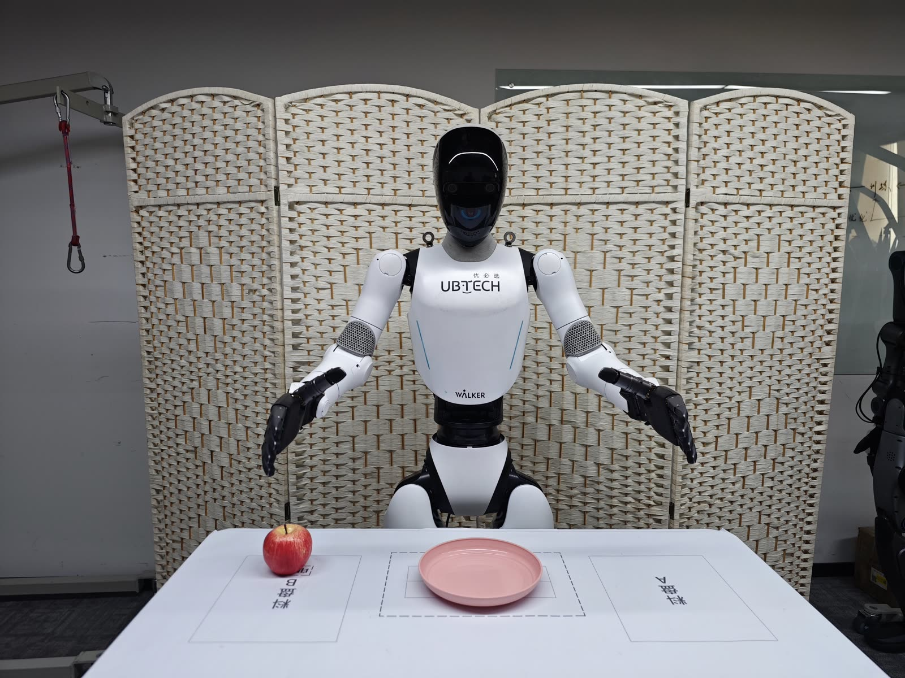
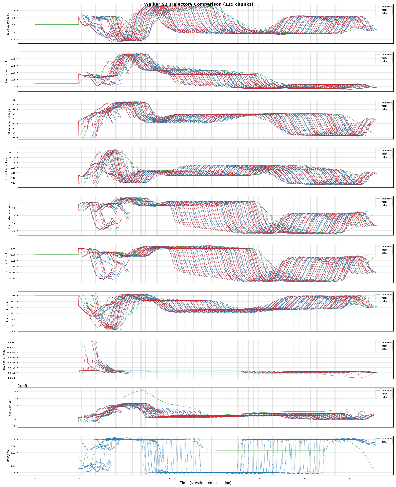

# Walker C1 EDU 共创者：真机部署（Rollout）

> 部署脚本：`ubt_IL/scripts/deploy/walker_c1/rollout.sh`，仿真部署与真机部署共用（差异见各工作流页）。本页给出完整参数、half_sdk 门禁、安全预检与在线评估说明。



## 前置条件

- 机器人**上电站立**，并切换到**开发者模式 + half_sdk**（C1 手臂只在 `HalfSdkActive` 下接收 ROS2 指令）。
- 机器人置于安全位；首次 `DURATION=10` 短时验证；手边留急停。
- 真机部署容器跑在机器人 **Thor 板**上，需将项目和模型拷贝到板端并构建、启动容器（`run.sh` 自动识别 Thor 并切 `Dockerfile.thor`）。
- `ROS_DOMAIN_ID` 真机默认 `0`；DDS 必须与主控栈一致（`rmw_cyclonedds_cpp` + `cyclonedds_thor.xml`，容器已自动注入）。

## 部署形态速查

| 场景 | 命令要点 |
|------|----------|
| 真机 13D 模型（右臂 + 右手） | `WALKER_C1_REAL=1 ROBOT_MODEL=walker_c1_13d` |
| 真机 26D 模型（双臂 + 双手） | `WALKER_C1_REAL=1 ROBOT_MODEL=walker_c1_26d` |
| 回注仿真验证 | `WALKER_C1_REAL=0 SDK_GUARD=0 RESET_MODE=sim-scene` |
| 长时间常驻部署 | 用 [推理服务器](inference-server.md)（免冷启动） |

## 部署步骤（真机）

```bash
# 0. 切 SDK 控制（进入开发者模式 -> 腿部 STAND -> half_sdk；幂等）
bash /ubt_IL/scripts/deploy/walker_c1/sdk_mode.sh half_sdk
bash /ubt_IL/scripts/deploy/walker_c1/sdk_mode.sh check      # 0=可部署，2=不满足

# 1. 相机自检（真机头左目，shm_msgs/Image6m）
python3 /ubt_IL/scripts/deploy/walker_c1/preview_camera.py --once --save-frame /tmp/c1.jpg \
  --msg-type image6m --topic /sensor/camera/head_stereo_left/color/raw

# 2. 摆到预备位（三段式；先 dry-run 看目标与每段时长）
bash /ubt_IL/scripts/deploy/walker_c1/robot_ready.sh --dry-run
bash /ubt_IL/scripts/deploy/walker_c1/robot_ready.sh

# 3. 部署真机 13D 模型（异步推理）
WALKER_C1_REAL=1 SDK_GUARD=1 \
POLICY_PATH=/ubt_IL/model/walker_c1_real_13d_act_1RGB/checkpoints/last/pretrained_model \
ROBOT_MODEL=walker_c1_13d \
INFERENCE_TYPE=act_async INFERENCE_HZ=1 \
FPS=30 DURATION=10 \
  bash /ubt_IL/scripts/deploy/walker_c1/rollout.sh

# 4. 收臂回 home（14 个臂关节全 0，手臂竖直贴身，手张开）
bash /ubt_IL/scripts/deploy/walker_c1/robot_home.sh --dry-run
bash /ubt_IL/scripts/deploy/walker_c1/robot_home.sh
```

## 部署效果演示

<video src="../../assets/walker-c1真机部署效果.mp4" controls muted width="100%"></video>

## SDK 模式（half_sdk）

| `developModeState` | 手臂指令 | 说明 |
|---|---|---|
| `NormalActive`（`normal`） | 忽略 | 内置运控控制全身，只能调 CC-API 技能 |
| `HalfSdkActive`（`half_sdk`） | 执行 | **VLA 唯一档位**：头/臂/腰由 SDK 控制，腿部由系统保持平衡（需 `legStatus=standing`） |
| `FullSdkActive`（`full_sdk`） | 执行 | 全身电机交出、内置平衡退出，必须悬吊，**不要用于 VLA** |

```bash
bash sdk_mode.sh status     # 工作模式/运控权限/腿部/急停
bash sdk_mode.sh check      # 只校验，0=可部署，2=不满足
bash sdk_mode.sh half_sdk   # develop -> 腿部 STAND -> half_sdk
bash sdk_mode.sh normal     # 回到 normal（保留开发者模式）
bash sdk_mode.sh work-mode joystick   # 退出开发者模式
```

- 默认经 SSH 在机器人开发者容器内执行（`ubt@192.168.11.3:2222`）；CI/脚本化可用 `WALKER_C1_SDK_PASSWORD` 非交互登录。
- `half_sdk` 幂等：已处于 half_sdk 时只打印状态；腿部非 `standing` 时先执行 `A000004` 技能切 STAND（`--no-leg-stand` 可关闭）。

### 部署门禁

`rollout.sh`、`robot_ready.sh` / `robot_home.sh`（非 `--dry-run`）、`inference_server.sh` 启动前都会调用 `sdk_guard.sh`，非 half_sdk 直接拒绝：

```bash
SDK_GUARD=1        # 真机默认（WALKER_C1_REAL=1 时自动取 1）：强制校验
SDK_GUARD=auto     # 检测到真机才校验（仿真默认）
SDK_GUARD=0        # 跳过（仅离线调试）
SDK_AUTO_SWITCH=1  # 不满足时自动执行 sdk_mode.sh half_sdk，再复检
```

## 初始化 / 回 home（robot_ready.sh / robot_home.sh）

| 命令 | 作用 |
|------|------|
| `robot_ready.sh` | 三段摆位：抬肩 → 收肘 → 预备位（每段默认 ≥5 s）+ 张开双手 |
| `robot_ready.sh --dry-run` | 只打印目标位姿与每段时长 |
| `robot_ready.sh --head-pitch 0.5` | 调整低头角度（默认 0.65 rad） |
| `robot_home.sh` | 三段严格逆序回 home（14 臂关节全 0） |
| `robot_home.sh --dry-run` | 只打印目标 |

> 预备位是**绝对**目标，不是回零；站立位手臂自然下垂时会低于桌面，必须分段摆位，避免手贴桌面从体侧扫过去。

## 安全预检

部署前自动做 **action 维度匹配预检**：policy `output_features.action.shape[0]` 必须与 robot config `action_order` 维度一致，不通过则**拒绝部署**。

- `ROBOT_MODEL` 必须与训练 DOF 一致（见下表）。
- 策略无 action names 时需 `ALLOW_DIM_ONLY_POLICY=1`（默认开）。
- 手部限位在插件与 bridge 双侧裁剪（插件 `hand_joint_limits` → `to_bridge_config()` → bridge）。

## 环境变量（rollout.sh）

| 变量 | 默认 | 说明 |
|------|------|------|
| `POLICY_PATH` | **必填，无默认值** | checkpoint 目录（含 `config.json`） |
| `ROBOT_MODEL` | 真机 `walker_c1_13d` / 仿真 `walker_c1_26d` | ROBOT_MODELS 注册表键（同时作为 `--robot.joint_config`），随 `WALKER_C1_REAL` 切换 |
| `ROBOT_CONFIG` | `configs/<ROBOT_MODEL>.json` | 硬件配置 JSON（按 `ROBOT_MODEL` 自动选择） |
| `ROBOT_TYPE` | `walker_c1` | 插件注册名 |
| `WALKER_C1_REAL` | `1` | `1`=真机（含 13d/task/act_async/门禁/真机相机）；`0`=仿真/离线 |
| `EPISODES` | `1` | 集数；base strategy 不支持多集，>1 时由外层循环 + 每集复位实现 |
| `DURATION` | `30` | 每集最长秒数 |
| `FPS` | `15` | 控制环 FPS（30 fps 数据集用 `FPS=30`） |
| `TASK` | `walker c1 pick place` | 任务描述 |
| `RESET_MODE` | 真机 `task` / 仿真 `sim-scene` | 每集前复位：`sim-scene` / `task` / `both` / `none` |
| `ALLOW_DIM_ONLY_POLICY` | `1` | 1=只校验维度；0=同时校验 `action_feature_names` |
| `INFERENCE_TYPE` | 真机 `act_async` / 仿真 `sync` | `sync` / `act_async`（chunk → bridge 融合 300 Hz） |
| `INFERENCE_HZ` | 真机 `1` / 仿真 `2` | act_async 重规划频率 |
| `EXECUTION_HORIZON` | `0` | act_async chunk 截断步数（0=不截断） |
| `PREVIEW_CAMERA` | `0` | 1=同时开预览窗口 |
| `CAMERA_TOPIC` | `WALKER_C1_REAL=1` 时头左目 | 相机话题（仿真覆盖为 `/sensor/camera/head/color/raw`） |
| `CAMERA_MSG_TYPE` | `WALKER_C1_REAL=1` 时 `shm_msgs/Image6m` | 相机消息类型（仿真 `sensor_msgs/Image`） |
| `SDK_GUARD` | 真机 `1` / 仿真 `auto` | half_sdk 门禁 |
| `SDK_AUTO_SWITCH` | `0` | 1=门禁不通过时自动切 half_sdk |
| `WALKER_C1_SINGLE_ACTION_SMOOTH_S` | `0.15` | sync 单动作平滑窗口（秒），`0`=关闭；仅影响 `sync` |
| `ZMQ_HOST` | `127.0.0.1` | 桥接地址（跨机部署改为机器人侧 IP） |

## 机器人配置（ROBOT_MODELS 注册表）

| 注册表键 | 维度 | 末端执行器 | 对应配置文件 |
|----------|------|-----------|--------------|
| `walker_c1_13d` | 13D（右臂 7 + 右手 6） | 右手灵巧手（13 维变体，左手 inactive_fill 保持 home） | `configs/walker_c1_13d.json` |
| `walker_c1_26d` | 26D（左臂 7 + 右臂 7 + 左手 6 + 右手 6） | 双手灵巧手 | `configs/walker_c1_26d.json` |

> 13D 配置的 `action_order` 只含右臂+右手；`body.groups` 仍保留 `left_arm`，`inactive_fill` 会把左臂 7 + 左手 6 填成 home 并下发（真机位置保持、仿真 home）。

## 在线评估（记录推理轨迹）

部署时可设置 `RECORD_ACTIONS=1`（及 `RECORD_OUTPUT_DIR`）记录 rollout 动作，用于分析模型预测轨迹、机器人执行轨迹、ACT 融合轨迹，记录文件默认保存于 `ubt_IL/scripts/deploy/output`。



## 离线策略评估

部署前建议先跑离线 MSE 评估（`ubt_IL/scripts/eval/eval_policy.py`），见 [模仿学习平台 §5](convert-train.md#5-策略评估离线-mse)。

## 推理服务器（常驻预热）

长时间/多任务常驻部署用推理服务器，免每次冷启动（`rollout.sh` 冷启动需加载 policy + 拉起桥接）。支持 `launch/load/start/stop/home/status/watch/shutdown`，详见 [推理服务器](inference-server.md)。

> `start`/`home`/`shutdown` 会让机器人运动，请在机旁执行。

## 常见问题

| 现象 | 处理 |
|------|------|
| 机器人不动 | `preview_camera.py --once` 能否出图；`ROS_DOMAIN_ID`/`RMW` 是否与机器人一致；bridge 日志 `ros2_walker_c1_bridge` |
| 手臂只动一部分 | 策略维度与 `action_order` 不符（预检会退出）；或左手数据全程为 0（该任务只用了右手，正常） |
| 动作抖动 | 提高 `FPS` 与 `--inference-hz`；或切 `act_async` 走 chunk 融合 |
| 相机超时 | 确认话题名与消息类型；QoS 必须 BEST_EFFORT；真机 `shm_msgs/Image6m` 必须显式指定 |
| `reset.py` 报 `No module named rclpy` | 用 `reset.sh`（走 `/usr/bin/python3`），不要用 venv 的 `python3` |
| 端口占用 | `ss -lntp \| grep 566`；同一主机不要同时跑两套 bridge |
| 退出后手臂不回位 | `disable_torque_on_disconnect` 被设 false；或 bridge 已被外部 kill |
| `sdk_mode.sh` 提示腿部非 standing | 用遥控器/Web 切站立，或让脚本自动执行 `A000004`（默认已开启） |
| `developModeState=sdk_error` | 按急停 → 退出开发者模式或重启运控，再重新 `half_sdk` |
