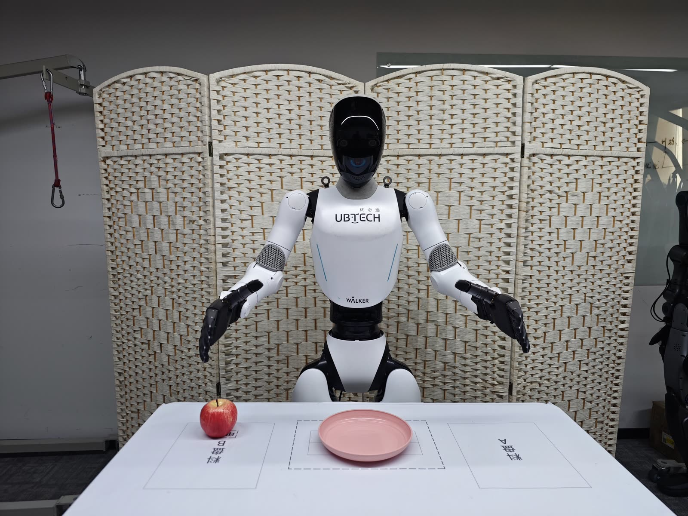

# Walker C1 EDU Real-Robot Workflow: Collect -> Convert -> Train -> Evaluate -> Deploy

> Robot: **Walker C1 EDU**
> Data source: real-robot teleoperation/scripted collection (Thinker Studio or `ubt_sim/teleoperation/control/walker_c1`)
> Code: `ubt_IL/scripts/{convert,train,eval,deploy}/walker_c1/`

Simulation and the real robot share the same ROS 2 interfaces (`mc_task_msgs` / `mc_state_msgs` / `sensor_msgs/Image`) and are isolated by `ROS_DOMAIN_ID`. The policy deployment path sends only 26 dimensions (both arms + both hands) or 13 dimensions (right arm + right hand); the head/waist/legs hold their current positions.

> ✅ **Verified on hardware (Nov 2026)**: the full loop works with **13D = right arm 7 + right hand 6** (`ROBOT_MODEL=walker_c1_13d`, 30 fps, head camera `head_stereo_left/color/raw` 640×512): dataset `walker_c1_real_13d_1RGB` (34 episodes / 11,406 frames) -> model `walker_c1_real_13d_act_1RGB` -> real-robot deployment.

```
Real robot ROS 2 ──► ubt_sim/teleoperation/control/walker_c1 (collection) ──► HDF5
                                                                             │
Container: convert.sh → train.sh → eval_policy.py → robot_ready.sh + rollout.sh
                                                                             │
LeRobot (3.12) ──ZMQ 5661/5662──► ros2_walker_c1_bridge.py (3.10) ──► real robot
```

## Contents

- [0. Workflow overview](#0-workflow-overview)
- [1. Real-robot prerequisites](#1-real-robot-prerequisites)
- [2. Real-robot collection](#2-real-robot-collection)
- [3. Start the container](#3-start-the-container)
- [4. Data conversion (HDF5 -> LeRobot)](#4-data-conversion)
  - [4.1 Conversion command](#41-conversion-command)
  - [4.2 Data visualization](#42-data-visualization)
- [5. Training and evaluation](#5-training-and-evaluation)
- [6. Deployment](#6-deployment)
- [7. FAQ](#7-faq)

<a id="0-workflow-overview"></a>

## 0. Workflow overview

| Stage | Location | Command |
|---|---|---|
| Switch SDK control | Operator machine / container | `bash scripts/deploy/walker_c1/sdk_mode.sh half_sdk` |
| Real-robot collection | Operator machine / ubt_sim container | `teleoperation/control/walker_c1/save_data.sh` |
| Container | Operator machine | `cd ubt_IL/docker && bash run.sh start && bash run.sh bash` |
| Conversion | Container | `scripts/convert/walker_c1/convert.sh` |
| Training | Container (GPU) | `scripts/train/walker_c1/train.sh` |
| Evaluation | Container | `scripts/eval/eval_policy.py` |
| Deployment | Container (robot side) | `robot_ready.sh` + `rollout.sh` |

<a id="1-real-robot-prerequisites"></a>

## 1. Real-robot prerequisites

1. **Switch to SDK control (half_sdk required)**: C1 arms accept ROS 2 joint commands only in `workMode=develop` + `developModeState=HalfSdkActive` (`normal` ignores commands; `full_sdk` hands over whole-body balance and is not used for VLA). The deployment script performs the full sequence (enter developer mode → legs STAND → half_sdk) over SSH in the robot's developer container (`ubt@192.168.11.3:2222`):

   ```bash
   bash /ubt_IL/scripts/deploy/walker_c1/sdk_mode.sh status     # work mode / motion permission / legs / e-stop
   bash /ubt_IL/scripts/deploy/walker_c1/sdk_mode.sh check      # validate only (0 = deployable)
   bash /ubt_IL/scripts/deploy/walker_c1/sdk_mode.sh half_sdk   # switch
   bash /ubt_IL/scripts/deploy/walker_c1/sdk_mode.sh normal     # restore normal
   ```

   `rollout.sh` / `robot_ready.sh` / `robot_home.sh` / `inference_server.sh` include the guard and refuse to run outside half_sdk (on hardware set `WALKER_C1_REAL=1` or `SDK_GUARD=1`; simulation uses the default `SDK_GUARD=auto` and skips the check).

2. **ROS domain**: the real robot defaults to `ROS_DOMAIN_ID=0`; simulation and real deployment must use the same value. Set both to `146` when isolation is needed.

3. **DDS**: **Thor (C1 onboard compute) must use the same RMW as the main control stack** — the robot stack uses `rmw_cyclonedds_cpp` + `CYCLONEDDS_URI` (bound to `mgbe2_0`, local `192.168.11.3`). `docker/run.sh` injects the same environment and mounts `docker/cyclonedds_thor.xml` (`CYCLONEDDS_URI=file:///opt/cyclonedds_thor.xml`), so no manual setup is needed. Two field-tested caveats when editing the config:

   - `<Interfaces>` must be inside `<General>` (Humble's CycloneDDS 0.10+). Under `<Domain>` it reports `unknown element` and falls back to the default NIC. List only `mgbe2_0`, not `lo` (not multicast).
   - Domain 0 has many participants; the default limit raises `Failed to find a free participant index for domain 0`. The config sets `ParticipantIndex=none` and `MaxAutoParticipantIndex=120`.

   For FastDDS (simulation/remote machines), set `RMW_IMPLEMENTATION=rmw_fastrtps_cpp` and add the local NIC IP (Thor `192.168.11.3`, Walker peer `192.168.11.99`) to the `docker/fastdds_no_shm.xml` whitelist.

4. **State self-check** (inside the container, after `run.sh bash`):

   ```bash
   source /opt/ros/humble/setup.bash
   source /ubt_IL/walker_s2/walker_sdk_ros2/install/setup.bash
   export ROS_DOMAIN_ID=0
   ros2 topic hz /mc/sdk/robot_state                                 # measured ≈ 460-490 Hz on Thor
   ros2 topic hz /sensor/camera/head_stereo_left/color/raw           # shm_msgs/Image6m
   ros2 topic info -v /mc/sdk/robot_command                          # should have subscribers (SDK control active)
   ```

   The real-robot `RobotState` contains only 19 joints (14 arm + 2 head + 3 waist, no legs). The bridge selects the 14 arm joints by name, so it is unaffected; head/waist/legs are not part of the policy and are not commanded.

5. **Safety**: place the robot in a safe position; use `DURATION=10` for the first short validation; keep the emergency stop within reach.

<a id="2-real-robot-collection"></a>

## 2. Real-robot collection

```bash
# Inside the ubt_sim container (same domain as the robot; do not reuse simulation processes)
bash teleoperation/control/walker_c1/save_data.sh
bash teleoperation/control/walker_c1/save_data.sh --batch 20
```

The output matches simulation: `ubt_sim/dataset/walker_c1/<epoch>/trajectory.hdf5` (15 Hz, 31 body joints + 6+6 hand channels, one RGB stream). You can also use the [Thinker Studio](https://thinkercosmos.ubtrobot.com/#/studio) teleoperation platform and export a LeRobot v3 dataset directly.

The collection side needs the real camera topics — **C1 hardware does not publish `/sensor/camera/head/color/raw`**; it provides:

| Topic | Type | Notes |
|---|---|---|
| `/sensor/camera/head_stereo_left/color/raw` | `shm_msgs/Image6m` | **Policy input**: 1920×1536, yuv422 (UYVY), step=3840, fixed 6 MB |
| ~~`/sensor/camera/head_stereo_left/color/compressed`~~ | `sensor_msgs/CompressedImage` | No longer published after the onboard vision stack restart |
| `head_stereo_right` / `head_fisheye_left,right` / `mono_chin` / `wrist_left,right` | Same family | Other views |

> Aspect ratio: native 1920×1536 (5:4). The collection side stores JPEG at half size (960×768, still 5:4). Training and deployment consistently use **640×512 (5:4, exactly 1/3 of 1920×1536)** with no cropping and no aspect-ratio change.

Use `WALKER_C1_CAMERA_TOPIC` + `WALKER_C1_CAMERA_MSG_TYPE` for collection/deployment (the deployment script uses `CAMERA_TOPIC` / `CAMERA_MSG_TYPE`). Topics ending in `/compressed` are inferred as compressed images; everything else defaults to `sensor_msgs/Image`. **The real `shm_msgs/Image6m` type must be specified explicitly**, otherwise the subscription type does not match.

<a id="3-start-the-container"></a>

## 3. Start the container

```bash
cd ubt_IL/docker
bash run.sh build && bash run.sh start && bash run.sh check && bash run.sh bash
```

Thor (L4T r38 / sm_110) is selected automatically by `env.sh`, which uses `Dockerfile.thor` (image `lerobot-tienkung:humble-thor`, based on the robot's `ros2_ws:humble-dyn`). Do **not** use the Orin `Dockerfile.arm64` (r36 base + sm_87 wheels; it does not run on Thor).

`run.sh check` should include:

- `[OK] walker_c1 plugin: installed`
- `[OK] walker_c1 bridge: available`
- `[OK] walker ROS2 msgs: installed` (`mc_state_msgs` / `mc_task_msgs`, sharing the workspace with walker_s2)
- `[OK] torch: 2.9.0+cu130 | arch: ...,sm_110,... | kernel: ok`
- `[INFO] RMW: rmw_cyclonedds_cpp | CYCLONEDDS_URI=file:///opt/cyclonedds_thor.xml`

<a id="4-data-conversion"></a>

## 4. Data conversion (HDF5 -> LeRobot)

<a id="41-conversion-command"></a>

### 4.1 Conversion command

**Verified path: real-robot 13D** (config `configs/walker_c1_real_13d_1RGB.json`, 13D = right arm 7 + right hand 6, head camera 640×512, 30 fps):

```bash
CONFIG=/ubt_IL/scripts/convert/walker_c1/configs/walker_c1_real_13d_1RGB.json \
SRC_ROOT=/ubt_IL/dataset/walker_c1 \
REPO_ID=walker_c1_real_13d_1RGB \
FPS=30 \
bash /ubt_IL/scripts/convert/walker_c1/convert.sh --overwrite
```

- If the data is still in `ubt_sim/dataset/walker_c1`, omit `SRC_ROOT` (the script falls back automatically) or set it explicitly.
- Real-robot recordings are 30 fps; keep the conversion `FPS` equal to the dataset frame rate. Use `RESAMPLE_FPS` for other rates.
- For 26D real-robot data use `walker_c1_real_26d_1RGB.json` (dual-arm task).
- Real hand ranges were verified: right hand `thumb_swing ≤0.68 / thumb_mcp ≤0.82 / four fingers ≤0.85`, all within deployment limits (0.96 / 1.04 / 1.57).

For simulation conversion see [Simulation workflow · Data conversion](sim-workflow.md#3-data-conversion).

<a id="42-data-visualization"></a>

### 4.2 Data visualization

```bash
HF_HUB_OFFLINE=1 lerobot-dataset-viz \
  --repo-id walker_c1_real_13d_1RGB \
  --episode-index 0 \
  --root /ubt_IL/dataset/walker_c1_real_13d_1RGB
```


> Check especially: image resolution (3×512×640), state/action dimension and order (13D = right arm 7 + right hand 6), hand range, and empty episodes.

<a id="5-training-and-evaluation"></a>

## 5. Training and evaluation

**Verified path: real-robot 13D training** (config `train_config_walker_c1_real_act_13d_1RGB.json`, dataset `walker_c1_real_13d_1RGB`, output `walker_c1_real_13d_act_1RGB`):

```bash
CONFIG=/ubt_IL/scripts/train/walker_c1/configs/train_config_walker_c1_real_act_13d_1RGB.json \
OUTPUT_DIR=/ubt_IL/model/walker_c1_real_13d_act_1RGB \
bash /ubt_IL/scripts/train/walker_c1/train.sh
```

> `train.sh` defaults to the simulation 26D config; real-robot training must set `CONFIG=` explicitly. When real lighting differs strongly from simulation, `image_transforms` is enabled by default in the config (color jitter / random affine).

Offline evaluation (real-robot dataset):

```bash
/lerobot/.venv/bin/python /ubt_IL/scripts/eval/eval_policy.py \
  --policy-path /ubt_IL/model/walker_c1_real_13d_act_1RGB/checkpoints/last/pretrained_model \
  --dataset-path /ubt_IL/dataset/walker_c1_real_13d_1RGB \
  --episodes 5 --inference-freq 1 --plot \
  --plot-dir /ubt_IL/scripts/eval/output/eval_walker_c1_real_13d_act \
  --output /ubt_IL/scripts/eval/output/eval_walker_c1_real_13d_act/results.json \
  --device cuda
```

With small real datasets, inspect per-dimension curves for plausibility (hand jitter, wrist overshoot) instead of relying only on the total MSE.

<a id="6-deployment"></a>

## 6. Deployment

Real-robot deployment (on-site photo):



```bash
# ⓪ Switch to half_sdk (developer mode + half-body SDK; idempotent, only prints state if already ready)
bash /ubt_IL/scripts/deploy/walker_c1/sdk_mode.sh half_sdk
bash /ubt_IL/scripts/deploy/walker_c1/sdk_mode.sh check      # 0 = deployable

# ① Camera check (real: head_stereo_left/color/raw, shm_msgs/Image6m)
python3 /ubt_IL/scripts/deploy/walker_c1/preview_camera.py --once --save-frame /tmp/c1.jpg \
  --msg-type image6m --topic /sensor/camera/head_stereo_left/color/raw

# ② Move to the ready pose (dry-run first to inspect targets and stage durations)
bash /ubt_IL/scripts/deploy/walker_c1/robot_ready.sh --dry-run
bash /ubt_IL/scripts/deploy/walker_c1/robot_ready.sh

# ③ Single-episode rollout (WALKER_C1_REAL=1 enables the half_sdk guard; refuses outside half_sdk)
#    Verified path: real-robot 13D model (on hardware ROBOT_MODEL defaults to walker_c1_13d)
WALKER_C1_REAL=1 SDK_GUARD=1 \
POLICY_PATH=/ubt_IL/model/walker_c1_real_13d_act_1RGB/checkpoints/last/pretrained_model \
DURATION=10 FPS=30 RESET_MODE=task \
CAMERA_TOPIC=/sensor/camera/head_stereo_left/color/raw \
CAMERA_MSG_TYPE=shm_msgs/Image6m \
  bash /ubt_IL/scripts/deploy/walker_c1/rollout.sh

# ④ Return home (home = all 14 arm joints at 0, arms straight down, hands open)
bash /ubt_IL/scripts/deploy/walker_c1/robot_home.sh --dry-run
bash /ubt_IL/scripts/deploy/walker_c1/robot_home.sh

# ⑤ Optional warm-started inference server (see inference-server.md)
WALKER_C1_REAL=1 \
POLICY_PATH=/ubt_IL/model/walker_c1_real_13d_act_1RGB/checkpoints/last/pretrained_model \
  bash /ubt_IL/scripts/deploy/walker_c1/inference_server.sh
```

- **Ready pose** includes a head-down angle of `head_pitch=0.65 rad` (37.2°): field tests show 0.50 only sees the table edge, while 0.65 covers the full table. Adjust with `--head-pitch`; `--no-head` leaves the head untouched. The three stages (raise shoulder → fold elbow → ready pose) default to ≥ 5 s each (15 s total + 0.5 s hold), and the log prints peak displacement and velocity (≈0.5 rad/s).
- **home** is the exact reverse of the three ready stages (wrist/shoulder pitch to zero → unfold elbow → lower shoulder); measured final error max |pos| ≈ 0.02 rad. It moves only the arm and hand; head/waist/legs are untouched.
- **Inference backend**: prefer `act_async` (default); serial `sync` is for debugging only and must keep single-action smoothing (default 0.15 s; setting 0 triggers a warning).
- `RESET_MODE`: the real robot has no `/sim/cmd_reset`; use `task` (pose only) or `none`.
- `max_relative_target`: `null` in the config JSON; set e.g. `0.05` rad/step when per-step limiting is needed.
- `disable_torque_on_disconnect=true`: smoothly return home on exit (2 s chunk).

Real-robot deployment demo:

<video src="../../assets/walker-c1真机部署效果.mp4" controls muted width="100%"></video>

See [Real-robot deployment](deploy.md) for the full guard, registry, and safety precheck details.

<a id="7-faq"></a>

## 7. FAQ

| Symptom | Fix |
|---|---|
| Arm does not move at all | Run `sdk_mode.sh check`: is it `develop + HalfSdkActive + standing`? Then check whether `/mc/sdk/robot_command` has subscribers and whether `ROS_DOMAIN_ID` matches |
| Only the right hand moves | The left hand is all zeros in the data (task characteristic); the policy reproduces this, which is normal |
| Joint 4 direction/name mismatch | SDK docs call it `elbow_roll`, the URDF calls it `elbow_pitch`; the bridge tolerates aliases, but verify the sign on hardware |
| Sudden motion | Set `max_relative_target`; lower `FPS`; check hand limits |
| Camera artifacts / no image | Simulation `sensor_msgs/Image` encoding should be `rgb8`; real is `shm_msgs/Image6m` (UYVY); QoS must be BEST_EFFORT |
| Arm does not return after exit | `disable_torque_on_disconnect` was set false, or the bridge was killed externally |
| Inference service unreachable | Ports 5690/5691; check the state machine with `inference_client.sh status` |
| Empty topic list / no `/mc/*` | RMW mismatch: on hardware use `rmw_cyclonedds_cpp` + `cyclonedds_thor.xml` (see §1 item 3) |
| `Failed to find a free participant index` | CycloneDDS default participant limit is too low; use `ParticipantIndex=none` + `MaxAutoParticipantIndex=120` |
| Camera topic missing / no frames | On hardware use `CAMERA_TOPIC=.../head_stereo_left/color/raw` + `CAMERA_MSG_TYPE=shm_msgs/Image6m`; green/purple colors mean UYVY is being decoded as YUYV |
| `torch.cuda.is_available()` is False | The container lacks `NVIDIA_VISIBLE_DEVICES=all` / `NVIDIA_DRIVER_CAPABILITIES=all` (`run.sh start` sets them) |
