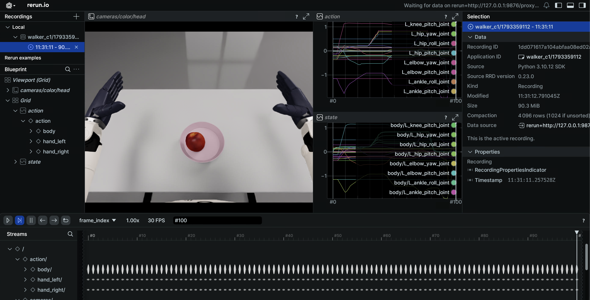

# Walker C1 EDU 共创者：仿真平台

Walker C1 EDU 共创者 仿真基于 NVIDIA Isaac Sim（Isaac Lab 2.2.0）构建，通过 ROS2-ZMQ 桥接将仿真状态与图像以**与真机一致的 ROS2 话题**对外发布，实现 sim-to-real 一致的遥操作与数据采集。整套环境运行在 Docker 容器内。


C1 与 Walker S2 共用同一套 SDK 话题面（`mc_task_msgs` / `mc_state_msgs`），但消息包相互隔离，靠 `UBT_SIM_ROBOT=walker_c1` 区分。两机型的仿真桥接端口同为 5655-5658，**不能同时启动**。

## 快速开始

> 命令分两段：构建/进入容器在**宿主机**执行；启动仿真与采集在**容器内**执行（容器内根路径为 `/ubt_sim`）。

### 1. 构建并启动容器（宿主机）

```bash
cd ubt_sim/docker
bash run.sh build      # 构建 ROS2 + Isaac Sim 镜像
bash run.sh start      # 创建/启动容器
bash run.sh init       # 编译各机型消息包（含 walker_c1_msgs），首次执行一次
bash run.sh check      # 校验环境（GPU / ROS2 / 消息包 / numpy<2）
```

容器构建流程见 [仿真平台 · 容器构建与使用](../sim/docker.md)。

> ⚠️ **构建镜像前必须修改（真机联调 / 跨机部署）**：编辑 `ubt_sim/docker/fastdds_no_shm.xml` 的 `interfaceWhiteList`，把 `<address>` 改为本机与机器人直连网卡的 IP（Thor 侧 `192.168.11.3`，Walker 直连对端 `192.168.11.99`）。该文件构建时 COPY 进镜像，构建后再改无效。纯本机仿真走回环，可保持默认。

### 2. 启动仿真（容器内）

```bash
# 进入容器（自动 source ROS2 与 C1 消息包）
UBT_SIM_ROBOT=walker_c1 bash run.sh bash

# 方式一：C1 专用脚本（默认 GPU 渲染 + CPU PhysX，100 Hz 物理步进）
bash scripts/start_c1_pick_place_sim.sh

# 方式二：统一启动器
UBT_SIM_TASK=UBTSim-WalkerC1-Parlor-v0 bash scripts/start_sim.sh
```

启动后会依次打印 ZMQ 端口、action 关节顺序、手部关节限位与增益摘要。

- **按 `R` 键**复位机器人/场景；`Space` 请求保存当前 episode（与 ROS 侧录制器配合）。
- 关闭仿真窗口时，`start_sim.sh` 的退出陷阱会自动停止桥接进程。

运行效果（桌面抓苹果）：

<video src="../../assets/walker-c1仿真部署效果.mp4" controls muted width="100%"></video>

常用环境变量/参数（可叠加）：

| 变量 / 参数 | 作用 | 默认 |
| --- | --- | --- |
| `UBT_SIM_TASK` | 任务名（决定机型） | `UBTSim-TienkungPro-Parlor-v0`，C1 用 `UBTSim-WalkerC1-Parlor-v0` |
| `UBT_SIM_ROBOT` | 容器内消息包选择 | 进入容器时设为 `walker_c1` |
| `UBT_SIM_WALKER_C1_USD_PATH` | 覆盖机器人 USD | `usd/walker_c1_merged.usd` |
| `UBT_SIM_C1_STEP_HZ` | 物理步进频率 | `100` |
| `UBT_SIM_LOAD_ONLY=1` | 只加载场景、不起桥接 | 关 |
| `--headless` | 无窗口运行 | 无显示器/服务器场景最常用 |
| `--device cpu\|cuda` | 运行设备 | `cpu`（C1 专用脚本默认） |

### 3. 数据采集（容器内，使用系统 Python 3.10）

```bash
# 单条：复位场景 -> 回预备位 -> 在线 IK 抓放一次 -> 成功才落盘
bash teleoperation/control/walker_c1/save_data.sh

# 批量：采 20 条，每集之间自动复位，成功才落盘
bash teleoperation/control/walker_c1/save_data.sh --batch 20

# 交互录制（Enter/s/q）
bash teleoperation/control/walker_c1/save_data.sh --manual
```

- 每集流程：复位场景 -> 回任务预备位 -> 在线 IK 抓放一次 -> **任务判定成功才落盘**。
- 采集频率 15 Hz；单路 `camera_head` 640×480 PNG，身体 31 关节 + 左右手各 6 通道。
- 产物路径：`/ubt_sim/dataset/walker_c1/<epoch 秒>/trajectory.hdf5`（目录 0777、文件 0666）。
- 采集前确认 `/mc/sdk/robot_state` 有数据（约 48 Hz），手部增益保持 `10/1`、`effort_limit_sim=2`。

单集 HDF5 结构：

| 路径 | 形状 | 含义 |
|---|---|---|
| `joint_observations/joint_position` | (T, 31) | L 臂 0-6 / R 臂 7-13 / 头 14-15 / 腰 16-18 / 腿 19-30 |
| `hand_observations/hand_left_position` | (T, 6) | 左手 SDK 6 通道 |
| `hand_observations/hand_right_position` | (T, 6) | 右手 SDK 6 通道 |
| `action_observations/*` | 同上 | 最近一次下发的指令值 |
| `camera_observations/color_images/camera_head` | (T,) | PNG 字节流，640×480 |
| `timestamp` | (T,) | 采集时刻 |

### 4. 复位（容器内）

```bash
# 任务预备位（分三段：抬肩 -> 收肘 -> 预备位）
/usr/bin/python3 teleoperation/control/walker_c1/reset.py --mode task

# 场景复位（等价于在仿真窗口按 R）
/usr/bin/python3 teleoperation/control/walker_c1/reset.py --mode sim-scene
```

`reset.py` 还支持 `sim-task`（场景 + 任务预备位）与 `sdk-home`（SDK 全零位）。

### 5. 数据集预览与回放（容器内）



```bash
# 预览 HDF5（Rerun）
/usr/bin/python3 teleoperation/tools/playback_walker_c1.py --mode preview

# 动作回放（仿真/真机同话题）
/usr/bin/python3 teleoperation/tools/playback_walker_c1.py \
    --episode dataset/walker_c1/<epoch 秒>/trajectory.hdf5 --mode control
```

完整参数与安全须知见 [数据可视化与回放](../common/playback.md)。

## 仿真模块

| 模块 | 路径 | 说明 |
| --- | --- | --- |
| Docker 编排 | `ubt_sim/docker/run.sh` | 镜像构建、容器生命周期、桥接启停 |
| 环境变量 | `ubt_sim/docker/env.sh` | 容器名、镜像、`ROS_DOMAIN_ID` |
| 仿真启动器 | `ubt_sim/scripts/start_sim.sh` | 按 `UBT_SIM_TASK` 识别机器人、拉起桥接 |
| C1 专用启动 | `ubt_sim/scripts/start_c1_pick_place_sim.sh` | 默认 GPU 渲染 + CPU PhysX、100 Hz 步进 |
| 任务定义 | `ubt_sim/source/ubt_sim/task/walker_c1_parlor/` | 客厅抓苹果场景 |
| 仿真配置 | `ubt_sim/config/walker_c1/parlor.yaml` | 场景/相机/设备参数 |
| ROS2-ZMQ 桥接 | `ubt_sim/teleoperation/bridges/walker_c1/` | 桥接脚本 + `walker_c1_bridge_config.yaml` |
| 控制与采集 | `ubt_sim/teleoperation/control/walker_c1/` | `reset.py` / `pick_place_controller.py` / `save_data.sh` / 在线 IK |
| 数据回放 | `ubt_sim/teleoperation/tools/playback_walker_c1.py` | 预览 / 动作回放 |
| 数据输出 | `ubt_sim/dataset/walker_c1/<时间戳>/trajectory.hdf5` | 采集产物 |

## ZMQ 端口

| 端口 | 用途 |
| --- | --- |
| 5655 | 控制指令（bridge PUB） |
| 5656 | 机器人状态（bridge SUB） |
| 5657 | 相机原图（RGB + 深度，C++ 桥接处理） |
| 5658 | JPEG 直连（调试用） |

> `ubt_IL` 侧 C1 插件使用 5661/5662/5663，与仿真桥接的 5655-5658 互不冲突，可同时运行。跨机型端口总览见 [系统架构 · ZMQ 端口一览](../architecture.md#zmq-端口一览)。

## ROS2 话题

| 方向 | 话题 | 类型 |
|---|---|---|
| sub | `/mc/sdk/robot_command` | `mc_task_msgs/RobotCommand` |
| sub | `/mc/left_hand/command`、`/mc/right_hand/command` | `mc_task_msgs/JointCommand` |
| pub | `/mc/sdk/robot_state` | `mc_state_msgs/RobotState`（31 关节） |
| pub | `/mc/{left,right}_hand/joint_states` | `sensor_msgs/JointState`（SDK 6 关节序） |
| pub | `/sim/object_state` | `std_msgs/String` |
| pub | `/sim/episode_complete` | `std_msgs/Bool` |
| pub | `/sensor/camera/head/color/raw` | `sensor_msgs/Image`（BEST_EFFORT） |

## 故障排查

- **`bash run.sh check` 报错**：按提示重跑 `bash run.sh init`；确认 `numpy<2`、`walker_c1_msgs` 已就绪。
- **采集脚本报 rclpy / 消息类型导入失败**：确认用的是 `/usr/bin/python3` 而非 Isaac Sim Python；确认已 `bash run.sh init`。
- **桥接启动即退出，报 `RMW implementation not installed`**：本仓库镜像只装了 `rmw_cyclonedds_cpp`，`start_sim.sh` / `save_data.sh` 会自动探测；手工启动时需自行 export。
- **报 `Address already in use (tcp://*:5656)`**：旧桥接未退干净，先 `kill -9` 残留 `sim_runner` / `ros2_zmq_bridge`，确认 5655-5658 全 free 再启动。
- **与 Walker S2 同时启动后指令串流**：二者端口相同（5655-5658），同一时间只能跑一个。
- **控制器报 `no /mc/sdk/robot_state`**：桥接没起来（端口冲突最常见）；用 `ros2 topic hz /mc/sdk/robot_state` 确认约 48 Hz。
- **苹果抓不住 / 弹飞**：手部增益必须保持 `10/1`、`effort_limit_sim=2`，不要按老调试值放大。
- **X11 不可用 / 仿真窗口不显示**：宿主机执行 `xhost +`，确认 `DISPLAY` 已透传；无显示器时用 `--headless` + `save_data.sh --batch`。

采集完成后进入下一步：[模仿学习平台](convert-train.md)。
