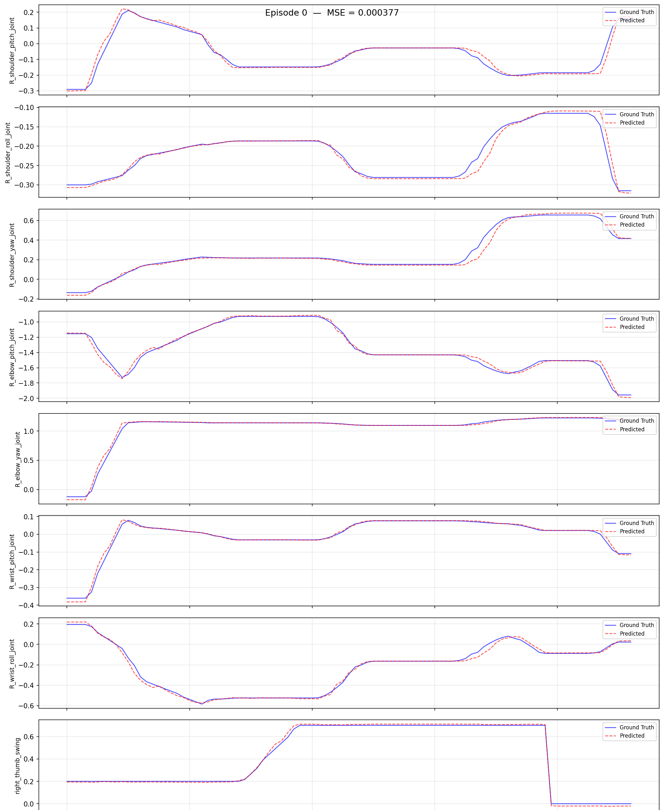

# Walker C1 EDU Simulation Workflow: Collect -> Convert -> Train -> Evaluate -> Deploy

> Robot: **Walker C1 EDU**
> Data source: **Isaac Sim collection** (`ubt_sim`, task `UBTSim-WalkerC1-Parlor-v0`)
> Container: `lerobot-tienkung` (built/started by `ubt_IL/docker/run.sh`, project mounted at `/ubt_IL`)

This guide covers the complete workflow from **raw simulation HDF5** to a **LeRobot dataset**, **ACT training**, **offline evaluation**, and finally **feedback deployment into the simulator**. All conversion/training/evaluation/deployment scripts run inside the `ubt_IL` container.

## Contents

- [0. Workflow overview](#0-workflow-overview)
- [1. Prerequisite: simulation collection (ubt_sim)](#1-prerequisite-simulation-collection)
- [2. Start the container (ubt_IL)](#2-start-the-container)
- [3. Data conversion (HDF5 -> LeRobot)](#3-data-conversion)
  - [3.1 Conversion command](#31-conversion-command)
  - [3.2 Data visualization](#32-data-visualization)
- [4. Policy training](#4-policy-training)
- [5. Policy evaluation (offline MSE)](#5-policy-evaluation)
- [6. Simulation deployment (closed-loop)](#6-sim-deployment)
- [7. FAQ](#7-faq)

<a id="0-workflow-overview"></a>

## 0. Workflow overview

```
ubt_sim HDF5 ──► convert.sh ──► LeRobot dataset ──► lerobot-train ──► checkpoint
                                                                  │
                                                                  ├─► eval_policy.py (offline)
                                                                  └─► rollout.sh (sim closed loop)
```

| Stage | Command | Output |
|---|---|---|
| Simulation collection | `ubt_sim/teleoperation/control/walker_c1/save_data.sh` | `ubt_sim/dataset/walker_c1/<epoch>/trajectory.hdf5` |
| Conversion | `scripts/convert/walker_c1/convert.sh` | `ubt_IL/dataset/walker_c1_sim_{26d,13d}_1RGB` |
| Training | `scripts/train/walker_c1/train.sh` | `ubt_IL/model/walker_c1_sim_26d_act_1RGB` |
| Evaluation | `scripts/eval/eval_policy.py` | `scripts/eval/output/.../results.json` |
| Deployment | `scripts/deploy/walker_c1/rollout.sh` | Simulated arm motion |

<a id="1-prerequisite-simulation-collection"></a>

## 1. Prerequisite: simulation collection (ubt_sim)

See [Simulation Platform](sim-setup.md) for scene, reset, and playback details.

```bash
# ① Launch simulation inside the ubt_sim container (separate terminal)
UBT_SIM_ROBOT=walker_c1 bash run.sh bash
bash scripts/start_c1_pick_place_sim.sh        # or UBT_SIM_TASK=UBTSim-WalkerC1-Parlor-v0 bash scripts/start_sim.sh

# ② Collect: one episode by default; --batch 20 randomizes object poses
bash teleoperation/control/walker_c1/save_data.sh --batch 20
```

- In the simulation window, `R` resets the scene and `Space` requests saving the current episode.
- Output: `ubt_sim/dataset/walker_c1/<epoch seconds>/trajectory.hdf5`, 15 Hz, one `camera_head` stream at 640×480 PNG.
- Before collecting, confirm `/mc/sdk/robot_state` is publishing (about 48 Hz) and hand gains are 10/1 with effort 2 N·m.

<a id="2-start-the-container"></a>

## 2. Start the container (ubt_IL)

```bash
cd ubt_IL/docker
bash run.sh build      # first time; Thor switches to Dockerfile.thor automatically
bash run.sh start
bash run.sh check      # expect [OK] for walker_c1 plugin / bridge / ROS2 msgs
bash run.sh bash       # enter the container; run the remaining commands there
```

Inside the container, `/ubt_sim` is a read-only mount. If `ls /ubt_sim` fails, the container was created with an old mount; rebuild it with `bash run.sh rm && bash run.sh start`.

<a id="3-data-conversion"></a>

## 3. Data conversion (HDF5 -> LeRobot)

Simulation data is written to `ubt_sim/dataset/walker_c1/<epoch seconds>/trajectory.hdf5`. The `ubt_IL` container mounts `ubt_sim/` read-only at `/ubt_sim`, so conversion reads it directly without copying.

<a id="31-conversion-command"></a>

### 3.1 Conversion command

```bash
# Convert one episode first to validate the pipeline
bash /ubt_IL/scripts/convert/walker_c1/convert.sh --save_one true --overwrite

# Full run (26D: both arms + both hands)
bash /ubt_IL/scripts/convert/walker_c1/convert.sh --overwrite

# 13D (right arm + right hand, single-arm task)
DIM=13 bash /ubt_IL/scripts/convert/walker_c1/convert.sh --overwrite
```

Defaults: `DIM=26`, `CONFIG=configs/walker_c1_sim_26d_1RGB.json`, `REPO_ID=walker_c1_sim_26d_1RGB`, `FPS=15`, `TASK_NAME=walker_c1_sim_pick_place`, `HDF5_REL_PATH=trajectory.hdf5`, `TAIL_TRIM=10`.

Common overrides: `REPO_ID`, `TASK_NAME`, `FPS`, `SRC_ROOT`, `TGT_PATH`, `TRIM_STATIONARY`. Run `bash convert.sh --help` for all options.

Validation:

```bash
python - <<'PY'
import json
info = json.load(open("/ubt_IL/dataset/walker_c1_sim_26d_1RGB/meta/info.json"))
print(info["total_episodes"], info["features"]["observation.state"]["shape"],
      info["features"]["observation.images.camera_head"]["shape"])
PY
```

Expected output: `11 [26] [3, 240, 320]` (the episode count depends on how much data was collected).

> The repository ships about 11 episodes × 100 frames, enough only for smoke tests and pipeline validation. Collect more data for real simulation training (50+ episodes recommended).

<a id="32-data-visualization"></a>

### 3.2 Data visualization

```bash
HF_HUB_OFFLINE=1 lerobot-dataset-viz \
  --repo-id walker_c1_sim_26d_1RGB \
  --episode-index 0 \
  --root /ubt_IL/dataset/walker_c1_sim_26d_1RGB
```


> `--root` must point to the dataset directory containing `meta/`; `--episode-index` visualizes one episode at a time.

<a id="4-policy-training"></a>

## 4. Policy training

```bash
# Smoke test: 2 steps, no checkpoint
bash /ubt_IL/scripts/train/walker_c1/train.sh --steps=2 --save_checkpoint=false

# Full training (default ACT / 26D simulation config)
bash /ubt_IL/scripts/train/walker_c1/train.sh

# Override common parameters
OUTPUT_DIR=/ubt_IL/model/walker_c1_sim_26d_act_1RGB_v2 \
STEPS=50000 SAVE_FREQ=5000 BATCH_SIZE=8 \
bash /ubt_IL/scripts/train/walker_c1/train.sh

# Resume (CONFIG points to train_config.json inside the checkpoint)
CONFIG=/ubt_IL/model/walker_c1_sim_26d_act_1RGB/checkpoints/last/pretrained_model/train_config.json \
RESUME=true bash /ubt_IL/scripts/train/walker_c1/train.sh
```

Key config (`configs/train_config_walker_c1_sim_act_26d_1RGB.json`):

| Item | Value |
|---|---|
| Policy | ACT, `chunk_size=n_action_steps=100` |
| Input | `observation.images.camera_head [3,240,320]` + `observation.state [26]` |
| Output | `action [26]` |
| Training | `batch_size=8`, `steps=30000`, `save_freq=5000` |

Output: `checkpoints/<step>/pretrained_model` (with `config.json` + `model.safetensors`) and `checkpoints/last`.

<a id="5-policy-evaluation"></a>

## 5. Policy evaluation (offline MSE)

```bash
/lerobot/.venv/bin/python /ubt_IL/scripts/eval/eval_policy.py \
  --policy-path /ubt_IL/model/walker_c1_sim_26d_act_1RGB/checkpoints/last/pretrained_model \
  --dataset-path /ubt_IL/dataset/walker_c1_sim_26d_1RGB \
  --episodes 5 \
  --inference-freq 15 \
  --plot \
  --plot-dir /ubt_IL/scripts/eval/output/eval_walker_c1_sim_26d_act \
  --output /ubt_IL/scripts/eval/output/eval_walker_c1_sim_26d_act/results.json \
  --device cuda
```

`--inference-freq 15` emulates a 15 Hz deployment cadence; `--plot` writes per-joint GT-vs-prediction curves to `--plot-dir` (one per episode).



You can also run a single-frame inference check:

```bash
python /ubt_IL/scripts/deploy/walker_c1/infer_check.py \
  --checkpoint /ubt_IL/model/walker_c1_sim_26d_act_1RGB/checkpoints/last/pretrained_model \
  --dataset /ubt_IL/dataset/walker_c1_sim_26d_1RGB --frame 0
```

<a id="6-sim-deployment"></a>

## 6. Simulation deployment (closed-loop)

```bash
# ① Confirm simulation is running (ubt_sim container) and the ROS domain matches
export ROS_DOMAIN_ID=0        # must be identical for simulation and deployment (ubt_sim defaults to 0; set both to 146 to isolate)

# ② Camera
python3 /ubt_IL/scripts/deploy/walker_c1/preview_camera.py --once --save-frame /tmp/c1.jpg

# ③ Reset + ready pose (three stages)
bash /ubt_IL/scripts/deploy/walker_c1/robot_ready.sh

# ④ rollout (WALKER_C1_REAL=0 for simulation)
WALKER_C1_REAL=0 SDK_GUARD=0 RESET_MODE=sim-scene \
POLICY_PATH=/ubt_IL/model/walker_c1_sim_26d_act_1RGB/checkpoints/last/pretrained_model \
  bash /ubt_IL/scripts/deploy/walker_c1/rollout.sh

# ⑤ Multiple episodes (reset + restart per episode; the base strategy does not support --strategy.num_episodes)
EPISODES=5 DURATION=20 RESET_MODE=both \
WALKER_C1_REAL=0 SDK_GUARD=0 \
POLICY_PATH=/ubt_IL/model/walker_c1_sim_26d_act_1RGB/checkpoints/last/pretrained_model \
  bash /ubt_IL/scripts/deploy/walker_c1/rollout.sh
```

Ports: C1 plugin 5661/5662/5663; ubt_sim C1 bridge 5655-5658; both can run together. For a 13D model add `ROBOT_MODEL=walker_c1_13d` (simulation defaults to `walker_c1_26d`).

Demo:

<video src="../../assets/walker-c1仿真部署效果.mp4" controls muted width="100%"></video>

<a id="7-faq"></a>

## 7. FAQ

| Symptom | Fix |
|---|---|
| Conversion reports "Found 0 episodes" | No `*/trajectory.hdf5` under `SRC_ROOT`; verify `HDF5_REL_PATH` |
| `meta/info.json` shows 640×480 images | The config was modified; it should be `image_size: [320,240]` |
| Training loss does not decrease | Too little data (about 11 episodes); collect more or reduce `dim_model` |
| rollout dimension precheck fails | Policy dimension and `ROBOT_MODEL` disagree (26D / 13D), or `ROBOT_CONFIG` points to another robot's config |
| Head/waist/legs slowly sink | Joints not commanded by the simulator should hold HOME_POSE; check that no external node is publishing them |
| No camera image | Check `preview_camera.py --topic`, `ROS_DOMAIN_ID`, and QoS (BEST_EFFORT) |
| Motion is very slow / stutters | Increase `FPS`; use `INFERENCE_TYPE=act_async INFERENCE_HZ=2` |
| Apple missed / knocked away | Residual state after reset is dirty: restart `sim_runner`, restore the apple with `/sim/cmd_set_object_pose`, then rerun `robot_ready.sh` |
