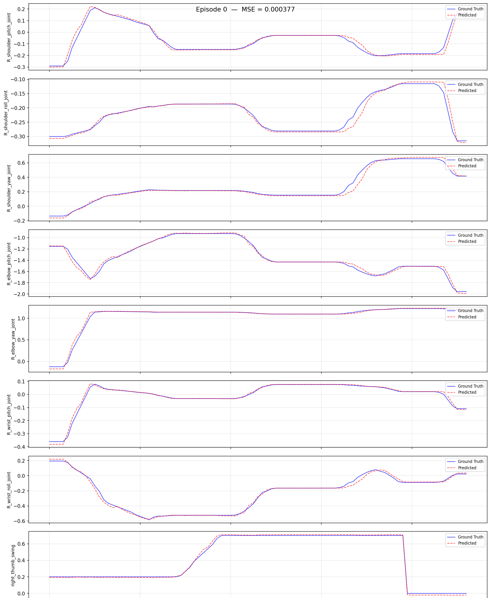

# Walker C1 EDU 共创者 仿真全流程：采集 -> 转换 -> 训练 -> 评估 -> 部署

> 适用机器人：**Walker C1 EDU 共创者**
> 数据来源：**Isaac Sim 仿真器采集**（`ubt_sim` 项目，任务 `UBTSim-WalkerC1-Parlor-v0`）
> 容器：`lerobot-tienkung`（`ubt_IL/docker/run.sh` 构建/启动，项目挂载 `/ubt_IL`）

本文档给出 Walker C1 EDU 共创者 从**仿真 HDF5 原始数据**到 **LeRobot 数据集**、**ACT 模型训练**、**离线策略评估**、最终**回注仿真器部署**的完整工作流程。全部转换/训练/评估/部署脚本在 `ubt_IL` 容器内执行。

## 目录

- [0. 全流程总览](#0-全流程总览)
- [1. 前置：仿真数据采集（ubt_sim）](#1-前置仿真数据采集ubt_sim)
- [2. 启动容器（ubt_IL）](#2-启动容器ubt_il)
- [3. 数据转换（HDF5 -> LeRobot）](#3-数据转换hdf5---lerobot)
  - [3.1 转换命令](#31-转换命令)
  - [3.2 数据可视化](#32-数据可视化)
- [4. 模型训练](#4-模型训练)
- [5. 策略评估（离线 MSE）](#5-策略评估离线-mse)
- [6. 仿真部署（闭环验证）](#6-仿真部署闭环验证)
- [7. 常见问题](#7-常见问题)

## 0. 全流程总览

```
ubt_sim 采集 HDF5 ──► convert.sh ──► LeRobot 数据集 ──► lerobot-train ──► checkpoint
                                                                 │
                                                                 ├─► eval_policy.py（离线）
                                                                 └─► rollout.sh（仿真闭环）
```

| 阶段 | 命令 | 产物 |
|---|---|---|
| 仿真采集 | `ubt_sim/teleoperation/control/walker_c1/save_data.sh` | `ubt_sim/dataset/walker_c1/<epoch>/trajectory.hdf5` |
| 转换 | `scripts/convert/walker_c1/convert.sh` | `ubt_IL/dataset/walker_c1_sim_{26d,13d}_1RGB` |
| 训练 | `scripts/train/walker_c1/train.sh` | `ubt_IL/model/walker_c1_sim_26d_act_1RGB` |
| 评估 | `scripts/eval/eval_policy.py` | `scripts/eval/output/.../results.json` |
| 部署 | `scripts/deploy/walker_c1/rollout.sh` | 仿真机械臂动作 |

<a id="1-前置仿真数据采集ubt_sim"></a>

## 1. 前置：仿真数据采集（ubt_sim）

仿真环境、任务场景、复位与回放的完整说明见 [仿真平台](sim-setup.md)。

```bash
# ① ubt_sim 容器内启动仿真（另开终端）
UBT_SIM_ROBOT=walker_c1 bash run.sh bash
bash scripts/start_c1_pick_place_sim.sh        # 或 UBT_SIM_TASK=UBTSim-WalkerC1-Parlor-v0 bash scripts/start_sim.sh

# ② 采集：默认 1 集；--batch 20 批量变位置
bash teleoperation/control/walker_c1/save_data.sh --batch 20
```

- 仿真窗口 `R` = 场景复位，`Space` = 请求保存当前 episode。
- 落盘路径 `ubt_sim/dataset/walker_c1/<epoch 秒>/trajectory.hdf5`，15 Hz，单路 `camera_head` 640×480 PNG。
- 采集前确认 `/mc/sdk/robot_state` 有数据（约 48 Hz）、手部增益 10/1 + effort 2 N·m。

<a id="2-启动容器ubt_il"></a>

## 2. 启动容器（ubt_IL）

```bash
cd ubt_IL/docker
bash run.sh build      # 首次；Thor 机型自动切 Dockerfile.thor
bash run.sh start
bash run.sh check      # 应看到 walker_c1 plugin / bridge / ROS2 msgs 三行 [OK]
bash run.sh bash       # 进入容器，后续命令均在容器内执行
```

容器内 `/ubt_sim` 为只读挂载；`ls /ubt_sim` 报不存在说明容器是旧挂载建的，`bash run.sh rm && bash run.sh start` 重建。

<a id="3-数据转换hdf5---lerobot"></a>

## 3. 数据转换（HDF5 -> LeRobot）

仿真数据落在 `ubt_sim/dataset/walker_c1/<epoch 秒>/trajectory.hdf5`；`ubt_IL` 容器会把 `ubt_sim/` 只读挂载到 `/ubt_sim`，转换时可直接读取，无需拷贝。

<a id="31-转换命令"></a>

### 3.1 转换命令

```bash
# 先转一集验证链路
bash /ubt_IL/scripts/convert/walker_c1/convert.sh --save_one true --overwrite

# 全量（26 维，双臂 + 双手）
bash /ubt_IL/scripts/convert/walker_c1/convert.sh --overwrite

# 13 维（右臂 + 右手，单臂任务）
DIM=13 bash /ubt_IL/scripts/convert/walker_c1/convert.sh --overwrite
```

默认参数：`DIM=26`、`CONFIG=configs/walker_c1_sim_26d_1RGB.json`、`REPO_ID=walker_c1_sim_26d_1RGB`、`FPS=15`、`TASK_NAME=walker_c1_sim_pick_place`、`HDF5_REL_PATH=trajectory.hdf5`、`TAIL_TRIM=10`。

常用覆盖：`REPO_ID`、`TASK_NAME`、`FPS`、`SRC_ROOT`、`TGT_PATH`、`TRIM_STATIONARY`。执行 `bash convert.sh --help` 查看全部。

校验：

```bash
python - <<'PY'
import json
info = json.load(open("/ubt_IL/dataset/walker_c1_sim_26d_1RGB/meta/info.json"))
print(info["total_episodes"], info["features"]["observation.state"]["shape"],
      info["features"]["observation.images.camera_head"]["shape"])
PY
```

期望输出：`11 [26] [3, 240, 320]`（集数取决于采集量）。

> 仓库自带仿真数据约 11 集 × 100 帧，仅够 smoke 与流程验证；正式仿真训练需补采（建议 ≥ 50 集）。

<a id="32-数据可视化"></a>

### 3.2 数据可视化

```bash
HF_HUB_OFFLINE=1 lerobot-dataset-viz \
  --repo-id walker_c1_sim_26d_1RGB \
  --episode-index 0 \
  --root /ubt_IL/dataset/walker_c1_sim_26d_1RGB
```


> `--root` 须指向包含 `meta/` 的数据集目录本身；`--episode-index` 一次只可视化一集。

<a id="4-模型训练"></a>

## 4. 模型训练

```bash
# 冒烟测试：2 步、不落盘
bash /ubt_IL/scripts/train/walker_c1/train.sh --steps=2 --save_checkpoint=false

# 正式训练（默认 ACT / 26 维仿真配置）
bash /ubt_IL/scripts/train/walker_c1/train.sh

# 覆盖常用参数
OUTPUT_DIR=/ubt_IL/model/walker_c1_sim_26d_act_1RGB_v2 \
STEPS=50000 SAVE_FREQ=5000 BATCH_SIZE=8 \
bash /ubt_IL/scripts/train/walker_c1/train.sh

# 断点续训（CONFIG 指向 checkpoint 内 train_config.json）
CONFIG=/ubt_IL/model/walker_c1_sim_26d_act_1RGB/checkpoints/last/pretrained_model/train_config.json \
RESUME=true bash /ubt_IL/scripts/train/walker_c1/train.sh
```

关键配置（`configs/train_config_walker_c1_sim_act_26d_1RGB.json`）：

| 项 | 值 |
|---|---|
| 策略 | ACT，`chunk_size=n_action_steps=100` |
| 输入 | `observation.images.camera_head [3,240,320]` + `observation.state [26]` |
| 输出 | `action [26]` |
| 训练 | `batch_size=8`、`steps=30000`、`save_freq=5000` |

产物：`checkpoints/<step>/pretrained_model`（含 `config.json` + `model.safetensors`）+ `checkpoints/last`。

<a id="5-策略评估离线-mse"></a>

## 5. 策略评估（离线 MSE）

```bash
/lerobot/.venv/bin/python /ubt_IL/scripts/eval/eval_policy.py \
  --policy-path /ubt_IL/model/walker_c1_sim_26d_act_1RGB/checkpoints/last/pretrained_model \
  --dataset-path /ubt_IL/dataset/walker_c1_sim_26d_1RGB \
  --episodes 5 \
  --inference-freq 15 \
  --plot \
  --plot-dir /ubt_IL/scripts/eval/output/eval_walker_c1_sim_26d_act \
  --output /ubt_IL/scripts/eval/output/eval_walker_c1_sim_26d_act/results.json \
  --device cuda
```

`--inference-freq 15` 模拟 15 Hz 部署节奏；`--plot` 输出逐关节 GT vs Pred 曲线，写到 `--plot-dir` 下（每个 episode 一张）。



也可先做单帧推理自检：

```bash
python /ubt_IL/scripts/deploy/walker_c1/infer_check.py \
  --checkpoint /ubt_IL/model/walker_c1_sim_26d_act_1RGB/checkpoints/last/pretrained_model \
  --dataset /ubt_IL/dataset/walker_c1_sim_26d_1RGB --frame 0
```

<a id="6-仿真部署闭环验证"></a>

## 6. 仿真部署（闭环验证）

```bash
# ① 确认仿真已在跑（ubt_sim 容器），ROS 域一致
export ROS_DOMAIN_ID=0        # 仿真与部署必须同一个值（ubt_sim 默认 0；隔离时两边都设 146）

# ② 相机
python3 /ubt_IL/scripts/deploy/walker_c1/preview_camera.py --once --save-frame /tmp/c1.jpg

# ③ 复位 + 预备位（三段式）
bash /ubt_IL/scripts/deploy/walker_c1/robot_ready.sh

# ④ rollout（仿真用 WALKER_C1_REAL=0）
WALKER_C1_REAL=0 SDK_GUARD=0 RESET_MODE=sim-scene \
POLICY_PATH=/ubt_IL/model/walker_c1_sim_26d_act_1RGB/checkpoints/last/pretrained_model \
  bash /ubt_IL/scripts/deploy/walker_c1/rollout.sh

# ⑤ 多集（每集复位 + 重启进程；base strategy 不支持 --strategy.num_episodes）
EPISODES=5 DURATION=20 RESET_MODE=both \
WALKER_C1_REAL=0 SDK_GUARD=0 \
POLICY_PATH=/ubt_IL/model/walker_c1_sim_26d_act_1RGB/checkpoints/last/pretrained_model \
  bash /ubt_IL/scripts/deploy/walker_c1/rollout.sh
```

端口：C1 插件 5661/5662/5663；ubt_sim C1 桥接 5655-5658；可同时运行。13D 模型加 `ROBOT_MODEL=walker_c1_13d`（仿真默认 `walker_c1_26d`）。

部署效果演示：

<video src="../../assets/walker-c1仿真部署效果.mp4" controls muted width="100%"></video>

<a id="7-常见问题"></a>

## 7. 常见问题

| 现象 | 处理 |
|---|---|
| 转换「Found 0 episodes」 | `SRC_ROOT` 下没有 `*/trajectory.hdf5`；确认 `HDF5_REL_PATH` |
| `meta/info.json` 里图像是 640×480 | 配置被改过；应为 `image_size: [320,240]` |
| 训练 loss 不降 | 数据太少（约 11 集）；先补采或减少 `dim_model` |
| rollout 维度预检失败 | policy 维度与 `ROBOT_MODEL` 不一致（26D / 13D）；或 `ROBOT_CONFIG` 指向了别的机型配置 |
| 头/腰/腿缓慢下沉 | 仿真侧未下发关节应保持 HOME_POSE；确认没有外部节点在发这些关节 |
| 相机不开图 | `preview_camera.py` 的 `--topic`；`ROS_DOMAIN_ID`；QoS BEST_EFFORT |
| 动作很慢/很卡 | 提高 `FPS`；`INFERENCE_TYPE=act_async INFERENCE_HZ=2` |
| 抓空 / 苹果被打飞 | 仿真 reset 后残留状态不干净：重启 `sim_runner`，用 `/sim/cmd_set_object_pose` 把苹果放回训练位置，再 `robot_ready.sh` |
