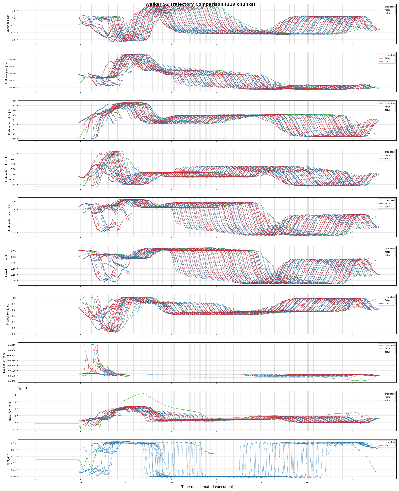

# Walker S2 EDU: Real-Robot Deployment (Rollout)

> Deployment script: `ubt_IL/scripts/deploy/walker_s2/rollout.sh`, shared by simulation and real-robot deployment (differences are described in the workflow pages). This page covers all parameters, safety prechecks, and online evaluation.

## Prerequisites

- The robot is **powered, standing**, and in **developer mode**.
- Startup sequence: power on, enable servos and press `D` to start internal motion control -> place the robot on the ground, hold `A` to enter standing mode. See the [Walker S2 EDU development guide](cc-api.md) for remote details.
- Walker real deployment runs on the robot **Vision board**; copy the project and model there, then build and start the container. The build script detects the board and builds the corresponding ARM container.

## Deployment matrix

| Scenario | Key command |
|------|----------|
| 19D simulation model -> 19D PGC gripper hardware | `ROBOT_MODEL=walker_s2_19d` |
| 10D simulation model -> real deployment (act_async) | `ROBOT_MODEL=walker_s2_10d INFERENCE_TYPE=act_async` |
| Simulation feedback validation | `ZMQ_HOST=127.0.0.1` (start the simulation task and bridge first) |
| Long-running deployment | Use the [inference server](inference-server.md) (no cold start) |

## Deployment steps (real robot)

```bash
# 0. Enter developer mode -- ubt container on the robot control PC
ssh -p 2222 ubt@192.168.11.2    # password: Ubtubt@9880
# Request developer mode: true to enter, false to exit
ros2 service call /sys/task/developer_mode std_srvs/srv/SetBool "{data: true}"
# true = developer mode, false = normal mode
ros2 topic echo /sys/state/walker_mode

# 1. Build and start the inference container -- robot Vision board
# 1.1 Copy the project (code + models) to the Vision board
scp project-code-and-models /home/walker/
# 1.2 Log in to the Vision board and build the container
ssh walker@192.168.11.3          # password: aa
cd project-path/ubt_IL/docker
bash run.sh build
# 1.3 Start the container
bash run.sh start
bash run.sh bash

# 2. Initialize the pose (raise the arm above the table; use --home to return to zero)
bash /ubt_IL/scripts/deploy/walker_s2/robot_ready.sh

# 3. Deploy the real-robot 10D model with asynchronous inference
ROBOT_MODEL=walker_s2_10d \
POLICY_PATH=/ubt_IL/model/walker_pick_part_real_10d_2RGB_act/checkpoints/080000/pretrained_model \
INFERENCE_TYPE=act_async INFERENCE_HZ=1 \
FPS=13 DURATION=60 \
bash /ubt_IL/scripts/deploy/walker_s2/rollout.sh

# 4. (Optional) Verify the camera path; specify camera topic/robot config
/usr/bin/python3 scripts/deploy/walker_s2/preview_camera.py --robot walker_s2_10d
```

> **Know the two machines**:
> - **Jetson `192.168.11.3`** (SSH `walker`, password `aa`): runs the `lerobot-tienkung` container and inference.
> - **Robot control PC `192.168.11.2`** (SSH `ubt`, port 2222): developer mode / ROS 2. It does **not** run the inference container.

## Demo

<video src="../../assets/walker真机部署效果.mp4" controls muted width="100%"></video>

## Initialize / home (robot_ready.sh)

| Command | Purpose |
|------|------|
| `robot_ready.sh` | Ready pose (`--init`, three safe stages, 13 s by default) |
| `robot_ready.sh --home` | Return to zero (three stages, 15 s by default); use after inference |
| `robot_ready.sh --legacy-init` / `--legacy-home` | Fall back to the old four-stage flow |
| Other arguments | Passed through to `robot_control.py` (e.g. `--init-duration 20`) |

## Safety precheck

Deployment runs an **action dimension precheck**: policy `output_features.action.shape[0]` must match robot config `action_order`; otherwise deployment is **refused**.

- `ROBOT_MODEL` must match the training DOF (see below).
- If the policy has no action names, set `ALLOW_DIM_ONLY_POLICY=1` (enabled by default).

## Environment variables

| Variable | Default | Description |
|------|--------|------|
| `POLICY_PATH` | **Required, no default** | Checkpoint directory (containing `config.json`) |
| `ROBOT_MODEL` | `walker_s2_31d` | ROBOT_MODELS registry key (see below) |
| `ROBOT_CONFIG` | `configs/<ROBOT_MODEL>.json` | Full path to the robot config (override for custom configs) |
| `ALLOW_DIM_ONLY_POLICY` | `1` | Allow dimension-only matching when the policy has no action names |
| `STRATEGY` | `base` | Rollout strategy |
| `FPS` | `13` | Control rate |
| `DURATION` | `30` | Run time (seconds) |
| `TASK` | `walker s2 rollout` | Task description |
| `PREVIEW_CAMERA` | `1` | Show the camera preview window |
| `RECORD_ACTIONS` | `1` | Record rollout actions (`RECORD_OUTPUT_DIR` sets the output) |
| `INFERENCE_TYPE` | `sync` | Inference engine (`sync` / `act_async`) |
| `INFERENCE_HZ` | `0.6` | act_async replanning rate |
| `EXECUTION_HORIZON` | `0` | Truncate chunks after N steps (0 = no truncation) |
| `ZMQ_HOST` | `127.0.0.1` | Bridge address (local for simulation feedback; robot IP for cross-machine deployment) |

> Exported parameters: `BLEND_HORIZON=10`, `BODY_PUBLISH_HZ=300`, `BODY_V_MAX=2.0` (bridge chunk blending and publish rate limiting).

## Robot configuration (ROBOT_MODELS registry)

| Registry key | Dimension | End effector | Config file |
|----------|------|-----------|--------------|
| `walker_s2_10d` | 10D (right arm 7 + head 2 + right gripper 1) | PGC right gripper | `walker_s2_gripper_19d.json` (10D is a subset) |
| `walker_s2_19d` | 19D (17 body + 2 grippers) | PGC 1-DOF gripper | `walker_s2_gripper_19d.json` |
| `walker_s2_31d` | 31D (17 body + 14 hands) | V4 dexterous hand 7 DOF | `walker_s2_v4_hand_31d.json` |

## Online evaluation (recording inference trajectories)

`RECORD_ACTIONS=1` (enabled by default) records rollout actions for analyzing model predictions, robot execution, and ACT blending. Records are saved under `ubt_IL/scripts/deploy/output`.



## Offline policy evaluation

Run the offline MSE evaluation (`ubt_IL/scripts/eval/eval_policy.py`, shared with TienKung) before deployment; see [Imitation Learning Platform §6](convert-train.md#6-policy-evaluation-offline-mse).

## Inference server (warm start)

For long-running or multi-task deployment, use the inference server to avoid a cold start (verified on hardware 2026-08-09: ~6 s warm-up to READY; `start`/`stop`/`home`/`shutdown` all pass). It supports `start/stop/home/status/shutdown`, model hot-swap with `load`, and remote launch. See [Inference server](inference-server.md).

> `start` / `home` / `shutdown` move the robot; execute them next to the robot.

## FAQ

| Symptom | Fix |
|------|------|
| Deployment reports a dimension mismatch | Safety precheck refused: match `ROBOT_MODEL` to the policy dimension (10D -> `walker_s2_10d`, 19D -> `walker_s2_19d`, 31D -> `walker_s2_31d`) |
| Robot does not move | On hardware, confirm Bridge2 is running (5561/5562), the camera relay is running (5563), and developer mode is active; in simulation confirm `ZMQ_HOST=127.0.0.1` and the simulation task is running |
| Inference server `start` fails | `start`/`stop` require `INFERENCE_TYPE=act_async`; the `sync` engine has no pause/resume semantics |
| `launch --remote` fails | Confirm `--host` is the **Jetson `192.168.11.3`** (SSH `walker`), not the control PC; the SSH user needs `sudo docker exec` permission |
| Repeated inference server launch fails | The singleton PID file `/tmp/walker_inference_server.pid` exists; `shutdown` cleanly or remove it manually |
| Simulation and hardware camera sizes differ | Simulation RGB is [3,240,320] (10D) or [3,480,640] (33D); hardware is [256,320] etc. Model input must match the training data — do not mix them |
