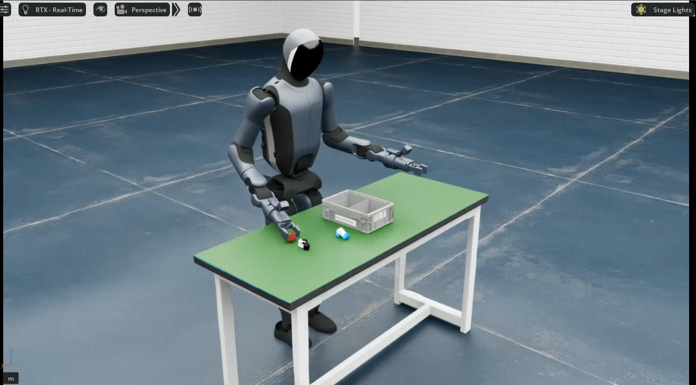

# Walker S2 EDU

Walker S2 EDU is a humanoid robot with 34 DOF, equipped with two PGC two-finger grippers (optionally two 7-DOF V4 dexterous hands).

## Specifications

| Item | Specification |
|------|------|
| DOF | 34 (17 body + hands) |
| End effectors | 2 × PGC two-finger grippers (optional 2 × 7-DOF V4 dexterous hands) |
| Common training dimensions | 10D (right arm 7 + head 2 + right gripper 1) / 19D (17 body + 2 grippers) / 31D (17 body + 2 V4 hands, 14) |
| LeRobot plugin | `ubt_IL/walker/lerobot_robot_walker` |
| USD model | `ubt_sim/assets/robots/walker_s2/s2_v1.usd` |
| Cameras | Four: head stereo left/right + wrist left/right |

> Constant dimensions in single-arm / single-gripper data break normalization during training (QUANTILES NaN/Inf). For real-robot data, reduce the action space to 10D (right arm + head + right gripper).

## Simulation tasks

| Task ID | Scene | Description |
|---------|------|------|
| `UBTSim-WalkerS2-PartSorting-v0` | Part sorting | 4 parts + bins (default) |
| `UBTSim-WalkerS2-PickPart-v0` | Part sorting | Single-part picking: only one part remains on the table; use with `pick_part.py` |

## Documentation

Platform entry points (shared architecture and commands are on the platform overview pages):

- [Simulation Platform · Walker S2 EDU](sim-setup.md) - Container build, launching simulation, batch collection, robot controller tools
- [Imitation Learning Platform · Walker S2 EDU](convert-train.md) - HDF5 -> LeRobot conversion, ACT / Pi0.5 training, offline evaluation

In order of use:

1. [Simulation workflow](sim-workflow.md) - End to end: simulation collection -> conversion -> training -> evaluation -> sim deployment
2. [Real-robot workflow](real-workflow.md) - End to end: real collection -> conversion -> training -> evaluation -> real deployment
3. [Real-robot deployment](deploy.md) - Rollout details, safety prechecks, ROBOT_MODELS registry, online evaluation
4. [Inference server](inference-server.md) - Warm start, ZMQ commands, remote launch, model hot-swap

## Deployment results

**Simulation**

<video src="../assets/walker仿真部署效果.mp4" controls muted width="100%"></video>

**Real robot**

<video src="../assets/walker真机部署效果.mp4" controls muted width="100%"></video>
