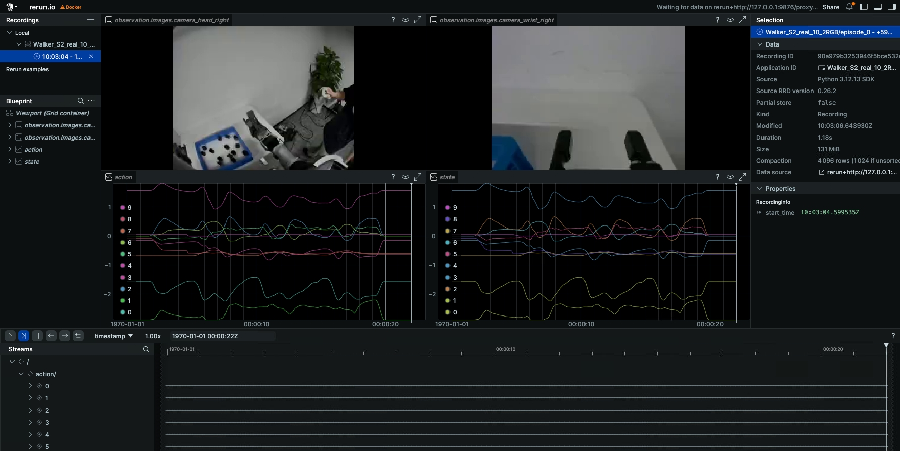
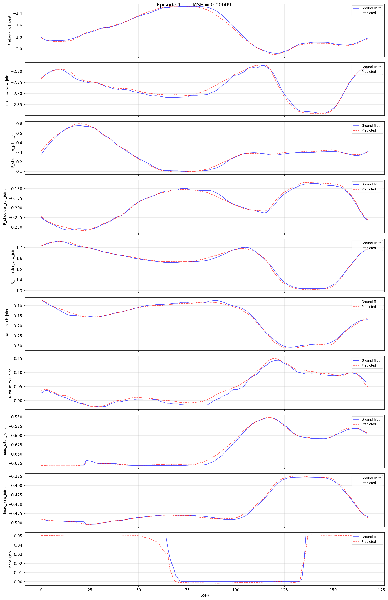
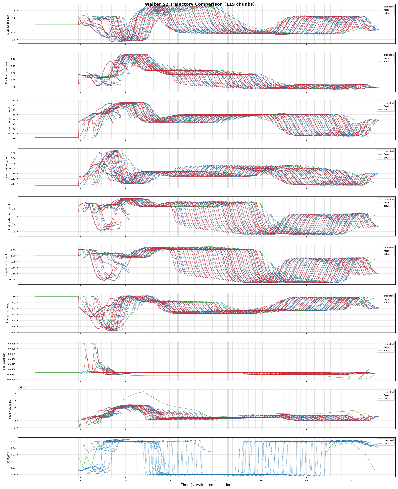

# Walker S2 EDU Real-Robot Workflow: Collect -> Convert -> Train -> Evaluate -> Deploy

> Complete closed loop for **real-robot collection -> Walker S2 EDU deployment**: real collection -> data conversion -> training -> evaluation -> real deployment.
> Code: `ubt_IL/scripts/{convert,train,deploy}/walker_s2/`.

## Contents

- [0. Workflow overview](#0-workflow-overview)
- [1. Prerequisite: real-robot data collection](#1-prerequisite-real-robot-data-collection)
- [2. Start the container](#2-start-the-container)
- [3. Data conversion (HDF5 -> LeRobot)](#3-data-conversion)
  - [3.1 Conversion command](#31-conversion-command)
  - [3.2 Data visualization](#32-data-visualization)
- [4. Policy training](#4-model-training)
- [5. Policy evaluation (offline MSE)](#5-policy-evaluation)
- [6. Model deployment (real robot)](#6-model-deployment-real)
  - [6.1 Inference deployment](#61-inference-deployment)
  - [6.2 Inference server (warm start/external calls)](#62-inference-server)
- [7. FAQ](#7-faq)

## 0. Workflow overview

```
A[Real-robot teleoperation] --> B[HDF5 conversion] --> C[Model training] --> D[Offline MSE] --> E[Real deployment / inference server] --> F[Task validation]
```

## 1. Prerequisite: real-robot data collection

Data is currently collected with the [Thinker Studio](https://thinkercosmos.ubtrobot.com/#/studio) teleoperation platform (see the official documentation), which can export LeRobot v3.0 datasets directly. You can also place collected real-robot HDF5 data under `/ubt_IL/dataset/hdf5/` (or any `SRC_ROOT`) and proceed to conversion.

## 2. Start the container

Training/conversion/deployment all run in the `lerobot-tienkung` container:

```bash
cd ubt_IL/docker

# ⚠️ Must be checked before building: edit interfaceWhiteList in ubt_IL/docker/fastdds_no_shm.xml
# and set <address> to 192.168.11.99 (Walker S2 direct-link subnet). The file is copied into the image
# at build time; changes after the build have no effect.
bash run.sh build      # first time
bash run.sh start
bash run.sh bash       # enter the container; run conversion/training/evaluation there
```

> The container has two Python environments: use `/usr/bin/python3` for ROS and `/lerobot/.venv/bin/python` (default) for LeRobot.
> For real deployment, the container is built on the **robot Jetson board**; the build script detects the board and builds the corresponding ARM container.

<a id="3-data-conversion"></a>

## 3. Data conversion (HDF5 -> LeRobot)

### 3.1 Conversion command

Script: `ubt_IL/scripts/convert/walker_s2/convert.sh`
Core converter: `ubt_IL/scripts/convert/common/convert_to_lerobot.py`
Configs: `/ubt_IL/scripts/convert/walker_s2/configs/`; choose or adapt one for your training needs.

**Real-robot 10D example (right arm + head + right gripper, 2 RGB):**

```bash
CONFIG=/ubt_IL/scripts/convert/walker_s2/configs/walker_s2_real_10d_2RGB.json \
SRC_ROOT=/ubt_IL/dataset/walker-s2-pick-part-real-hdf5 \
TGT_PATH=/ubt_IL/dataset \
REPO_ID=Walker_S2_pick_part_real_10_2RGB \
TASK_NAME=walker_s2_pick_part \
bash /ubt_IL/scripts/convert/walker_s2/convert.sh

# Stationary-trimmed variant (removes grasp-waiting stationary segments to avoid local stationary loops)
TRIM_STATIONARY=1 \
CONFIG=/ubt_IL/scripts/convert/walker_s2/configs/walker_s2_real_10d_2RGB.json \
SRC_ROOT=/ubt_IL/dataset/walker-s2-pick-part-real-hdf5 \
TGT_PATH=/ubt_IL/dataset \
REPO_ID=Walker_S2_pick_part_real_10_2RGB \
TASK_NAME=walker_s2_pick_part \
bash /ubt_IL/scripts/convert/walker_s2/convert.sh

```

#### Environment variables

| Variable | Default | Description |
|------|--------|------|
| `SRC_ROOT` | `/ubt_IL/dataset/walker-s2-real-data` | HDF5 source directory (default real-data location) |
| `TGT_PATH` | `/ubt_IL/dataset` | LeRobot output root |
| `CONFIG` | `configs/walker_s2_real_19d_1RGBD.json` | Conversion config (**the default file is not in the repository**; always specify an existing config) |
| `REPO_ID` | `Walker_S2_real_19_1RGBD` | Output dataset repo_id (local directory name + HF repo name) |
| `ROBOT_TYPE` | `walker_s2` | Robot type (written to metadata) |
| `TASK_NAME` | `walker_s2_real` | Task name (written to metadata) |
| `FPS` | `15` | Dataset frame rate (`auto` uses the source HDF5 rate) |
| `VCODEC` | `h264` | Video codec (`h264`/`jpeg`/`png`) |
| `HDF5_REL_PATH` | `hdf5/metadata_aligned.hdf5` | Source HDF5 relative path |
| `RESAMPLE_FPS` | Empty | Resample to the target rate when set |
| `LABEL_ROOT` | Empty | Label root (used when task labels exist) |
| `TRIM_STATIONARY` | Empty | Trim stationary frames when set (`--trim-stationary`) |
| `STATIONARY_KEY` | `action` | Key used for stationary detection |
| `STATIONARY_WINDOW` | Auto (`0.3 × fps`) | Stationary detection window |
| `STATIONARY_THRESH` | `0.03` | Stationary detection threshold |
| `STATIONARY_CAP` | `8` | Maximum consecutive stationary frames |
| `STATIONARY_MIN_RUN` | `3` | Minimum valid run length |
| `STATIONARY_RANGE_EPS` | `1e-3` | Stationary interval tolerance |

> Pass-through options: `--overwrite` replaces an existing dataset; `--save_one true` uses single-file mode.

### 3.2 Data visualization

After conversion, inspect the dataset with the LeRobot visualizer:

```bash
# Inside the container:
HF_HUB_OFFLINE=1 lerobot-dataset-viz \
  --repo-id <dataset name> \
  --episode-index 0 \
  --root /ubt_IL/dataset/<dataset name>
```

Example:

```bash
# Visualize the dataset converted in section 3.1
HF_HUB_OFFLINE=1 lerobot-dataset-viz \
  --repo-id Walker_S2_real_10_2RGB \
  --episode-index 0 \
  --root /ubt_IL/dataset/Walker_S2_real_10_2RGB
```

Preview:


> Check especially: image resolution, state/action dimension and order, grip range, and empty episodes.

<a id="4-model-training"></a>

## 4. Policy training

Training script: `/ubt_IL/scripts/train/walker_s2/train.sh`
Configs: `/ubt_IL/scripts/train/walker_s2/configs/`; choose or adapt one for your training needs.

```bash
# Specify the real-robot training config explicitly, or override common parameters.
# Single-part policy: use the pick_part config + matching dataset.
CONFIG=/ubt_IL/scripts/train/walker_s2/configs/train_config_pick_part_real_10d_2RGB.json \
DATASET_REPO_ID=Wlaker_Pick_part_real_10d_2RGB \
OUTPUT_DIR=/ubt_IL/model/Wlaker_Pick_part_real_10d_2RGB_act \
STEPS=50000 SAVE_FREQ=5000 BATCH_SIZE=8 \
bash /ubt_IL/scripts/train/walker_s2/train.sh

# Resume (CONFIG points to train_config.json inside the checkpoint)
CONFIG=/ubt_IL/model/Wlaker_Pick_part_real_10d_2RGB_act/checkpoints/last/pretrained_model/train_config.json \
RESUME=true \
bash /ubt_IL/scripts/train/walker_s2/train.sh
```

**Without train.sh** (call `lerobot-train` directly with `--xxx=yyy` overrides; run from `/ubt_IL/lerobot`):

```bash
# Train from scratch
cd /ubt_IL/lerobot
HF_HUB_OFFLINE=1 /lerobot/.venv/bin/lerobot-train \
  --config_path=/ubt_IL/scripts/train/walker_s2/configs/train_config_pick_part_real_10d_2RGB.json \
  --output_dir=/ubt_IL/model/Wlaker_Pick_part_real_10d_2RGB_act \
  --steps=50000 --save_freq=5000 --batch_size=8

# Resume
HF_HUB_OFFLINE=1 /lerobot/.venv/bin/lerobot-train \
  --config_path=/ubt_IL/model/Wlaker_Pick_part_real_10d_2RGB_act/checkpoints/last/pretrained_model/train_config.json \
  --resume=true
```

#### Overrides

| Variable | Default | Description |
|------|--------|------|
| `CONFIG` | `$SCRIPT_DIR/configs/train_config_walker_s2_sim_act_10_2RGB.json` | Training config JSON (**defaults to the simulation config**; specify a real config such as `train_config_pick_part_real_10d_2RGB.json`) |
| `DATASET_REPO_ID` | From config | Dataset repo_id |
| `DATASET_ROOT` | From config | Dataset root |
| `OUTPUT_DIR` | From config | Model output directory |
| `STEPS` | From config | Total training steps |
| `SAVE_FREQ` | From config | Checkpoint save frequency |
| `BATCH_SIZE` | From config | Batch size |
| `SEED` | From config | Random seed |
| `DEVICE` | From config | Training device (`cuda`/`cpu`) |
| `RESUME` | `false` | `true` resumes from the checkpoint |
| `WANDB_ENABLE` | `false` | wandb logging switch |

> `HF_HUB_OFFLINE=1` is enabled by default (offline training). Environment variables override config values only when **explicitly set**.

<a id="5-policy-evaluation"></a>

## 5. Policy evaluation (offline MSE)

Runs offline MSE evaluation (prediction vs ground truth) on a LeRobot dataset without connecting to the robot and generates per-episode comparison plots.
Script (shared with TienKung): `ubt_IL/scripts/eval/eval_policy.py`.

Example:
```bash
cd /ubt_IL/lerobot

/lerobot/.venv/bin/python /ubt_IL/scripts/eval/eval_policy.py \
  --policy-path /ubt_IL/model/walker_pick_part_real_10d_2RGB_act/checkpoints/080000/pretrained_model \
  --dataset-path /ubt_IL/dataset/Wlaker_Pick_part_real_10d_2RGB \
  --episodes 10 \
  --inference-freq 1 \
  --plot \
  --plot-dir /ubt_IL/scripts/eval/output/eval_walker_pick_part_real_10d_2RGB_act \
  --output /ubt_IL/scripts/eval/output/eval_walker_pick_part_real_10d_2RGB_act/results.json \
  --device cuda
```

Preview:


| Argument | Description |
|------|------|
| `--policy-path` | `pretrained_model` directory (containing `config.json` + `model.safetensors`) |
| `--dataset-path` | LeRobot dataset root (containing `meta/info.json`) |
| `--episodes` | Number of episodes to evaluate (default: all) |
| `--inference-freq` | Run inference every N steps and reuse the predicted chunk in between (emulates real deployment; `1` = every step) |
| `--plot` / `--plot-dir` | Per-episode prediction-vs-ground-truth plots and output directory |
| `--output` | Result JSON path |
| `--device` | `cuda` or `cpu` (default `cuda`, falls back automatically) |

<a id="6-model-deployment-real"></a>

## 6. Model deployment (real robot)

#### Prerequisites:
 - The robot is powered, standing, and in developer mode.
 - Sequence: power on, enable servos and press D to start internal motion control -> place the robot on the ground, hold A to enter standing mode. See the [Walker S2 EDU development guide](cc-api.md) for remote details.
 - Walker real deployment runs on the robot Vision board; copy the project and model to the board, then build and start the container.

<a id="61-inference-deployment"></a>

### 6.1 Inference deployment

Script: `ubt_IL/scripts/deploy/walker_s2/rollout.sh`.

**Deployment steps**:

```bash
# 0. Enter developer mode -- ubt container on the robot Vision board
ssh -p 2222 ubt@192.168.11.2/3  # password: Ubtubt@9880
# Request developer mode: true to enter, false to exit
ros2 service call /sys/task/developer_mode std_srvs/srv/SetBool "{data: true}"
# true = developer mode, false = normal mode
ros2 topic echo /sys/state/walker_mode

# 1. Build and start the inference container -- robot Vision board
# 1.1 Copy the project to the Vision board
scp project-code-and-models /home/walker/
# 1.2 Log in to the Vision board and build the container
ssh walker@192.168.11.3 # password: aa
cd project-path/ubt_IL/docker
# ⚠️ Must be checked before building: edit interfaceWhiteList in fastdds_no_shm.xml
# and set <address> to 192.168.11.99 (Walker S2 direct-link subnet); the file is copied at build time.
bash run.sh build
# 1.3 Start the container
bash run.sh start
bash run.sh bash

# 2. Initialize the pose (raise the arm above the table)
bash /ubt_IL/scripts/deploy/walker_s2/robot_ready.sh

# 3. Deploy the real-robot 10D model with asynchronous inference
ROBOT_MODEL=walker_s2_10d \
POLICY_PATH=/ubt_IL/model/walker_pick_part_real_10d_2RGB_act/checkpoints/080000/pretrained_model \
INFERENCE_TYPE=act_async INFERENCE_HZ=1 \
FPS=13 DURATION=60 \
bash /ubt_IL/scripts/deploy/walker_s2/rollout.sh

# (Optional) Verify the camera path; specify camera topic/robot config
/usr/bin/python3 scripts/deploy/walker_s2/preview_camera.py --robot walker_s2_10d
```

**Demo** (real-robot deployment):

<video src="../../assets/walker真机部署效果.mp4" controls muted width="100%"></video>

#### Environment variables

| Variable | Default | Description |
|------|--------|------|
| `POLICY_PATH` | **Required, no default** | Checkpoint directory (containing `config.json`) |
| `ROBOT_MODEL` | `walker_s2_31d` | ROBOT_MODELS registry key (see below) |
| `ROBOT_CONFIG` | `configs/<ROBOT_MODEL>.json` | Full path to the robot config (override for custom configs) |
| `ALLOW_DIM_ONLY_POLICY` | `1` | Allow dimension-only matching when the policy has no action names |
| `STRATEGY` | `base` | Rollout strategy |
| `FPS` | `13` | Control rate |
| `DURATION` | `30` | Run time (seconds) |
| `TASK` | `walker s2 rollout` | Task description |
| `PREVIEW_CAMERA` | `1` | Show the camera preview window |
| `RECORD_ACTIONS` | `1` | Record rollout actions (`RECORD_OUTPUT_DIR` sets the output) |
| `INFERENCE_TYPE` | `sync` | Inference engine (`sync` / `act_async`) |
| `INFERENCE_HZ` | `0.6` | act_async replanning rate |
| `EXECUTION_HORIZON` | `0` | Truncate chunks after N steps (0 = no truncation) |
| `ZMQ_HOST` | `127.0.0.1` | Bridge address (keep default when Bridge2 is on the same host; use the robot IP for cross-machine deployment) |

#### Online evaluation (recording inference trajectories)

Set `RECORD_ACTIONS=1` during deployment to record rollout actions for analyzing model predictions, robot execution, and ACT blending. Records are saved under `ubt_IL/scripts/deploy/output`.



#### Robot configuration (ROBOT_MODELS registry)

| Registry key | Dimension | End effector | Config file |
|----------|------|-----------|--------------|
| `walker_s2_10d` | 10D (right arm 7 + head 2 + right gripper 1) | PGC right gripper | `walker_s2_gripper_19d.json` (10D is a subset) |
| `walker_s2_19d` | 19D (17 body + 2 grippers) | PGC 1-DOF gripper | `walker_s2_gripper_19d.json` |
| `walker_s2_31d` | 31D (17 body + 14 hands) | V4 dexterous hand 7 DOF | `walker_s2_v4_hand_31d.json` |

<a id="62-inference-server"></a>

### 6.2 Inference server (warm start/external calls)

Inference server script: `ubt_IL/scripts/deploy/walker_s2/inference_server.sh`
Client script: `ubt_IL/scripts/deploy/walker_s2/inference_client.sh`

`rollout.sh` pays a long cold start on every run (policy load to CUDA + bridge startup). The inference server stays **resident** and pre-warmed; external clients use ZMQ commands `start/stop/home/status/shutdown` and can `load` models for hot-swapping VLA tasks and other tasks such as navigation or box carrying. See [Inference server](inference-server.md).

> ✅ **Verified on hardware (2026-08-09)**: pre-warm to READY in ~6 s; `start` -> RUNNING; `stop` / `home` (no jitter) / `shutdown` all pass.

```bash
# 1. Start the service (inside the container; pre-warms in the background to READY; the engine is paused and the robot does not move)
cd /ubt_IL/scripts/deploy/walker_s2
ROBOT_MODEL=walker_s2_10d \
POLICY_PATH=/ubt_IL/model/walker_pick_part_real_10d_2RGB_act/checkpoints/080000/pretrained_model \
INFERENCE_TYPE=act_async INFERENCE_HZ=1 FPS=15 \
bash inference_server.sh

# 2. Check whether the service is READY; if false, wait and query again
bash inference_client.sh status

# 3. Start / stop inference (moves the robot!)
bash inference_client.sh start
bash inference_client.sh stop

# 4. Return home / shut down (both return to home_position)
bash inference_client.sh home
bash inference_client.sh shutdown
```

> `start` / `home` / `shutdown` move the robot; execute them next to the robot.

#### Remote launch (load a model with explicit parameters)

Launch remotely from another machine (SSH + `docker exec` on the **Jetson running the container**, polling until READY):

```bash
cd /ubt_IL/scripts/deploy/walker_s2
bash inference_client.sh launch \
  --policy-path /ubt_IL/model/walker_pick_part_real_10d_2RGB_act/checkpoints/080000/pretrained_model \
  --robot-model walker_s2_10d --inference-hz 2 --fps 13 \
  --remote --host 192.168.11.3 --ssh-user walker
```

> **Know the two machines**:
> - **Jetson `192.168.11.3`** (SSH `walker`, port 22/2222): runs the `lerobot-tienkung` container and inference. This is the `--host` for `launch --remote`.
> - **Robot control PC `192.168.11.2`** (SSH `ubt`, port 2222): `dev_mode.sh` developer mode / ROS 2. It does **not** run the inference container; do not use it as `--host`.

#### Client commands

```bash
bash inference_client.sh status                       # query state (state/model/loop_hz/chunk_id/...)
bash inference_client.sh start                        # start inference (engine reset+resume -> RUNNING)
bash inference_client.sh stop                         # stop inference (engine pause -> READY, hold current pose)
bash inference_client.sh home                         # return to home_position (pause, then smooth chunk)
bash inference_client.sh load --policy-path /ubt_IL/model/<other>/.../pretrained_model --robot-model walker_s2_10d
                                                       # hot-swap the model while running (full rebuild incl. reconnect)
bash inference_client.sh shutdown                     # shut down (home + kill bridge + exit)
bash inference_client.sh watch                        # subscribe to the status PUB stream (Ctrl-C to exit)
```

#### Environment variables (inference_server.sh)

| Variable | Default | Description |
|------|--------|------|
| `POLICY_PATH` | **Required** | `pretrained_model` directory |
| `ROBOT_MODEL` | `walker_s2_31d` | ROBOT_MODELS registry key |
| `ROBOT_CONFIG` | Empty | Custom robot config JSON (overrides ROBOT_MODEL) |
| `INFERENCE_TYPE` | `act_async` | Inference engine (`start`/`stop` require act_async) |
| `INFERENCE_HZ` | `0.6` | act_async replanning rate |
| `EXECUTION_HORIZON` | `0` | Truncate chunks after N steps |
| `FPS` | `13` | Control loop FPS |
| `BLEND_HORIZON` | `10` | Bridge chunk blending overlap points |
| `BODY_PUBLISH_HZ` | `300` | Bridge 300 Hz body publish rate |
| `BODY_V_MAX` | `2.0` | Bridge rate-limit maximum joint velocity |
| `SERVER_CMD_PORT` | `5570` | ZMQ REP command port |
| `SERVER_STATUS_PORT` | `5571` | ZMQ PUB status port |
| `PREVIEW_CAMERA` | `0` | Server does not open the preview window by default |

> Singleton: `/tmp/walker_inference_server.pid`; a second launch is refused while it exists. Log: `/tmp/walker_inference_server.log`.
> State machine: `LOADING` (warm-up/rebuild) -> `READY` (idle) ⇄ `RUNNING` (executing); `home` -> `RETURNING_HOME` -> `READY`.

## 7. FAQ

| Problem | Cause / fix |
|------|-------------|
| Conversion reports "config does not exist" | The `convert.sh` default `CONFIG=configs/walker_s2_real_19d_1RGBD.json` is not in the repository; specify an existing config (`walker_s2_real_10d_2RGB.json`) |
| Real-robot 19D data cannot be converted | The repository only provides a 10D real config; write `walker_s2_real_19d_*.json` based on the joint order in `walker_s2_gripper_19d.json` |
| Dataset frame rate differs from expected | Collection runs at 15 Hz and conversion defaults to `FPS=15`; use `FPS=auto` for the source rate or `RESAMPLE_FPS` to resample |
| Deployment reports a dimension mismatch | Safety precheck refused: policy `output_features.action.shape[0]` does not match robot config `action_order`. Match `ROBOT_MODEL` to the policy dimension (10D -> `walker_s2_10d`, 19D -> `walker_s2_19d`, 31D -> `walker_s2_31d`); policies without action names need `ALLOW_DIM_ONLY_POLICY=1` |
| Inference server `start` fails | `start`/`stop` rely on act_async pause/resume; the `sync` engine has no such semantics, so use `INFERENCE_TYPE=act_async` |
| `launch --remote` fails | Confirm `--host` is the **Jetson `192.168.11.3`** (SSH `walker`), not the control PC; the SSH user needs `sudo docker exec` permission |
| Robot does not move during deployment | Confirm Bridge2 is running (5561/5562/5563), `dev_mode.sh` has switched to developer mode, and `status` shows the bridge connected |
| Repeated inference server launch fails | The singleton PID file `/tmp/walker_inference_server.pid` exists; `shutdown` cleanly or remove it manually |
