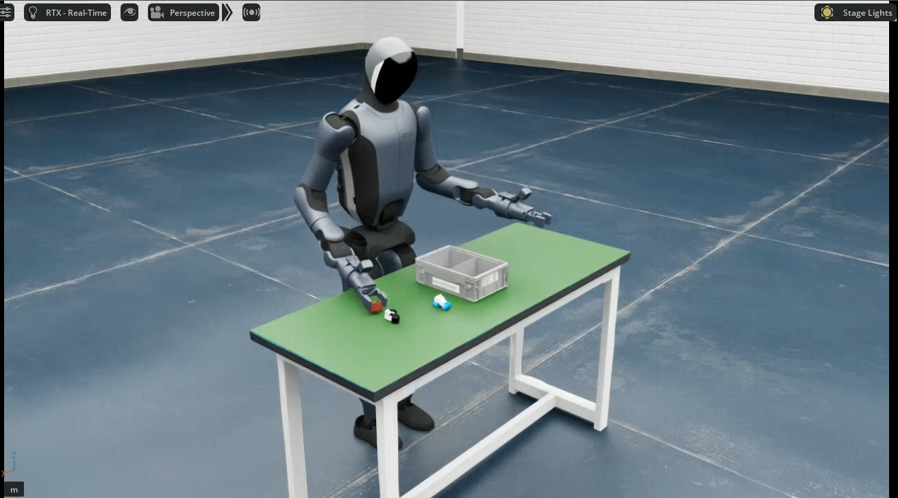
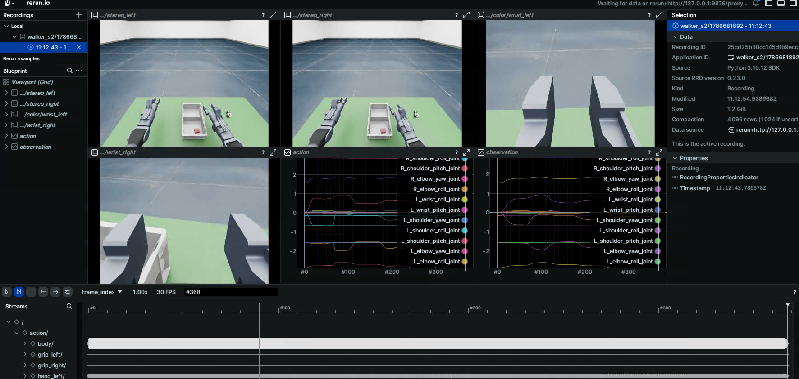

# Walker S2 EDU: Simulation Platform

The Walker S2 EDU simulation is built on NVIDIA Isaac Sim (Isaac Lab 2.2.0). A ROS2-ZMQ bridge publishes simulation state and images on **exactly the same ROS 2 topics as the real robot**, enabling sim-to-real consistent teleoperation and data collection. The whole environment runs in a Docker container.



## Quick start

### 1. Build the environment (host)

The container build is identical for all robots; see [Simulation Platform · Container Setup](../sim/docker.md) (`build` / `start` / `init` / `check` / `bash`).

> ⚠️ **Must be changed before building**: edit `interfaceWhiteList` in `ubt_sim/docker/fastdds_no_shm.xml` and set `<address>` to `192.168.11.99` (the Walker S2 direct-link subnet). The file is copied into the image at build time; changes after the build have no effect.

### 2. Launch simulation (container)

```bash
bash run.sh bash                       # enter the container (ROS 2 + Walker SDK environment sourced automatically)
UBT_SIM_TASK=UBTSim-WalkerS2-PickPart-v0 bash /ubt_sim/scripts/start_sim.sh   # start simulation + bridge
```

Select the task scene with `UBT_SIM_TASK`.

| Task ID | Scene | Description |
|---------|------|------|
| `UBTSim-WalkerS2-PartSorting-v0` | Part sorting | 4 parts + bins (default) |
| `UBTSim-WalkerS2-PickPart-v0` | Part sorting | Single-part picking: only one part on the table, used with `pick_part.py` |

Demo (pick-and-place):

<video src="../../assets/walker.mp4" controls muted width="100%"></video>

- Press **`R`** to reset the robot/scene; the collection script can also publish `/sim/cmd_reset` with `--reset-scene`.
- When the simulation window closes, the exit trap in `start_sim.sh` stops the bridge automatically.

Common environment variables/arguments (combinable):

| Variable | Purpose | Default |
| --- | --- | --- |
| `UBT_SIM_TASK` | Task name (also determines the robot type) | `UBTSim-TienkungPro-Parlor-v0`; see the task table for Walker S2 EDU |
| `--headless` | Run without a window | Common on headless servers |
| `--perf_stats` | Print performance statistics | Frame-rate debugging |
| `--device cpu\|cuda\|cuda:N` | Execution device | For switching GPUs outside load-only mode |

### 3. Data collection (container, system Python 3.10)

```bash
# Grasp a part and record
/usr/bin/python3 /ubt_sim/teleoperation/control/walker_s2/pick_part.py --save --reset-scene --robot-init

# Batch loop (400 iterations by default)
bash /ubt_sim/teleoperation/control/walker_s2/save_data.sh
```

- `pick_part.py` performs one part pick-and-place: reads `/sim/part_states` live -> pregrasp -> grasp -> lift -> place in the bin -> return.
- `--save` enables recording: 17 body joints + both hands + grippers + four RGB cameras and timestamps are written to HDF5 (by default only successful episodes are saved).
- `--reset-scene` resets the scene first; `--robot-init` moves the robot to its initial pose (setup actions, not recorded).
- `save_data.sh` is the batch script; adjust its internal parameters per task (currently 400 single-part grasps by default).
- Output: `/ubt_sim/dataset/walker_s2/<timestamp>/trajectory.hdf5`.

Detailed parameters:

| Argument | Default | Description |
| --- | --- | --- |
| `--part <name>` | `part_a_red` | Part name (`part_a_ori` / `part_a_red` / `part_b_blue` / `part_b_ori`) |
| `--all-parts` / `--parts <name...>` | - | Grasp all four parts in order / custom order |
| `--side left\|right` | `right` | Grasping arm |
| `--reset-scene` | Off | Publish `/sim/cmd_reset` before grasping |
| `--robot-init` | Off | Move to READY_POSE before grasping (equivalent to `state --init`) |
| `--randomize-parts` / `--no-randomize-parts` | On | Randomize part poses before multi-part grasping |
| `--save` | Off | Record HDF5 (with `--save-only-success`, only successful episodes by default) |
| `--capture-hz <Hz>` | `15.0` | HDF5 capture rate |
| `--unlock-waist` | Off | Unlock waist IK |

### 4. Robot controller (container, system Python 3.10)

Unified entry point `walker_s2_controller.py`, usable for both simulation and hardware:

```bash
# Initialize the robot pose (staged move to READY_POSE)
/usr/bin/python3 /ubt_sim/teleoperation/control/walker_s2/walker_s2_controller.py --init
# See --help for more; subcommand parameters: <subcommand> --help
```

Subcommands:

| Subcommand | Description | Common arguments |
| --- | --- | --- |
| `state` | Joint/gripper/end-effector state, single-joint moves, ready pose, gripper control | `--print-state` `--init` `--grip-open` `--move-joint --joint <name> --pos <rad>` |
| `joint` | Joint/hand debugging | `--print` `--move JOINT=ANGLE` `--hand-open` `--monitor` |
| `endpoint` | End-effector/TCP pose test | `--no-move` `--side left` |
| `home` | Staged return to all-zero home + open hands | No arguments |
| `analyze` | Joint step/sine response analysis + CSV | `--joint <name> --step <rad>` `--sine` `--listen` `--csv <path>` |
| `camera` | Camera topic info/preview/save | `--preview` `--save --count 5` `--topic <topic>` |

Examples:

```bash
/usr/bin/python3 walker_s2_controller.py state --print-state                # show joint/gripper/end-effector state
/usr/bin/python3 walker_s2_controller.py state --init                       # staged move to the ready pose
/usr/bin/python3 walker_s2_controller.py joint --move R_elbow_yaw_joint=0.5 # move one joint to 0.5 rad (press Enter to confirm)
/usr/bin/python3 walker_s2_controller.py home                               # staged return to all-zero home + open hands
/usr/bin/python3 walker_s2_controller.py analyze --joint R_elbow_yaw_joint --step 0.5  # joint step analysis
/usr/bin/python3 walker_s2_controller.py camera --preview                   # live camera preview
```

#### Camera test (`camera` subcommand)

Walker S2 EDU publishes four cameras (head stereo left/right + wrist left/right) over ZMQ (5657) and ROS 2 topics:

```bash
# Live preview (cv2.imshow, requires X11; use -X forwarding over SSH; press Q/ESC to exit)
/usr/bin/python3 /ubt_sim/teleoperation/control/walker_s2/walker_s2_controller.py camera --preview

# Inspect/save all four camera images
/usr/bin/python3 /ubt_sim/teleoperation/control/walker_s2/walker_s2_controller.py camera --save --count 5
```

| Argument | Default | Description |
| --- | --- | --- |
| `--topic` | bridge config -> `/sensor/camera/stereo/color/raw` | Camera topic to subscribe to |
| `--msg-type` | `Image2m` | Message type (`Image8k`/`Image512k`/`Image1m`/`Image2m`/`Image4m`/`Image6m`/`Image8m`/`sensor_msgs/Image`) |
| `--preview` | Off | cv2.imshow live preview (Q/ESC to exit, requires X11) |
| `--save` | Off | Save frames as PNG (`camera_frame_<timestamp>.png`) |
| `--count <N>` | `0` (unlimited) | Maximum frames to save/preview, then exit |
| `--interval <seconds>` | `1.0` | Print/save loop interval |
| `--no-print` | Off | Suppress frame info (all modes) |

### 5. Dataset preview and playback (container)

Reads `dataset/walker_s2/<timestamp>/trajectory.hdf5`, previews cameras + joint curves (Rerun), or replays recorded actions on simulation/hardware topics.



```bash
# Preview an HDF5 dataset
/usr/bin/python3 /ubt_sim/teleoperation/tools/playback_walker_s2.py \
    --episode dataset/walker_s2/1786681892 --mode preview --web-port 9090

# Action playback (simulation/hardware)
/usr/bin/python3 /ubt_sim/teleoperation/tools/playback_walker_s2.py \
    --episode dataset/walker_s2/1786681892 --mode control
```

See [Playback](../common/playback.md) for all options and safety notes.

## Simulation modules

| Module | Path | Description |
| --- | --- | --- |
| Docker orchestration | `ubt_sim/docker/run.sh` | Image build, container lifecycle, bridge start/stop |
| Environment variables | `ubt_sim/docker/env.sh` | Container name, image, `ROS_DOMAIN_ID` |
| Simulation launcher | `ubt_sim/scripts/start_sim.sh` | Detects the robot from `UBT_SIM_TASK` and starts the bridge |
| Task definitions | `ubt_sim/source/ubt_sim/task/walker_*/` | Walker S2 scene definitions |
| Simulation config | `ubt_sim/config/walker_s2/` | `part_sorting.yaml` / `pick-part.yaml` / `parlor.yaml` |
| ROS2-ZMQ bridge | `ubt_sim/teleoperation/bridges/walker_s2/` | Bridge script + `walker_s2_bridge_config.yaml` |
| Teleoperation and collection | `ubt_sim/teleoperation/control/walker_s2/` | `walker_s2_controller.py` / `pick_part.py` / `carry_box.py` / `keyboard_ee_control.py` / `save_data.sh` |
| Data output | `ubt_sim/dataset/walker_s2/<timestamp>/trajectory.hdf5` | Collected episodes |

## Walker S2 EDU specifics

### GPU rendering + CPU PhysX

Walker S2 EDU uses **GPU rendering + CPU PhysX** by default: `start_sim.sh` / `sim_runner.py` set the rendering/AppLauncher device to `cuda:0` but the Isaac Lab physics/env device to `cpu`. This avoids a PhysX GPU tensor device mismatch triggered by `get_dof_velocities()` during Walker S2 articulation initialization with Isaac Sim 5.0 + Isaac Lab 2.2. Do not switch physics back to GPU by default; for experiments set `UBT_SIM_WALKER_S2_PHYSICS_DEVICE=cuda:0` explicitly.

### Walker SDK ROS 2 message packages

The bridge and collection scripts depend on Walker SDK ROS 2 messages (`rosa_msgs` / `shm_msgs` / `mc_task_msgs` / `mc_state_msgs` / `ecat_task_msgs`), built by `bash run.sh init` into `/opt/ubt_sim/walker_sdk_ros2_msgs/install` and sourced automatically by `run.sh bash`. The DDS middleware is `rmw_cyclonedds_cpp`.

## Troubleshooting

- **`bash run.sh check` reports errors**: follow the prompt and rerun `bash run.sh init`; verify `numpy<2`, `bodyctrl_msgs`, and the Walker SDK ROS 2 messages.
- **Collection script fails to import rclpy / message types**: use `/usr/bin/python3`, not Isaac Sim Python, and confirm `bash run.sh init` built the message packages.
- **`save_data.sh` trips the consecutive-failure breaker**: usually the bridge is not ready. Verify the simulation window is running and the bridge process exists (`pgrep -f walker_s2_ros2_zmq_bridge`), or run `bash run.sh bridge-start` separately.
- **Simulation reports "Walker SDK messages not built"**: run `cd /ubt_sim/docker && bash run.sh init` inside the container.
- **X11 unavailable / no simulation window**: run `xhost +` on the host and verify `DISPLAY` is forwarded; on headless machines only `UBT_SIM_LOAD_ONLY=1` preview is available.
- **Keyboard teleoperation cannot capture input**: pynput does not work in headless containers; run `keyboard_ee_control.py` on the host with a graphical session.

After collection, continue with [Imitation Learning Platform](convert-train.md).
