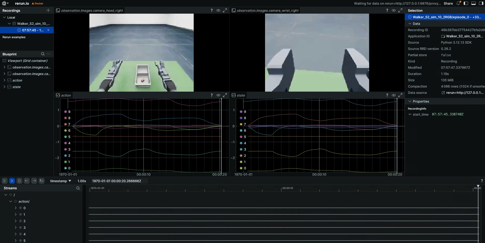
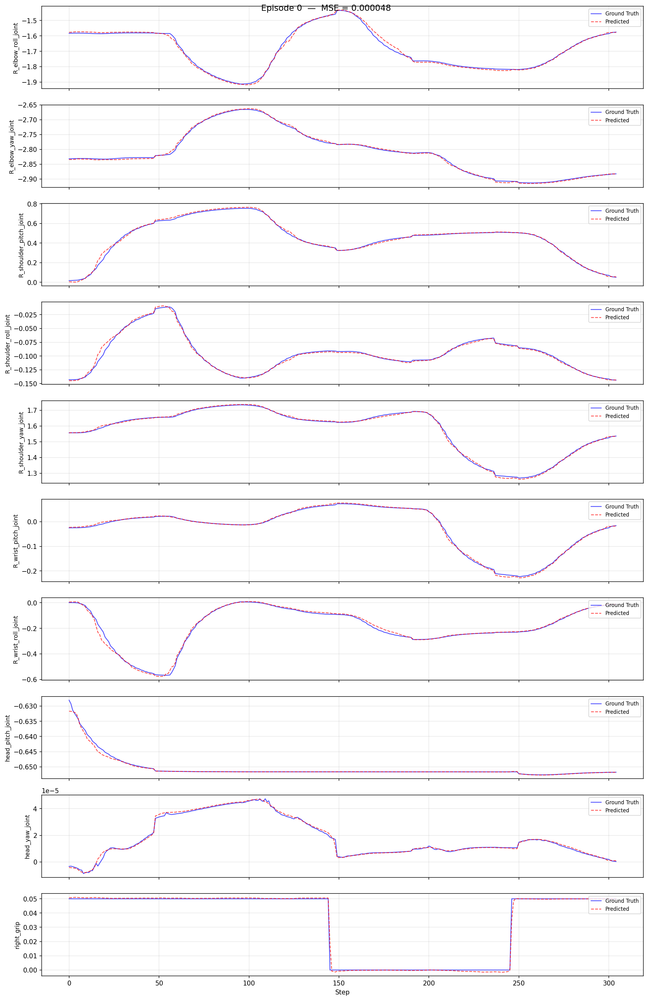
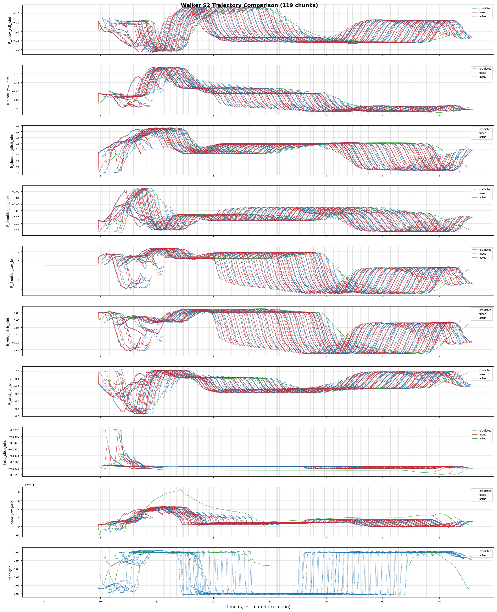

# Walker S2 EDU Simulation Workflow: Collect -> Convert -> Train -> Evaluate -> Deploy

> Complete closed loop for **Isaac Sim -> Walker S2 EDU hardware**: simulation collection -> data conversion -> training -> evaluation -> simulation feedback deployment.
> Code: `ubt_IL/scripts/{convert,train,deploy}/walker_s2/` and the `ubt_sim/` simulation project.

## Contents

- [0. Workflow overview](#0-workflow-overview)
- [1. Prerequisite: simulation data collection](#1-prerequisite-simulation-data-collection)
- [2. Start the container](#2-start-the-container)
- [3. Data conversion (HDF5 -> LeRobot)](#3-data-conversion)
  - [3.1 Conversion command](#31-conversion-command)
  - [3.2 Data visualization](#32-data-visualization)
- [4. Policy training](#4-model-training)
- [5. Policy evaluation (offline MSE)](#5-policy-evaluation)
- [6. Model deployment (simulation feedback)](#6-model-deployment-sim)
  - [6.1 Rollout deployment](#61-rollout)
  - [6.2 Inference server (warm start/external calls)](#62-inference-server)
- [7. FAQ](#7-faq)

## 0. Workflow overview

```mermaid
A[Simulation collection hdf5] --> B[Data conversion] --> C[Model training] --> D[Offline MSE] --> E[Simulation deployment]
```

## 1. Prerequisite: simulation data collection

Data comes from **Isaac Sim collection** (`ubt_sim`); see [Simulation Platform](sim-setup.md) for details.

### 1.1 Launch the simulation environment and task

```bash
cd ubt_sim/docker
bash run.sh bash                       # enter the container (ROS 2 + Walker SDK environment sourced)
UBT_SIM_TASK=UBTSim-WalkerS2-PickPart-v0 bash /ubt_sim/scripts/start_sim.sh   # start simulation + bridge
```

### 1.2 Collection commands

Single episode (`--save` records, `--reset-scene` resets, `--robot-init` initializes the pose):

```bash
/usr/bin/python3 /ubt_sim/teleoperation/control/walker_s2/pick_part.py --save --reset-scene --robot-init
```

Batch collection (400 iterations by default):

```bash
bash /ubt_sim/teleoperation/control/walker_s2/save_data.sh
```

### 1.3 Output

- Output directory: `/ubt_sim/dataset/walker_s2/<timestamp>/trajectory.hdf5` (15 Hz)
- After collection, copy the HDF5 data to `/ubt_IL/dataset/walker-s2-sim-data/` so the container can mount it easily.

## 2. Start the container

Training/conversion/deployment all run in the `lerobot-tienkung` container:

```bash
cd ubt_IL/docker
bash run.sh build      # first time
bash run.sh start
bash run.sh bash       # enter the container; run conversion/training/evaluation there
```

> The container has two Python environments: use `/usr/bin/python3` for ROS and `/lerobot/.venv/bin/python` (default) for LeRobot.

## 3. Data conversion (HDF5 -> LeRobot)

### 3.1 Conversion command

Script: `ubt_IL/scripts/convert/walker_s2/convert.sh`; configs in `/ubt_IL/scripts/convert/walker_s2/configs/`; choose or adapt one for your training needs.

```bash
# Simulation conversion
CONFIG=/ubt_IL/scripts/convert/walker_s2/configs/walker_s2_sim_10d_2RGB.json \
SRC_ROOT=/ubt_IL/dataset/Walker-s2-pick-part-sim \
HDF5_REL_PATH=trajectory.hdf5 \
TGT_PATH=/ubt_IL/dataset \
REPO_ID=Walker_S2_sim_10_2RGB \
TASK_NAME=walker_s2_sim_pick_part \
bash /ubt_IL/scripts/convert/walker_s2/convert.sh


# Stationary frames can trap the policy in a local stationary loop; enable trimming with TRIM_STATIONARY=1
TRIM_STATIONARY=1 \
CONFIG=/ubt_IL/scripts/convert/walker_s2/configs/walker_s2_sim_10d_2RGB.json \
SRC_ROOT=/ubt_IL/dataset/Walker-s2-pick-part-sim \
HDF5_REL_PATH=trajectory.hdf5 \
TGT_PATH=/ubt_IL/dataset \
REPO_ID=Walker_S2_sim_10_2RGB \
TASK_NAME=walker_s2_sim_pick_part \
bash /ubt_IL/scripts/convert/walker_s2/convert.sh

```

#### Environment variables

| Variable | Default | Description |
|------|--------|------|
| `SRC_ROOT` | `/ubt_IL/dataset/walker-s2-real-data` | HDF5 source directory (change to the sim data directory for simulation) |
| `TGT_PATH` | `/ubt_IL/dataset` | LeRobot output root |
| `CONFIG` | `configs/walker_s2_real_19d_1RGBD.json` | Conversion config (**the default file is not in the repository**; always specify an existing config) |
| `REPO_ID` | `Walker_S2_real_19_1RGBD` | Output dataset repo_id (local directory name + HF repo name) |
| `ROBOT_TYPE` | `walker_s2` | Robot type (written to metadata) |
| `TASK_NAME` | `walker_s2_real` | Task name (written to metadata) |
| `FPS` | `13` | Dataset frame rate (`auto` uses the source HDF5 rate) |
| `VCODEC` | `h264` | Video codec (`h264`/`jpeg`/`png`) |
| `HDF5_REL_PATH` | `hdf5/metadata_aligned.hdf5` | Source HDF5 relative path |
| `RESAMPLE_FPS` | Empty | Resample to the target rate when set |
| `LABEL_ROOT` | Empty | Label root (used when task labels exist) |
| `TRIM_STATIONARY` | Empty | Trim stationary frames when set (`--trim-stationary`) |
| `STATIONARY_KEY` | `action` | Key used for stationary detection |
| `STATIONARY_WINDOW` | Auto (`0.3 × fps`) | Stationary detection window |
| `STATIONARY_THRESH` | `0.03` | Stationary detection threshold |
| `STATIONARY_CAP` | `8` | Maximum consecutive stationary frames |
| `STATIONARY_MIN_RUN` | `3` | Minimum valid run length |
| `STATIONARY_RANGE_EPS` | `1e-3` | Stationary interval tolerance |

> Pass-through options: `--overwrite` replaces an existing dataset; `--save_one true` uses single-file mode.

### 3.2 Data visualization

After conversion, inspect the dataset with the LeRobot visualizer:

```bash
# Inside the container:
HF_HUB_OFFLINE=1 lerobot-dataset-viz \
  --repo-id <dataset name> \
  --episode-index 0 \
  --root /ubt_IL/dataset/<dataset name>
```

Example:

```bash
# Visualize the dataset converted in section 3.1
HF_HUB_OFFLINE=1 lerobot-dataset-viz \
  --repo-id Walker_S2_sim_10_2RGB \
  --episode-index 0 \
  --root /ubt_IL/dataset/Walker_S2_sim_10_2RGB
```

Preview:


> Check especially: video frame rate, state/action dimension and order, grip range, and empty episodes.

## 4. Policy training

Training script: `/ubt_IL/scripts/train/walker_s2/train.sh`
Configs: `/ubt_IL/scripts/train/walker_s2/configs/`; choose or adapt one for your training needs.

```bash
# Train with the default config
bash /ubt_IL/scripts/train/walker_s2/train.sh

# Specify a config path explicitly and override common parameters
CONFIG=/ubt_IL/scripts/train/walker_s2/configs/train_config_walker_s2_sim_act_10_2RGB.json \
OUTPUT_DIR=/ubt_IL/model/Walker_S2_sim_10_2RGB_act \
STEPS=50000 SAVE_FREQ=5000 BATCH_SIZE=8 \
bash /ubt_IL/scripts/train/walker_s2/train.sh

# Resume (CONFIG points to train_config.json inside the checkpoint)
CONFIG=/ubt_IL/model/Walker_S2_sim_10_2RGB_act/checkpoints/last/pretrained_model/train_config.json \
RESUME=true \
bash /ubt_IL/scripts/train/walker_s2/train.sh
```

**Without train.sh** (call `lerobot-train` directly with `--xxx=yyy` overrides; run from `/ubt_IL/lerobot`):

```bash
# Train from scratch
cd /ubt_IL/lerobot
HF_HUB_OFFLINE=1 /lerobot/.venv/bin/lerobot-train \
  --config_path=/ubt_IL/scripts/train/walker_s2/configs/train_config_walker_s2_sim_act_10_2RGB.json \
  --output_dir=/ubt_IL/model/Walker_S2_sim_10_2RGB_act \
  --steps=50000 --save_freq=5000 --batch_size=8

# Resume
HF_HUB_OFFLINE=1 /lerobot/.venv/bin/lerobot-train \
  --config_path=/ubt_IL/model/Walker_S2_sim_10_2RGB_act/checkpoints/last/pretrained_model/train_config.json \
  --resume=true
```

#### Overrides

| Variable | Default (config) | Description |
|------|--------|------|
| `CONFIG` | `$SCRIPT_DIR/configs/train_config_walker_s2_sim_act_10_2RGB.json` | Training config JSON |
| `DATASET_REPO_ID` | `Walker_S2_sim_10_2RGB` | Dataset repo_id |
| `DATASET_ROOT` | `/ubt_IL/dataset` | Dataset root |
| `OUTPUT_DIR` | `/ubt_IL/model/Walker_S2_sim_10_2RGB_act` | Model output directory |
| `STEPS` | `50000` | Total training steps |
| `SAVE_FREQ` | `5000` | Checkpoint save frequency |
| `BATCH_SIZE` | `8` | Batch size |
| `SEED` | `1000` | Random seed |
| `DEVICE` | `cuda` | Training device (`cuda`/`cpu`) |
| `RESUME` | `false` | `true` resumes from the checkpoint |
| `WANDB_ENABLE` | `false` | wandb logging switch |

> `HF_HUB_OFFLINE=1` is enabled by default (offline training). Environment variables override config values only when **explicitly set**.

## 5. Policy evaluation (offline MSE)

Runs offline MSE evaluation (prediction vs ground truth) on a LeRobot dataset without connecting to the robot and generates per-episode comparison plots.
Script (shared with TienKung): `ubt_IL/scripts/eval/eval_policy.py`.

Example:
```bash
cd /ubt_IL/lerobot

/lerobot/.venv/bin/python /ubt_IL/scripts/eval/eval_policy.py \
  --policy-path /ubt_IL/model/Walker_S2_sim_10_2RGB_act/checkpoints/last/pretrained_model \
  --dataset-path /ubt_IL/dataset/Walker_S2_sim_10_2RGB \
  --episodes 10 \
  --inference-freq 1 \
  --plot \
  --plot-dir /ubt_IL/scripts/eval/output/eval_Walker_S2_sim_10_2RGB_act \
  --output /ubt_IL/scripts/eval/output/eval_Walker_S2_sim_10_2RGB_act/results.json \
  --device cuda
```
Preview:


| Argument | Description |
|------|------|
| `--policy-path` | `pretrained_model` directory (containing `config.json` + `model.safetensors`) |
| `--dataset-path` | LeRobot dataset root (containing `meta/info.json`) |
| `--episodes` | Number of episodes to evaluate (default: all) |
| `--inference-freq` | Run inference every N steps and reuse the predicted chunk in between (emulates real deployment; `1` = every step) |
| `--plot` / `--plot-dir` | Per-episode prediction-vs-ground-truth plots and output directory |
| `--output` | Result JSON path |
| `--device` | `cuda` or `cpu` (default `cuda`, falls back automatically) |

## 6. Model deployment (simulation feedback)

Simulation deployment shares `rollout.sh` / the inference server with hardware. Differences:

- Robot commands are fed back into Isaac Sim through the **ROS2-ZMQ Bridge**, with `ZMQ_HOST=127.0.0.1` (local bridge);
- Cameras come from simulation (four RGB streams or the configured cameras), no hardware camera needed;
- A safety precheck (action dimension match) runs before deployment and must pass before motion is allowed.

### 6.1 Rollout deployment

Script: `ubt_IL/scripts/deploy/walker_s2/rollout.sh`.

**Deployment steps** (run in the simulation and inference containers separately):

```bash
# 1. Start simulation -- host, enter the simulation container
cd ubt_sim/docker 
bash run.sh start
bash run.sh bash
UBT_SIM_TASK=UBTSim-WalkerS2-PickPart-v0 bash /ubt_sim/scripts/start_sim.sh      # start the task matching the model

# 2. Start the inference container -- host
cd ubt_IL/docker
bash run.sh start
bash run.sh bash

# 3. Initialize the pose (raise the arm above the table) -- inference container; /usr/bin/python3 has ROS access
bash /ubt_IL/scripts/deploy/walker_s2/robot_ready.sh

# Deploy simulation asynchronous inference (020000 checkpoint shown)
ROBOT_MODEL=walker_s2_10d \
POLICY_PATH=/ubt_IL/model/Walker_S2_sim_10_2RGB_act/checkpoints/020000/pretrained_model \
INFERENCE_TYPE=act_async INFERENCE_HZ=2 \
FPS=13 DURATION=60 \
ZMQ_HOST=127.0.0.1 \
bash /ubt_IL/scripts/deploy/walker_s2/rollout.sh

# (Optional) Verify the camera path; specify camera topic/robot config
/usr/bin/python3 scripts/deploy/walker_s2/preview_camera.py --robot walker_s2_10d 
```
Demo:
<video src="../../assets/walker仿真部署效果.mp4" controls muted width="100%"></video>

#### Environment variables

| Variable | Default | Description |
|------|--------|------|
| `POLICY_PATH` | **Required, no default** | Checkpoint directory (containing `config.json`) |
| `ROBOT_MODEL` | `walker_s2_31d` | ROBOT_MODELS registry key (see below) |
| `ROBOT_CONFIG` | `configs/<ROBOT_MODEL>.json` | Full path to the robot config (override for custom configs) |
| `ALLOW_DIM_ONLY_POLICY` | `1` | Allow dimension-only matching when the policy has no action names |
| `STRATEGY` | `base` | Rollout strategy |
| `FPS` | `13` | Control rate |
| `DURATION` | `30` | Run time (seconds) |
| `TASK` | `walker s2 rollout` | Task description |
| `PREVIEW_CAMERA` | `1` | Show the camera preview window |
| `RECORD_ACTIONS` | `1` | Record rollout actions (`RECORD_OUTPUT_DIR` sets the output) |
| `INFERENCE_TYPE` | `sync` | Inference engine (`sync` / `act_async`) |
| `INFERENCE_HZ` | `0.6` | act_async replanning rate |
| `EXECUTION_HORIZON` | `0` | Truncate chunks after N steps (0 = no truncation) |
| `ZMQ_HOST` | `127.0.0.1` | Bridge address (local for simulation feedback) |

> Exported parameters: `BLEND_HORIZON=10`, `BODY_PUBLISH_HZ=300`, `BODY_V_MAX=2.0` (bridge chunk blending and publish rate limiting).

#### Online evaluation (recording inference trajectories)

Set `RECORD_ACTIONS=1` during deployment to record rollout actions for analyzing model predictions, robot execution, and ACT blending. Records are saved under `ubt_IL/scripts/deploy/output`.



#### Robot configuration (ROBOT_MODELS registry)

| Registry key | Dimension | End effector | Config file |
|----------|------|-----------|--------------|
| `walker_s2_10d` | 10D (right arm 7 + head 2 + right gripper 1) | PGC right gripper | `walker_s2_gripper_19d.json` (10D is a subset) |
| `walker_s2_19d` | 19D (17 body + 2 grippers) | PGC 1-DOF gripper | `walker_s2_gripper_19d.json` |
| `walker_s2_31d` | 31D (17 body + 14 hands) | V4 dexterous hand 7 DOF | `walker_s2_v4_hand_31d.json` |

### 6.2 Inference server (warm start/external calls)

Inference server script: `ubt_IL/scripts/deploy/walker_s2/inference_server.sh`
Client script: `ubt_IL/scripts/deploy/walker_s2/inference_client.sh`

`rollout.sh` pays a long cold start (policy load + bridge startup) on every run. The inference server stays **resident** and pre-warmed; external clients control it over ZMQ and can switch VLA tasks and other tasks such as navigation or box carrying. See [Inference server](inference-server.md).

```bash
# 1. Start the service (inside the container; pre-warms in the background to READY; the engine is paused and the robot does not move)
cd /ubt_IL/scripts/deploy/walker_s2
ROBOT_MODEL=walker_s2_10d \
POLICY_PATH=/ubt_IL/model/Walker_S2_sim_10_2RGB_act/checkpoints/last/pretrained_model \
INFERENCE_TYPE=act_async INFERENCE_HZ=2 FPS=13 \
bash inference_server.sh

# 2. Check whether the service is READY
bash inference_client.sh status

# 3. Start / stop inference
bash inference_client.sh start
bash inference_client.sh stop

# 4. Return home / shut down
bash inference_client.sh home
bash inference_client.sh shutdown
```

> State machine: `LOADING` (warm-up/rebuild) -> `READY` (idle) ⇄ `RUNNING` (executing); `home` -> `RETURNING_HOME` -> `READY`.

## 7. FAQ

| Problem | Cause / fix |
|------|-------------|
| Conversion reports "config does not exist" | The `convert.sh` default `CONFIG=configs/walker_s2_real_19d_1RGBD.json` is not in the repository; specify an existing config (`walker_s2_sim_10d_2RGB.json` / `walker_s2_sim_33d_4RGB.json`) |
| Dataset frame rate differs from expected | Collection runs at 15 Hz and conversion defaults to `FPS=13`; use `FPS=auto` to keep the source rate or `RESAMPLE_FPS` to resample |
| Deployment reports a dimension mismatch | Safety precheck refused: policy `output_features.action.shape[0]` does not match robot config `action_order`. Match `ROBOT_MODEL` to the policy dimension (10D -> `walker_s2_10d`, 19D -> `walker_s2_19d`, 31D -> `walker_s2_31d`); policies without action names need `ALLOW_DIM_ONLY_POLICY=1` |
| Inference server `start` fails | `start`/`stop` rely on act_async pause/resume; the `sync` engine has no such semantics, so use `INFERENCE_TYPE=act_async` |
| Simulation and hardware camera sizes differ | Simulation RGB is [3,240,320] (10D) or [3,480,640] (33D); hardware is [256,320] etc. Model input must match the training data — do not mix them |
| Repeated inference server launch fails | The singleton PID file `/tmp/walker_inference_server.pid` exists; `shutdown` cleanly or remove it manually before relaunching |
